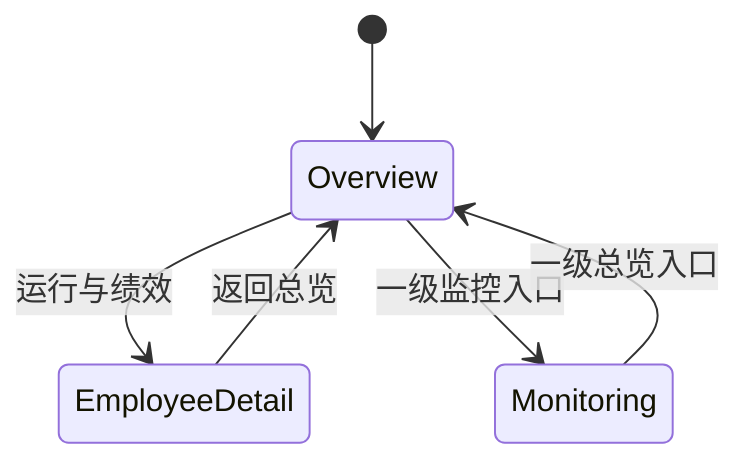

> **C04 方案 A 已确认（2026-10-11）**：Agent 详情「今日执行」复用 B01 **按 `started_at` 所属统计日计数真实唯一技术 Run** 的方向，并**限定当前 Agent**；同 Run HTTP 重传或状态变化不增加计数，不以 B06 活动消息数、业务 Task 或 UI-F0 静态数字替代。**统计时区/日界、RUNNING/SUCCEEDED/FAILED/CANCELLED 资格、唯一键及跨迁移冲突、迟到补报、环境权限、停用/归档 Agent、真实零/无数据、B01/C01/B10 对账、刷新与审计**均继续待议。不批准具体 SQL、API、协议、原型改动或上线。下一项 **C05 详情最近执行时间** 待确认。

> **C03 方案 A 已确认（2026-10-11）**：员工卡保留「估算节省工时（h）」，**仅当有经认可的人工基线、适用且可核实的业务工作量、需扣除的人工投入及可追溯的版本化估算规则**时展示 `ESTIMATED` 小时数；证据不足显示「不可估算」，不当作真实零、不使用 UI 静态值、Run 次数或 `duration_ms` 推算。与 B07 月度趋势及 B09 Top8 遵循可信依据原则，但**不自动批准 C07 或三者数值同口径**。**人工基线、业务工作量及去重、统计窗口、Run 状态、人工复核扣除、估算质量与覆盖率、负值、精度、环境权限、无数据、B07/B09/C07 对账及审计**全部待议。本次不批准新采集协议、SQL/API、原型改动或上线。下一项 **C04 详情今日执行** 待确认。

> **C02 方案 A 已确认（2026-10-11）**：员工卡与 Agent 详情统一显示**Agent 技术执行成功率**，采用 B02 同类的 `SUCCEEDED/(SUCCEEDED+FAILED)` 技术终态口径，**不再将该指标标为「一次通过率」**；技术成功不等于业务完成或首次尝试成功。**统计时间窗及 `finished_at` 日界、SUCCEEDED/FAILED/RUNNING/CANCELLED 资格细则、Run 唯一性、首次尝试与跨 Run 重试关联、零分母、Agent 状态、环境权限、缺失/数据质量、精度、B02 聚合一致性和审计继续待确认**。本决定不批准 attempt/correlation 新字段、业务完成率、API/SQL 或修改原型/严格 v1/v1.1。下一项 **C03 员工卡估算节省工时** 待议。

> **C01 方案 A 已确认（2026-10-11）**：员工卡「累计执行」以**该 Agent 实际采集并持久化的历史唯一技术 Run** 计数，与 B11 同源，但不默认跨状态/环境/时间/权限完全同口径。不得用 UI-F0 原型静态次数、HTTP 重传或业务 Task 数替代，不补造接入前历史。**时间范围、唯一键及迁移、RUNNING/FAILED/CANCELLED、停用归档、环境权限、迟到补报、真实零/未接入、展示精度、B11/E01 对账及审计仍待确认**。仅确认方向，不批准新 API/SQL/协议/原型改动或上线。下一项 **C02 技术成功率与「一次通过率」** 待议。

**B11 方案 A 已确认（2026-10-11）**：集团累计运行量以**授权范围内实际已采集、已持久化的历史唯一 Agent 技术 Run** 为依据；不得使用演示数字、HTTP 上报次数、业务任务数，或补造接入前未采集的历史运行。当前 Agent 启用/停用状态不自动抹除历史，但停用/归档历史的可见权限仍待确认。**历史起算时间、Run 唯一性跨迁移处理、RUNNING/FAILED/CANCELLED 纳入、迁移与完整性、迟到补报、环境与权限、归档 Agent、无数据、展示位置、审计及 C01/E01 是否复用均未批准**。仅确认方向，不批准 API、SQL、协议或上线。下一项 **C01 员工卡累计执行** 待确认。

**B11 方案 A 已确认（2026-10-11）**：集团累计运行量采用授权范围内**实际已采集并持久化的历史唯一 Agent 技术 Run**，不以当前 A02「在用」标记自动剔除历史，不虚构日志接入前的运行次数，也不将技术 Run 解释为业务任务完成。**历史起算时间、唯一键与跨源迁移冲突、RUNNING/FAILED/CANCELLED 纳入、迁移及数据完整性、迟到补报、环境与权限、停用/归档 Agent 历史可见性、无数据/真实零、展示位置、审计以及 C01/E01 关联均待确认**。本次只批准统计方向，不批准具体 SQL、接口、历史回填或上线；原型和 v1/v1.1 协议不变。**下一项 C01 员工卡累计执行待确认**。

> **B05 方案 B 已确认（2026-10-11；正式看板）**：人工介入率采用「已明确报告有人工介入的唯一技术 Run 数 ÷ 所选范围全部唯一技术 Run 数」方向；介入字段未上报的 Run 也在分母但不能补 0。比例可能低估，首页/监控不得使用原型静态 1.8%；监控介入事件次数与发生介入的 Run 数是两类指标。事件定义、时间窗/状态、覆盖率、精度、旧 v1、权限审计等均未决，详见 [21 台账](21-metrics-field-confirmation-register.md)。原型 HTML 不修改，UI-F0 Demo 可保留注明演示的数据，正式 Provider 不得继承其静态真值。

> **B11 全集团累计运行量方案 A 已确认（2026-10-11）**：集团指标仅表示**授权范围内系统真实已采集/保存的历史唯一 Agent 技术 Run 累计数**，以 `(agent_id, source_run_id)` 识别唯一执行，HTTP 重传/状态更新不得多计。**不能声称 Agent 自创建以来全部执行，也不能用原型员工卡静态值、请求次数或业务任务数补造**；当前 A02 在用标记变更不会自动抹除已记录事实，但已停用/归档 Agent 的历史访问与统计纳入资格仍须确认。**历史起算时间、跨环境 Run 身份、RUNNING/FAILED/CANCELLED、可信历史迁移与缺口/重复、迟到补报、时区/日界、环境权限/归档、无数据/真零、展示位置/精度、审计及 C01 员工卡/E01 监控的对账关系未获批准**。本决定只确认核心历史累计方向，不批准新首页卡布局、新 Schema/新 API 形状、回填虚假历史或直接上线。**下一项 C01 员工卡累计执行待独立选择**。

> **B10 已确认方案 A（2026-10-11）**：集团今日 Agent 技术 Run 次数以服务端复用 B01 `(agent_id, source_run_id)` 唯一 Run、按 `started_at` 启动日得到的真实聚合统计为权威；正式前端**自动刷新读取服务端新快照**，不得按 B06 动态条数、RUNNING→终态、重传/乱序事件或 DemoTicker/本地定时器直接 `+1`。这**不批准**刷新机制选轮询/SSE/WebSocket 哪种，也不决定周期/实时延迟、水位/快照版本、RUNNING 等状态、迟到补报、统计日界/时区、环境权限、无数据/网络错误、页面重挂载/重复订阅、审计和 B06 联动细节；不自动创建 API 协议或修改原始 HTML/严格 v1/v1.1。下一项 B11 集团历史累计运行量待确认。

> **B09 方案 A 已确认（2026-10-11）**：总览原「场景效能 Top 8」改为按**已登记 Agent** 的可信「**估算节省工时（h）**」排行，不按场景，不使用技术 Run 次数或耗时替代。只有具备真实人工处理基线、适用业务工作量及版本化估算规则的 Agent 才可形成估算值；缺基线是**不可估算、不是 0 或末位**，完全没有可信可比样本应显示「暂无可靠排行」，禁止用原型静态榜单。A10 已取消的五场景页/Agent—场景绑定仍不恢复。**Agent 唯一性、统计窗口与时区、状态/业务工作量去重、Top N/并列、不足 8/无样本、Agent 管理状态与归档、环境及权限、估算覆盖率/基线质量、负值/精度与审计均待确认**。C03/C07 不随之自动批准；不因本决定批准人工基线系统、业务 Task 对账或 v1/v1.1 协议修改。下一项 B10 实时累计计数/刷新待选。

> **B08 已确认方案 A（2026-10-11，正式 UI-F1）**：集团首页保留「月度模型估算费用」趋势，按授权环境 + Run `started_at` 所属统计月份 + 调用方原始计价币种分别展示 ESTIMATED 模型费用；不自动换汇/跨币种合计/跨环境无说明混算，也不能按 B04 单均 × Run 数补缺。缺失费用不等于零，须结合 B03-P0-12 上报覆盖率。月份/时区、状态、币种精度、质量 KPI 准入、迟到/历史冻结、环境权限审计、图表形式和 C08 均待确认，不改原型及协议。见 [21 台账](21-metrics-field-confirmation-register.md)。

> **B07 已确认方案 A（2026-10-11，正式 UI-F1）**：集团月度图表保留「估算节省工时（小时）」方向。仅在**可靠人工基线、适用业务任务/工作量、投入扣减与版本化规则另行获批且数据可用**时显示估算小时数；缺可靠依据显示「暂无可靠估算」，不能用运行耗时、Run 数或静态模拟小时数据填充，也不自动改成 Run 月执行量。显示精度、图形/统计窗口/时区、运行状态、去重/迟到、环境权限、覆盖率/质量、C03/C07/B09 关联规则全部待选。只确认指标方向，不批准额外开发/修改原型 HTML。详见 [21 台账](21-metrics-field-confirmation-register.md)。

> **B06 已确认方案 A（2026-10-11，正式 UI-F1）**：总览「实时执行动态」由真实、授权 Agent 技术 Run 产生，包含可信技术状态/时间/Agent 登记名称；有真实且已脱敏的调用侧活动摘要时可选附加，没有摘要时退化为中性的技术执行描述，**不能把技术成功描述成业务已办结**。N/排序/事件更新与消息去重/刷新延迟、摘要字段/脱敏与缺失、权限审计仍待确认。UI-F0 Demo 演示定时消息仍只属于显著标注的演示环境，不得进入正式 Provider；不修改原始 HTML。详见 [21 逐项台账](21-metrics-field-confirmation-register.md)。

> **A11 决定（2026-10-10）**：顶栏**只有当前时间**，不再显示静态「系统运行中」；不要求系统健康接口或 Run 数据新鲜度展示，时区/格式/刷新频率/异常处理待确认。原型 HTML 保持不变。

> **A10 用户已取消场景演示（2026-10-10）**：原型 HTML 原样保留；**新 Vue Demo 与正式模式**均不包含 `p7` 页面、`ScenarioDemoPage.vue`、`sc-1..5` 导航、员工卡/详情场景演示入口和 Agent 场景绑定。下文旧原型相关说明仅供历史参照，不作实现要求。

> **最新 MVP 覆盖说明（2026-10-10）**：本文件中 UI-F0 的原型交互还原继续有效。**UI-F1 正式版仅登记 Agent、采集 Run 日志、展示技术看板**；正式页面不实现业务任务/源回执、持久化工作流上传、真实告警处理/忽略和节省工时/财务成本。详见 [17 最新范围](17-agent-log-dashboard-mvp.md)。

# 12｜Vue 1:1 复刻：页面、路由与交互契约

> **性质：实施规范**。已确定 Vue 3 + TS + Vite 和“原型 1:1 还原”；页面字段、内容、样式与已实现的交互以 [原始 HTML](../prototype/index.html) 为事实基准。**下文独立 URL、浏览器前进后退、自动化测试结构是推荐增强，并非原型自带功能。**

## 1. 页面与 URL 对照

| 原型标识 | 页面组件（建议） | 推荐 URL | 一级导航高亮 | 核心内容 |
| --- | --- | --- | --- | --- |
| `p0` | `OverviewPage.vue` | `/` | 总览 | Banner、4 KPI、实时执行动态、按部门员工卡、工时/成本/排行图 |
| `p11` | `EmployeeDetailPage.vue` | `/employees/:employeeId` | 总览 | 员工信息、4 KPI、3 图、单文件工作流预览、最新执行日志 |
| `p4` | `MonitoringPage.vue` | `/monitoring` | 监控中心 | 4 KPI、告警列表、执行流水 |

以上是**逻辑路由路径**：内部正式部署可配置 History + 服务器 fallback；纯静态预览可选 Hash History；不要在同一个部署环境动态混用模式。

**新 Vue 无场景 ID 路由**；员工使用独立 `employeeId`，不能用员工昵称作唯一 ID（原型有同昵称）。

## 2. 通用 Shell

| 元素 | 原型行为 | Vue 实现注意 |
| --- | --- | --- |
| `.topbar` | 蓝色渐变品牌栏及当前时间位置 | **只显示浏览器当前时钟，不显示静态「系统运行中」**；不得作为服务或 Agent 健康心跳。时区、格式、更新间隔由后续确认决定 |
| `#nav` | 2 个一级按钮；`p11` 高亮 `p0`；**不存在 `p7`** | 路由元信息 `activeNav`；不要增加第三个一级导航 |
| `main` | 最大宽 1280px、padding 与原型一致 | 搬运已有 CSS 变量、间距和 640px 断点 |
| footer | MVP v6 说明 | UI-F0 文案完全一致；正式环境的原型身份说明需单独审核 |
| Toast | 原型页面浮层提示 | 采用可复用组件；保留交互反馈，不引入新的大模态框覆盖页面 |

## 3. 总览 `p0`

- 页面初次加载展示原型顶部 Banner 和**原有四卡顺序**（数字员工总数、当日执行任务、当日成本、自动化成功率）。**正式 UI-F1 的 B10 已确认 A：今日技术执行次数从服务端 B01 去重聚合读取并自动刷新快照；不因 pushFeed、RUNNING 终态更新、HTTP 重传或定时器直接自行 `+1`。**周期/轮询还是推送、缓存水位、权限、异常和重复挂载尚待确认。
- “实时执行动态”在 UI-F0 继续处于原位置；Demo 中动态追加条目、限制记录数。**正式模式 B06 已确认 A：显示真实 Run 的技术时间/状态/Agent 名称，可信脱敏摘要可选，没有摘要则退化为中性技术状态；技术成功不得断言业务办结**。N、排序、RUNNING 更新、重传去重、轮询/延迟、字段脱敏/缺失、权限/审计待另定。
- 员工分组顺序按源码：信息中心 → 财务中心 → 采购中心 → 内审部 → 运营中心；示例数据 9 条。每组标题/统计数量和员工卡的名称、身份、负责人、来源、版本、执行/成功率/工时保持原样。**B11 已批准集团已采集历史唯一技术 Run 累计指标方向，但不据此自动在首页新增第五张 KPI 卡、也不将所有员工卡的演示累计求和当集团统计**；详情 C01 仍须另行确认。
- “运行与绩效”对每名员工均可点开；**所有卡片均无「场景演示」按钮**。
- 三张图表：`c-hours`、`c-cost`、`c-top`，UI-F0 Demo 对照原型 ECharts 还原，原型 `genTrend` 与硬编码只属于显著标注的演示数据。**UI-F1 的 `c-hours` 已由 B07 选方案 A：条件式「月度估算节省工时（h）」，需可追溯人工基线与规则才能绘制真实估算，否则展示暂无可靠估算**；不能默认改画月度 Run 次数（此前 MVP 工程建议已被 B07 明确选择覆盖）。C03/C07 仍需另行确认；B09 方案 A 已确认、工程细则待议；**`c-cost` 对应 B08 已选 A：保留「月度模型估算费用」方向，按环境、Run `started_at` 月份及原始币种分组展示；具体图形、精度/多币种系列、覆盖率提示仍未确定；详情 C08 不自动获批。** **`c-top` 对应 B09 方案 A：正式版排名对象为 Agent，展示有依据的估算节省工时，不得继续呈现场景排行或以 Run 次数代替。无可信基线显示「暂无可靠排行」，不可估算不记 0；Top N/并列/覆盖率等仍待审。** 其余图表亦遵循各自未完成的口径审批。
- 原 HTML 中 `renderEmps()` 被连续调用两次，但最终 DOM 无重复：Vue 只需保证**最终页面一致**，不重复发请求或保留非必要的重复渲染调用。

## 4. 员工详情 `p11`

1. 点击卡片“运行与绩效”→ 展示选中员工名称/部门/版本/四个 KPI→ 加载 3 图 `c-detail-trend`、`c-detail-hours`、`c-detail-cost`→ 显示工作流上传与最近日志。
2. 从详情点击“返回总览”→ 回 `p0`；**建议**恢复前一滚动位置（原型直接到页首，需在 UI-F0 截图验收明确是否沿用页首行为；默认按原型执行）。
3. **不生成 `btn-go-scene`**，也不在详情页提供场景演示跳转。
4. 切换详情对象时图表不能显示上一员工数据；离开页面时 ECharts 实例正确 `dispose`，再次进入重新挂载或显式 `resize`。
5. 文件支持原型 `accept="image/*,.pdf,application/pdf"`，点击/拖拽、图片/PDF 本地预览、重新上传替换、移除、在新标签打开；前端预览保留原文件名及大小信息。每次只展示最新文件。
6. UI-F0 文件不会保存到服务器：不得出现“已上传平台”的正式语义；UI-F1 才配置持久化与权限、安全校验。

## 5. 五场景 `p7`（用户已取消）

新 Vue 与正式版本**不开发、不注册路由、不生成导航及跳转**。原型源码仍保留其静态五场景，作为历史参考。

## 6. 监控中心 `p4`

- 点击二级导航“监控中心”呈现四张监控统计卡、告警列表和最近执行流水；原型使用静态/动态示例。
- Demo 告警的“处理/忽略”使当前项变为已完成样式并移除动作，出现带 **【演示】** 标识的 Toast；演示操作不产生真实业务系统写入。
- UI-F1 正式模式必须使用真实告警 ID、权限、审计和后端确认；**请求失败则保留/回滚告警的待处理状态并提示原因**，绝不直接宣布成功。
- 流水保留原型列：时间、员工、任务、结果、耗时；长内容遵循现有横向滚动样式。

## 7. 演示事件与生产事件的边界

### Demo Provider（UI-F0）

- 原型模拟源 `evPool`、`perfData`、`genTrend`、`pushFeed` 移到独立模块。
- 首次进入时可显示一条模拟事件；原型每 6 秒追加事件并递增相关演示数值，正式模式不能使用这段自动递增逻辑。
- 推荐增加**可测试的模拟时钟与固定随机种子**，以便 Playwright 冻结快照；不改变普通演示时的可见效果。
- 定时器在 provider 生命周期统一管理，启动不能因页面重挂载重复订阅；暂停和销毁时清理。
- 所有演示页有显式“演示数据”环境标签；生产构建不得注入示例人的业务状态作为在线事实。

### Production Provider（UI-F1）

- API 响应使用 `Metric<T>` 携带 `quality, asOf, reason`；页面区分真实 0、无数据、延迟、估算和已核验。
- 业务任务是最小统计单位；运行尝试/LLM 调用不可充当工作量，业务成功有源系统结果证据。
- 任务/告警/工作流操作均由服务端做权限校验；数据范围由 JWT + 后端授权判断，而非仅前端隐藏。

## 8. 页面状态机（推荐）

后续路由直接访问员工详情时，如果员工不存在→“未找到”；无访问授权→“无权访问”；API 错误→“加载失败”，不要把异常替换为第一名员工卡或默认成功。

## 9. 可核对的交互验收用例 ID

| ID | 操作 | 预期结果 |
| --- | --- | --- |
| NAV-01 | 从总览切监控再切回 | 页面显示正确且只有一个一级导航处于高亮 |
| NAV-02 | 进入员工详情 | 一级“总览”高亮，展示与员工卡匹配的身份/绩效 |
| NAV-03 | 检查员工卡与详情页 | **不存在**场景演示入口、`sc-N` 跳转或 `/scenarios` 导航 |
| NAV-04 | 直接访问旧 `/scenarios` 路径 | 不加载场景演示页，按统一 404/安全回退处理（具体行为待前端路由规则确认） |
| EMP-01 | 遍历 9 张员工卡点击详情 | 正确关联数据；中文昵称重名不串数据 |
| CHART-01 | 首次进详情、切员工、调整浏览器宽度 | ECharts 显示完整、尺寸更新、无重复实例 |
| FILE-01 | 上传图片、再上传 PDF、预览、移除 | 最新单文件展示且资源 URL 已回收 |
| ALERT-01 | 在 Demo 中“处理/忽略” | 已处理样式 + 演示 Toast，其他告警不受影响 |
| FEED-01 | 演示动态运行、切换页面若干次 | 更新频率不加倍，不出现多个相同 Timer |
| DATA-01 | 生产无指标/事件源断连 | “未接入/待核验/数据延迟”而非伪造正数 |

与 [13 测试与验收](13-ui-acceptance.md) 的截图/CI 质量门禁配合执行。

### C05 Agent 详情交互与展示（方案 A 已确认，2026-10-11）

**C05 方案 A 已确认（2026-10-11）**：Agent 详情「最近执行时间」应来源于**该 Agent 真实已采集、可信的技术 Run 事件时间**，而非服务端最近收到上报的时间、浏览器当前时钟或模拟数据；`started_at` 可作为「最近启动执行」的候选，**`started_at` 与 `finished_at` 最终选择、优先级与指标准确命名尚未确认**。最近执行时间不等于在线、健康或当前 RUNNING 状态；平台接收时间仅可作为独立「最近收到上报」语义。**迟到补报、乱序、调用侧时钟偏差与异常时间校验、无数据与真实无运行、环境权限、停用/归档 Agent、时区格式、刷新/缓存、B06/B10/E01 一致性与审计均继续待议**。不修改原型 HTML、严格 v1/v1.1 协议，不批准新 API/SQL 或上线。下一项 **C06 详情月度执行趋势** 待选。

**待单独确认**：`started_at`/`finished_at` 字段及事件优先级、迟到补报与乱序、调用侧时钟偏差/时间质量校验、无数据、环境权限、停用/归档 Agent 历史、时区/格式、刷新与缓存、B06/B10/E01 一致性、审计。

### 详情月度技术执行趋势交互（C06） · 方案 A 已确认（2026-10-11）

**C06 方案 A 已确认（2026-10-11）**：Agent 详情月度执行趋势，按当前 Agent 实际采集、持久化的历史唯一技术 Run，根据可信 `started_at` 所属统计月份归集，同一 Run 的重传/状态变化不额外计次。不能从 UI-F0 `genTrend` 固定权重拆分累计数、使用静态月份数或将业务 Task 数冒充技术 Run。虽然与 B01/C04 的启动时间方向一致，**并不自动确认与 B01/C01/C04/B10 全部状态、环境权限和历史范围相同**。**统计月份及时区、Run 唯一性/跨迁移、RUNNING/FAILED/CANCELLED、迟到补报、历史重算/冻结和数据完整度、环境与部门权限、停用归档历史、缺失月份/真实零、图表类型精度及月份范围、B01/C01/C04/B10 对账和审计均待确认**。不批准具体 SQL/API、额外 Schema、原型 HTML 修改或上线；C07 详情月度估算节省工时另议。

**工程待确认**：服务端聚合与读取接口、时区/月界、状态过滤和跨源去重规则、补报重算/冻结、零与无数据的视觉含义、授权范围及监控审计必须单独批准。原型演示视觉仍独立于正式真实数据；不能以选择 C06 为由生成静态趋势、修改严格 Run v1 或自动开放 C07。
