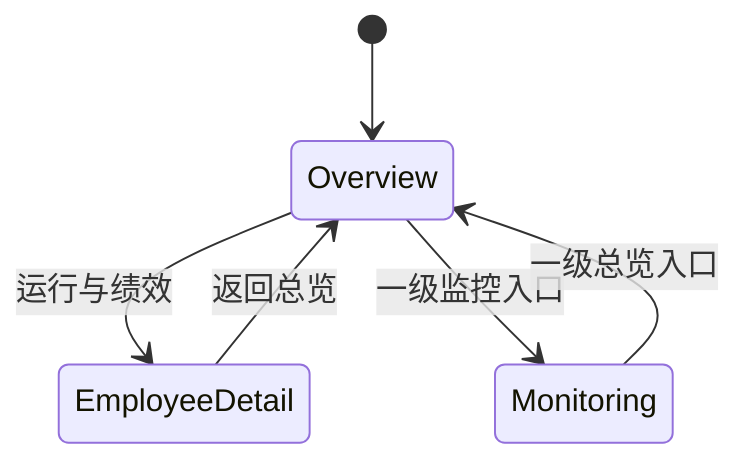

> **C04 方案 A 已确认（2026-10-11）**：Agent 详情「今日执行」复用 B01 **按 `started_at` 所属统计日计数真实唯一技术 Run** 的方向，并**限定当前 Agent**；同 Run HTTP 重传或状态变化不增加计数，不以 B06 活动消息数、业务 Task 或 UI-F0 静态数字替代。**统计时区/日界、RUNNING/SUCCEEDED/FAILED/CANCELLED 资格、唯一键及跨迁移冲突、迟到补报、环境权限、停用/归档 Agent、真实零/无数据、B01/C01/B10 对账、刷新与审计**均继续待议。不批准具体 SQL、API、协议、原型改动或上线。下一项 **C05 详情最近执行时间** 待确认。

> **C03 方案 A 已确认（2026-10-11）**：员工卡保留「估算节省工时（h）」，**仅当有经认可的人工基线、适用且可核实的业务工作量、需扣除的人工投入及可追溯的版本化估算规则**时展示 `ESTIMATED` 小时数；证据不足显示「不可估算」，不当作真实零、不使用 UI 静态值、Run 次数或 `duration_ms` 推算。与 B07 月度趋势及 B09 Top8 遵循可信依据原则，但**不自动批准 C07 或三者数值同口径**。**人工基线、业务工作量及去重、统计窗口、Run 状态、人工复核扣除、估算质量与覆盖率、负值、精度、环境权限、无数据、B07/B09/C07 对账及审计**全部待议。本次不批准新采集协议、SQL/API、原型改动或上线。下一项 **C04 详情今日执行** 待确认。

> **C02 方案 A 已确认（2026-10-11）**：员工卡与 Agent 详情统一显示**Agent 技术执行成功率**，采用 B02 同类的 `SUCCEEDED/(SUCCEEDED+FAILED)` 技术终态口径，**不再将该指标标为「一次通过率」**；技术成功不等于业务完成或首次尝试成功。**统计时间窗及 `finished_at` 日界、SUCCEEDED/FAILED/RUNNING/CANCELLED 资格细则、Run 唯一性、首次尝试与跨 Run 重试关联、零分母、Agent 状态、环境权限、缺失/数据质量、精度、B02 聚合一致性和审计继续待确认**。本决定不批准 attempt/correlation 新字段、业务完成率、API/SQL 或修改原型/严格 v1/v1.1。下一项 **C03 员工卡估算节省工时** 待议。

> **C01 方案 A 已确认（2026-10-11）**：员工卡「累计执行」以**该 Agent 实际采集并持久化的历史唯一技术 Run** 计数，与 B11 同源，但不默认跨状态/环境/时间/权限完全同口径。不得用 UI-F0 原型静态次数、HTTP 重传或业务 Task 数替代，不补造接入前历史。**时间范围、唯一键及迁移、RUNNING/FAILED/CANCELLED、停用归档、环境权限、迟到补报、真实零/未接入、展示精度、B11/E01 对账及审计仍待确认**。仅确认方向，不批准新 API/SQL/协议/原型改动或上线。下一项 **C02 技术成功率与「一次通过率」** 待议。

**B11 方案 A 已确认（2026-10-11）**：集团累计运行量以**授权范围内实际已采集、已持久化的历史唯一 Agent 技术 Run** 为依据；不得使用演示数字、HTTP 上报次数、业务任务数，或补造接入前未采集的历史运行。当前 Agent 启用/停用状态不自动抹除历史，但停用/归档历史的可见权限仍待确认。**历史起算时间、Run 唯一性跨迁移处理、RUNNING/FAILED/CANCELLED 纳入、迁移与完整性、迟到补报、环境与权限、归档 Agent、无数据、展示位置、审计及 C01/E01 是否复用均未批准**。仅确认方向，不批准 API、SQL、协议或上线。下一项 **C01 员工卡累计执行** 待确认。

**B11 方案 A 已确认（2026-10-11）**：集团累计运行量采用授权范围内**实际已采集并持久化的历史唯一 Agent 技术 Run**，不以当前 A02「在用」标记自动剔除历史，不虚构日志接入前的运行次数，也不将技术 Run 解释为业务任务完成。**历史起算时间、唯一键与跨源迁移冲突、RUNNING/FAILED/CANCELLED 纳入、迁移及数据完整性、迟到补报、环境与权限、停用/归档 Agent 历史可见性、无数据/真实零、展示位置、审计以及 C01/E01 关联均待确认**。本次只批准统计方向，不批准具体 SQL、接口、历史回填或上线；原型和 v1/v1.1 协议不变。**下一项 C01 员工卡累计执行待确认**。

> **B05 方案 B 已确认（2026-10-11；正式看板）**：人工介入率采用「已明确报告有人工介入的唯一技术 Run 数 ÷ 所选范围全部唯一技术 Run 数」方向；介入字段未上报的 Run 也在分母但不能补 0。比例可能低估，首页/监控不得使用原型静态 1.8%；监控介入事件次数与发生介入的 Run 数是两类指标。事件定义、时间窗/状态、覆盖率、精度、旧 v1、权限审计等均未决，详见 [21 台账](21-metrics-field-confirmation-register.md)。原型 HTML 不修改，UI-F0 Demo 可保留注明演示的数据，正式 Provider 不得继承其静态真值。

> **B11 全集团累计运行量方案 A 已确认（2026-10-11）**：集团指标仅表示**授权范围内系统真实已采集/保存的历史唯一 Agent 技术 Run 累计数**，以 `(agent_id, source_run_id)` 识别唯一执行，HTTP 重传/状态更新不得多计。**不能声称 Agent 自创建以来全部执行，也不能用原型员工卡静态值、请求次数或业务任务数补造**；当前 A02 在用标记变更不会自动抹除已记录事实，但已停用/归档 Agent 的历史访问与统计纳入资格仍须确认。**历史起算时间、跨环境 Run 身份、RUNNING/FAILED/CANCELLED、可信历史迁移与缺口/重复、迟到补报、时区/日界、环境权限/归档、无数据/真零、展示位置/精度、审计及 C01 员工卡/E01 监控的对账关系未获批准**。本决定只确认核心历史累计方向，不批准新首页卡布局、新 Schema/新 API 形状、回填虚假历史或直接上线。**下一项 C01 员工卡累计执行待独立选择**。

> **B10 已确认方案 A（2026-10-11）**：集团今日 Agent 技术 Run 次数以服务端复用 B01 `(agent_id, source_run_id)` 唯一 Run、按 `started_at` 启动日得到的真实聚合统计为权威；正式前端**自动刷新读取服务端新快照**，不得按 B06 动态条数、RUNNING→终态、重传/乱序事件或 DemoTicker/本地定时器直接 `+1`。这**不批准**刷新机制选轮询/SSE/WebSocket 哪种，也不决定周期/实时延迟、水位/快照版本、RUNNING 等状态、迟到补报、统计日界/时区、环境权限、无数据/网络错误、页面重挂载/重复订阅、审计和 B06 联动细节；不自动创建 API 协议或修改原始 HTML/严格 v1/v1.1。下一项 B11 集团历史累计运行量待确认。

> **B09 方案 A 已确认（2026-10-11）**：总览原「场景效能 Top 8」改为按**已登记 Agent** 的可信「**估算节省工时（h）**」排行，不按场景，不使用技术 Run 次数或耗时替代。只有具备真实人工处理基线、适用业务工作量及版本化估算规则的 Agent 才可形成估算值；缺基线是**不可估算、不是 0 或末位**，完全没有可信可比样本应显示「暂无可靠排行」，禁止用原型静态榜单。A10 已取消的五场景页/Agent—场景绑定仍不恢复。**Agent 唯一性、统计窗口与时区、状态/业务工作量去重、Top N/并列、不足 8/无样本、Agent 管理状态与归档、环境及权限、估算覆盖率/基线质量、负值/精度与审计均待确认**。C03/C07 不随之自动批准；不因本决定批准人工基线系统、业务 Task 对账或 v1/v1.1 协议修改。下一项 B10 实时累计计数/刷新待选。

> **B08 已确认方案 A（2026-10-11，正式 UI-F1）**：集团首页保留「月度模型估算费用」趋势，按授权环境 + Run `started_at` 所属统计月份 + 调用方原始计价币种分别展示 ESTIMATED 模型费用；不自动换汇/跨币种合计/跨环境无说明混算，也不能按 B04 单均 × Run 数补缺。缺失费用不等于零，须结合 B03-P0-12 上报覆盖率。月份/时区、状态、币种精度、质量 KPI 准入、迟到/历史冻结、环境权限审计、图表形式和 C08 均待确认，不改原型及协议。见 [21 台账](21-metrics-field-confirmation-register.md)。

> **B07 已确认方案 A（2026-10-11，正式 UI-F1）**：集团月度图表保留「估算节省工时（小时）」方向。仅在**可靠人工基线、适用业务任务/工作量、投入扣减与版本化规则另行获批且数据可用**时显示估算小时数；缺可靠依据显示「暂无可靠估算」，不能用运行耗时、Run 数或静态模拟小时数据填充，也不自动改成 Run 月执行量。显示精度、图形/统计窗口/时区、运行状态、去重/迟到、环境权限、覆盖率/质量、C03/C07/B09 关联规则全部待选。只确认指标方向，不批准额外开发/修改原型 HTML。详见 [21 台账](21-metrics-field-confirmation-register.md)。

> **B06 已确认方案 A（2026-10-11，正式 UI-F1）**：总览「实时执行动态」由真实、授权 Agent 技术 Run 产生，包含可信技术状态/时间/Agent 登记名称；有真实且已脱敏的调用侧活动摘要时可选附加，没有摘要时退化为中性的技术执行描述，**不能把技术成功描述成业务已办结**。N/排序/事件更新与消息去重/刷新延迟、摘要字段/脱敏与缺失、权限审计仍待确认。UI-F0 Demo 演示定时消息仍只属于显著标注的演示环境，不得进入正式 Provider；不修改原始 HTML。详见 [21 逐项台账](21-metrics-field-confirmation-register.md)。

> **A11 决定（2026-10-10）**：顶栏**只有当前时间**，不再显示静态「系统运行中」；不要求系统健康接口或 Run 数据新鲜度展示，时区/格式/刷新频率/异常处理待确认。原型 HTML 保持不变。

> **A10 用户已取消场景演示（2026-10-10）**：原型 HTML 原样保留；**新 Vue Demo 与正式模式**均不包含 `p7` 页面、`ScenarioDemoPage.vue`、`sc-1..5` 导航、员工卡/详情场景演示入口和 Agent 场景绑定。下文旧原型相关说明仅供历史参照，不作实现要求。

> **最新 MVP 覆盖说明（2026-10-10）**：本文件中 UI-F0 的原型交互还原继续有效。**UI-F1 正式版仅登记 Agent、采集 Run 日志、展示技术看板**；正式页面不实现业务任务/源回执、持久化工作流上传、真实告警处理/忽略和节省工时/财务成本。详见 [17 最新范围](17-agent-log-dashboard-mvp.md)。

# 12｜Vue 1:1 复刻：页面、路由与交互契约

> **性质：实施规范**。已确定 Vue 3 + TS + Vite 和“原型 1:1 还原”；页面字段、内容、样式与已实现的交互以 [原始 HTML](../prototype/index.html) 为事实基准。**下文独立 URL、浏览器前进后退、自动化测试结构是推荐增强，并非原型自带功能。**

## 1. 页面与 URL 对照

| 原型标识 | 页面组件（建议） | 推荐 URL | 一级导航高亮 | 核心内容 |
| --- | --- | --- | --- | --- |
| `p0` | `OverviewPage.vue` | `/` | 总览 | Banner、4 KPI、实时执行动态、按部门员工卡、工时/成本/排行图 |
| `p11` | `EmployeeDetailPage.vue` | `/employees/:employeeId` | 总览 | 员工信息、4 KPI、3 图、单文件工作流预览、最新执行日志 |
| `p4` | `MonitoringPage.vue` | `/monitoring` | 监控中心 | 4 KPI、告警列表、执行流水 |

以上是**逻辑路由路径**：内部正式部署可配置 History + 服务器 fallback；纯静态预览可选 Hash History；不要在同一个部署环境动态混用模式。

**新 Vue 无场景 ID 路由**；员工使用独立 `employeeId`，不能用员工昵称作唯一 ID（原型有同昵称）。

## 2. 通用 Shell

| 元素 | 原型行为 | Vue 实现注意 |
| --- | --- | --- |
| `.topbar` | 蓝色渐变品牌栏及当前时间位置 | **只显示浏览器当前时钟，不显示静态「系统运行中」**；不得作为服务或 Agent 健康心跳。时区、格式、更新间隔由后续确认决定 |
| `#nav` | 2 个一级按钮；`p11` 高亮 `p0`；**不存在 `p7`** | 路由元信息 `activeNav`；不要增加第三个一级导航 |
| `main` | 最大宽 1280px、padding 与原型一致 | 搬运已有 CSS 变量、间距和 640px 断点 |
| footer | MVP v6 说明 | UI-F0 文案完全一致；正式环境的原型身份说明需单独审核 |
| Toast | 原型页面浮层提示 | 采用可复用组件；保留交互反馈，不引入新的大模态框覆盖页面 |

## 3. 总览 `p0`

- 页面初次加载展示原型顶部 Banner 和**原有四卡顺序**（数字员工总数、当日执行任务、当日成本、自动化成功率）。**正式 UI-F1 的 B10 已确认 A：今日技术执行次数从服务端 B01 去重聚合读取并自动刷新快照；不因 pushFeed、RUNNING 终态更新、HTTP 重传或定时器直接自行 `+1`。**周期/轮询还是推送、缓存水位、权限、异常和重复挂载尚待确认。
- “实时执行动态”在 UI-F0 继续处于原位置；Demo 中动态追加条目、限制记录数。**正式模式 B06 已确认 A：显示真实 Run 的技术时间/状态/Agent 名称，可信脱敏摘要可选，没有摘要则退化为中性技术状态；技术成功不得断言业务办结**。N、排序、RUNNING 更新、重传去重、轮询/延迟、字段脱敏/缺失、权限/审计待另定。
- 员工分组顺序按源码：信息中心 → 财务中心 → 采购中心 → 内审部 → 运营中心；示例数据 9 条。每组标题/统计数量和员工卡的名称、身份、负责人、来源、版本、执行/成功率/工时保持原样。**B11 已批准集团已采集历史唯一技术 Run 累计指标方向，但不据此自动在首页新增第五张 KPI 卡、也不将所有员工卡的演示累计求和当集团统计**；详情 C01 仍须另行确认。
- “运行与绩效”对每名员工均可点开；**所有卡片均无「场景演示」按钮**。
- 三张图表：`c-hours`、`c-cost`、`c-top`，UI-F0 Demo 对照原型 ECharts 还原，原型 `genTrend` 与硬编码只属于显著标注的演示数据。**UI-F1 的 `c-hours` 已由 B07 选方案 A：条件式「月度估算节省工时（h）」，需可追溯人工基线与规则才能绘制真实估算，否则展示暂无可靠估算**；不能默认改画月度 Run 次数（此前 MVP 工程建议已被 B07 明确选择覆盖）。C03/C07 仍需另行确认；B09 方案 A 已确认、工程细则待议；**`c-cost` 对应 B08 已选 A：保留「月度模型估算费用」方向，按环境、Run `started_at` 月份及原始币种分组展示；具体图形、精度/多币种系列、覆盖率提示仍未确定；详情 C08 不自动获批。** **`c-top` 对应 B09 方案 A：正式版排名对象为 Agent，展示有依据的估算节省工时，不得继续呈现场景排行或以 Run 次数代替。无可信基线显示「暂无可靠排行」，不可估算不记 0；Top N/并列/覆盖率等仍待审。** 其余图表亦遵循各自未完成的口径审批。
- 原 HTML 中 `renderEmps()` 被连续调用两次，但最终 DOM 无重复：Vue 只需保证**最终页面一致**，不重复发请求或保留非必要的重复渲染调用。

## 4. 员工详情 `p11`

1. 点击卡片“运行与绩效”→ 展示选中员工名称/部门/版本/四个 KPI→ 加载 3 图 `c-detail-trend`、`c-detail-hours`、`c-detail-cost`→ 显示工作流上传与最近日志。
2. 从详情点击“返回总览”→ 回 `p0`；**建议**恢复前一滚动位置（原型直接到页首，需在 UI-F0 截图验收明确是否沿用页首行为；默认按原型执行）。
3. **不生成 `btn-go-scene`**，也不在详情页提供场景演示跳转。
4. 切换详情对象时图表不能显示上一员工数据；离开页面时 ECharts 实例正确 `dispose`，再次进入重新挂载或显式 `resize`。
5. 文件支持原型 `accept="image/*,.pdf,application/pdf"`，点击/拖拽、图片/PDF 本地预览、重新上传替换、移除、在新标签打开；前端预览保留原文件名及大小信息。每次只展示最新文件。
6. UI-F0 文件不会保存到服务器：不得出现“已上传平台”的正式语义；UI-F1 才配置持久化与权限、安全校验。

## 5. 五场景 `p7`（用户已取消）

新 Vue 与正式版本**不开发、不注册路由、不生成导航及跳转**。原型源码仍保留其静态五场景，作为历史参考。

## 6. 监控中心 `p4`

- 点击二级导航“监控中心”呈现四张监控统计卡、告警列表和最近执行流水；原型使用静态/动态示例。
- Demo 告警的“处理/忽略”使当前项变为已完成样式并移除动作，出现带 **【演示】** 标识的 Toast；演示操作不产生真实业务系统写入。
- **E07 方案 A（2026-10-11）优先于旧候选**：UI-F1 正式监控仅只读显示经授权的真实独立告警，不提供「处理/忽略」按钮或对应写入请求；UI-F0 仍只做带【演示】标识的本地模拟。未来若重新审批真实处置才另定真实告警 ID、权限、审计和失败回滚，不代表现阶段已允许写入。
- 流水保留原型列：时间、员工、任务、结果、耗时；长内容遵循现有横向滚动样式。

## 7. 演示事件与生产事件的边界

### Demo Provider（UI-F0）

- 原型模拟源 `evPool`、`perfData`、`genTrend`、`pushFeed` 移到独立模块。
- 首次进入时可显示一条模拟事件；原型每 6 秒追加事件并递增相关演示数值，正式模式不能使用这段自动递增逻辑。
- 推荐增加**可测试的模拟时钟与固定随机种子**，以便 Playwright 冻结快照；不改变普通演示时的可见效果。
- 定时器在 provider 生命周期统一管理，启动不能因页面重挂载重复订阅；暂停和销毁时清理。
- 所有演示页有显式“演示数据”环境标签；生产构建不得注入示例人的业务状态作为在线事实。

### Production Provider（UI-F1）

- API 响应使用 `Metric<T>` 携带 `quality, asOf, reason`；页面区分真实 0、无数据、延迟、估算和已核验。
- 业务任务是最小统计单位；运行尝试/LLM 调用不可充当工作量，业务成功有源系统结果证据。
- 任务/告警/工作流操作均由服务端做权限校验；数据范围由 JWT + 后端授权判断，而非仅前端隐藏。

## 8. 页面状态机（推荐）

后续路由直接访问员工详情时，如果员工不存在→“未找到”；无访问授权→“无权访问”；API 错误→“加载失败”，不要把异常替换为第一名员工卡或默认成功。

## 9. 可核对的交互验收用例 ID

| ID | 操作 | 预期结果 |
| --- | --- | --- |
| NAV-01 | 从总览切监控再切回 | 页面显示正确且只有一个一级导航处于高亮 |
| NAV-02 | 进入员工详情 | 一级“总览”高亮，展示与员工卡匹配的身份/绩效 |
| NAV-03 | 检查员工卡与详情页 | **不存在**场景演示入口、`sc-N` 跳转或 `/scenarios` 导航 |
| NAV-04 | 直接访问旧 `/scenarios` 路径 | 不加载场景演示页，按统一 404/安全回退处理（具体行为待前端路由规则确认） |
| EMP-01 | 遍历 9 张员工卡点击详情 | 正确关联数据；中文昵称重名不串数据 |
| CHART-01 | 首次进详情、切员工、调整浏览器宽度 | ECharts 显示完整、尺寸更新、无重复实例 |
| FILE-01 | 上传图片、再上传 PDF、预览、移除 | 最新单文件展示且资源 URL 已回收 |
| ALERT-01 | 在 Demo 中“处理/忽略” | 已处理样式 + 演示 Toast，其他告警不受影响 |
| FEED-01 | 演示动态运行、切换页面若干次 | 更新频率不加倍，不出现多个相同 Timer |
| DATA-01 | 生产无指标/事件源断连 | “未接入/待核验/数据延迟”而非伪造正数 |

与 [13 测试与验收](13-ui-acceptance.md) 的截图/CI 质量门禁配合执行。

### C05 Agent 详情交互与展示（方案 A 已确认，2026-10-11）

**C05 方案 A 已确认（2026-10-11）**：Agent 详情「最近执行时间」应来源于**该 Agent 真实已采集、可信的技术 Run 事件时间**，而非服务端最近收到上报的时间、浏览器当前时钟或模拟数据；`started_at` 可作为「最近启动执行」的候选，**`started_at` 与 `finished_at` 最终选择、优先级与指标准确命名尚未确认**。最近执行时间不等于在线、健康或当前 RUNNING 状态；平台接收时间仅可作为独立「最近收到上报」语义。**迟到补报、乱序、调用侧时钟偏差与异常时间校验、无数据与真实无运行、环境权限、停用/归档 Agent、时区格式、刷新/缓存、B06/B10/E01 一致性与审计均继续待议**。不修改原型 HTML、严格 v1/v1.1 协议，不批准新 API/SQL 或上线。下一项 **C06 详情月度执行趋势** 待选。

**待单独确认**：`started_at`/`finished_at` 字段及事件优先级、迟到补报与乱序、调用侧时钟偏差/时间质量校验、无数据、环境权限、停用/归档 Agent 历史、时区/格式、刷新与缓存、B06/B10/E01 一致性、审计。

### 详情月度技术执行趋势交互（C06） · 方案 A 已确认（2026-10-11）

**C06 方案 A 已确认（2026-10-11）**：Agent 详情月度执行趋势，按当前 Agent 实际采集、持久化的历史唯一技术 Run，根据可信 `started_at` 所属统计月份归集，同一 Run 的重传/状态变化不额外计次。不能从 UI-F0 `genTrend` 固定权重拆分累计数、使用静态月份数或将业务 Task 数冒充技术 Run。虽然与 B01/C04 的启动时间方向一致，**并不自动确认与 B01/C01/C04/B10 全部状态、环境权限和历史范围相同**。**统计月份及时区、Run 唯一性/跨迁移、RUNNING/FAILED/CANCELLED、迟到补报、历史重算/冻结和数据完整度、环境与部门权限、停用归档历史、缺失月份/真实零、图表类型精度及月份范围、B01/C01/C04/B10 对账和审计均待确认**。不批准具体 SQL/API、额外 Schema、原型 HTML 修改或上线；C07 详情月度估算节省工时另议。

**工程待确认**：服务端聚合与读取接口、时区/月界、状态过滤和跨源去重规则、补报重算/冻结、零与无数据的视觉含义、授权范围及监控审计必须单独批准。原型演示视觉仍独立于正式真实数据；不能以选择 C06 为由生成静态趋势、修改严格 Run v1 或自动开放 C07。

### C07 详情月度估算节省工时 · 方案 A（2026-10-11）

**C07 方案 A 已确认（2026-10-11）**：Agent 详情保留「月度估算节省工时（h）」趋势，**仅对具备经认可的人工处理基线、可核验的适用业务工作量、必要人工投入扣除及可追溯版本化估算规则的 Agent 月份**展示明确标识为 `ESTIMATED` 的小时数；缺乏可信依据的月份显示「暂无可靠估算／不可估算」，不得填入假零、静态模拟趋势，也不得以技术 Run 次数或 `duration_ms` 直接推算人工节省。与 B07 集团月趋势、B09 Top8、C03 员工卡共享**可信证据门槛方向**，但不默认同一公式或口径，C06 仍是技术执行量而非节省工时。**人工基线来源及审批、业务工作量／任务关联与去重、Run 状态及重试、统计月份及时区、人工参与／复核扣除、估算规则版本／生效及历史重算、估算质量与覆盖率、负值和精度、环境与停用归档权限、缺失月份与真实零、B07/B09/C03/C06 一致性及审计均继续待议**。仅确认指标展示方向，不批准业务 Task/Outcome 采集、基线系统、新 SQL/API、严格 v1/v1.1 协议改动、原型修改或上线。**下一项 C08 详情月度成本**待选。

**待议**：人工基线来源及审批、业务工作量与任务关联去重、Run 状态与重试、月份及时区、人工复核扣除、估算版本与历史重算、质量覆盖率、负值精度、环境归档权限、缺失与真实零、B07/B09/C03/C06 一致性及审计。**下一项 C08 待确认**。

### C08 详情月度成本 · 方案 A（2026-10-11）

**C08 方案 A 已确认（2026-10-11）**：Agent 详情「月度成本」仅按**当前 Agent 真实采集并保存的技术 Run 模型费用**汇总，采用可信 `started_at` 所属统计月份，展示标明 `ESTIMATED` 的金额；**按原币种分别统计和展示**，不同币种不直接相加或换汇，不采用原型固定单均成本×Run 次数。未上报费用与真实零金额须区分，费用覆盖率与质量状态不能隐瞒。与 B08 月趋势、B03 当日费用、B04 平均费用遵循保存费用来源原则，但**各指标分母、窗口、状态和权限并不自动视为一致**。**统计月份和时区、费用来源与版本、Run 唯一性和 RUNNING/FAILED/CANCELLED、迟到补报和历史重算、币种与精度、费用覆盖率、无费用与真实零、环境权限及归档 Agent、B03/B04/B08 对账和审计全部继续待议**。仅批准展示与来源方向，不批准新 API/SQL、汇率机制、协议 v1/v1.1、原型修改或上线。下一项 **C09 工作流图片/PDF 上传与预览** 待确认。

**实施细节待议**：统计月份与时区、费用来源及版本、Run 唯一性和状态、迟到补报/历史重算、币种精度、费用覆盖率、无费用与真实零、环境权限与归档 Agent、B03/B04/B08 对账及审计。

### C09 工作流图片/PDF 上传与预览 · 方案 A（2026-10-11）

**C09 方案 A 已确认（2026-10-11）**：Agent 详情**正式支持受控的工作流图片/PDF 附件登记、上传、替换和预览方向**，使用服务端受控存储与经授权访问；附件仅作为工作流说明资料，**不代表技术 Run 或业务任务完成证据**。仅确认功能方向，**是否纳入当前 MVP 交付、具体文件类型与大小、上传/替换/删除主体及权限、存储方案与访问鉴权、版本与审计、恶意文件检测、敏感信息脱敏、PDF/图片安全预览、历史附件迁移、无附件状态、与 Agent 登记关系全部待议**。不因本决定自动批准上传 API、存储结构、MVP 排期、原型修改、严格 v1/v1.1 协议改动或上线。**下一项 C10 最近执行记录**待确认。

**实施细节待议**：MVP 范围、文件类型大小、上传替换删除权限、存储与访问鉴权、版本和审计、恶意文件检测、敏感信息脱敏、预览安全、历史附件迁移、无附件状态及 Agent 登记关联。

### C10 最近执行记录 · 方案 A（2026-10-11）

**C10 方案 A 已确认（2026-10-11）**：Agent 详情「最近执行记录」仅展示**当前 Agent 实际采集并持久化、在授权范围内的真实技术 Run**，按待确认的可信 Run **事件时间**排序呈现最近 N 条，展示可以核实的**技术状态、执行时间、耗时**以及**仅在实际存在可信、已脱敏安全摘要时**显示简短摘要；缺少可信摘要时使用中性的技术状态说明，**不生成虚构业务描述，不把 `SUCCEEDED` 解释为业务办结**。同一 Run HTTP 重传或状态更新不能伪装为多次独立执行；是否显示状态变更记录仍待确定。严格 v1 没有已批准的自由文本摘要字段，不以本决定批准 v1.1 草案字段。**Run 唯一键与跨源身份、事件时间/接收时间及乱序、状态变化与多事件、排序分页/最近条数、耗时来源及有效性、摘要来源与脱敏、环境部门权限、停用归档 Agent、无数据、迟到补报、B06/C05/C01 一致性及审计继续待议**。仅确认展示方向，不批准 SQL/API/Schema、原型 HTML 改动或上线。**下一项 E01 监控中心今日执行／执行成功率**待选。

**待议**：Run 唯一键、事件时间/接收时间及乱序、状态更新和多事件、排序分页/展示条数、耗时来源、摘要来源及脱敏、环境/部门权限、停用归档、无数据、迟到补报、B06/C05/C01 对账和审计。

### E01 监控中心今日执行／执行成功率 · 方案 A（2026-10-11）

**E01 方案 A 已确认（2026-10-11）**：监控中心「今日执行」复用 B01 的真实唯一技术 Run **`started_at` 所属启动日计数**；「技术执行成功率」复用 B02 的 **`finished_at` 所属结束日技术终态 `SUCCEEDED/(SUCCEEDED+FAILED)`**，排除 RUNNING/CANCELLED 于 B02 已确认的成功率分母。两项采用**不同事件时间与样本范围**，不能强行统一分母；在相同统计范围、过滤条件和数据水位下，E01 的同名指标须与对应 B01/B02 可核对，不把技术成功解释为业务完成。**统计窗口及时区日界、Run 唯一性与迁移、RUNNING/FAILED/CANCELLED 在各指标中的具体资格、`started_at`/`finished_at` 异常与时间校验、零分母及无数据、迟到补报和历史重算、环境部门权限、停用归档 Agent、刷新和数据水位、B01/B02/B10/B11/C01/C02 一致性及审计继续待议**。本轮不批准 SQL/API/协议/原型修改或上线。下一项 **E02 监控中心人工介入次数** 待选。

**待议**：统计窗口及时区日界、Run 唯一性与迁移、RUNNING/FAILED/CANCELLED、事件时间基准与校验、零分母与无数据、迟到补报和历史重算、环境部门权限、停用归档、刷新和水位、B01/B02/B10/B11/C01/C02 对账及审计。

### E02 监控中心人工介入次数 · 方案 A（2026-10-11）

**E02 方案 A 已确认（2026-10-11）**：监控中心「人工介入次数」仅按授权范围内**真实唯一技术 Run 已明确、可信上报的人工介入事件次数**（候选 `manual_intervention_count`）累计，单位为**次**；一条 Run 若经实际观测报告多次介入，按可信次数求和，**不把介入 Run 数当介入事件次数**，不由 B05/E03 比率反推。**未上报介入字段与明确报告的 0 必须区分**，已知次数之和不能冒充覆盖完整的真实总次数；展示应披露上报覆盖率／缺失和质量状况，但具体统计与展示标准未批准。**介入事件定义及多次计数、`manual_intervention_count` 观测来源与协议批准、真实零/未上报、覆盖率及质量准入、Run 唯一性与状态更新、重试和重复事件、统计窗口及时区、迟到补报与历史重算、环境部门权限及停用归档 Agent、B05/E03 一致性、显示精度和审计全部继续待议**。现行严格 v1 不含已批准的介入数字段，不因此批准 v1.1、增加协议/SQL/API/Schema、原型修改或上线。**下一项 E03 监控中心人工介入率（复用 B05 方案 B）**待确认展示方向。

**实施细节待议**：介入事件定义与多次计数、来源与协议批准、真实零与未上报、上报覆盖率和质量准入、Run 唯一及状态更新、重试与重复事件、统计窗口时区、迟到补报及历史重算、环境部门权限和停用归档、B05/E03 对账、精度与审计。

### E03 监控中心人工介入率 · 方案 A（2026-10-11）

**E03 方案 A 已确认（2026-10-11）**：监控中心展示**「已知人工介入 Run 占全部技术执行比例」**，与 **B05 已确认方案 B 完全保持统计方向一致，不修改 B05 既有决定**。分子为可信且明确上报人工介入次数大于 0 的**真实唯一技术 Run 数**；分母为同一统计和权限范围的**全部真实唯一技术 Run 数**，**包括介入字段未上报的 Run**；同一 Run 即使介入多次分子仍只计 1。E02 为**介入事件次数的合计**，不得替换 E03 分子或分母。监控端必须说明这是**已知介入占比**而非完整真实介入率，并提示**介入字段上报覆盖率、缺失及可能低估风险**；缺字段不是实际零，不套原型百分比或造数据。对相同范围、查询条件与数据水位，应与 B05 方向保持可对账。**介入事件与介入 Run 的区别、`manual_intervention_count` 来源及协议批准、字段上报覆盖率与质量门槛、Run 唯一性及状态更新/重试、RUNNING/FAILED/CANCELLED、统计时间窗和时区、迟到补报及历史重算、零分母和无数据、环境/部门权限及停用归档 Agent、指标名称/展示精度/刷新、B05/E02 一致性和审计均继续待议**。严格 v1 不含已批准的人工介入次数字段；仅确认 E03 展示方向，不批准 v1.1、SQL/API/Schema、原型 HTML 修改或上线。**下一项 E04 监控中心异常事件总数**待选。

**仍待确认**：介入事件/介入 Run 区分、`manual_intervention_count` 来源及协议批准、字段覆盖率/质量门槛、唯一 Run 与更新重试、RUNNING/FAILED/CANCELLED、窗口时区、迟到历史重算、零分母/无数据、环境部门权限、归档、指标名称/精度/刷新、B05/E02 对账及审计。

### E04 监控中心异常事件总数 · 方案 B（2026-10-11）

**E04 方案 B 已确认（2026-10-11）**：监控中心**保留「异常事件总数」**，但只计算有**真实可信来源、独立事件身份／ID、发生时间和可核验去重依据**的**独立异常／告警事件**；仅在该类事件采集与统计规则**另行批准且数据实际接入**后展示可核验的事件条数。**无可靠独立事件数据时显示「暂无可信异常事件数据／不可统计」而非 0**，不得用 `FAILED` 技术 Run 数、告警工单数、模拟原型数字或由 Run 状态派生的虚构事件替代。独立事件≠技术失败 Run≠告警处置工单；一个 Run 和多个事件的映射关系尚未确认，也**不能从 E04 推导已恢复、自动恢复、待处理或已关闭数量**。**FAILED 技术 Run、独立异常事件和告警工单的定义与边界、统计单位及事件唯一性、重复消息／状态变化及重试、事件时间与统计窗口时区、迟到补报及历史重算、失败原因及敏感信息脱敏、RUNNING/FAILED/CANCELLED 资格和关联规则、环境部门权限及停用归档 Agent、无数据与真实零、E01/E05/E06/E07/E08/B02 一致性及审计全部继续待议**。本决议**仅批准指标名称、可信来源门槛和缺失提示方向**，不自动批准建设事件模型／采集系统、告警生命周期、Schema、SQL/API、严格 v1/v1.1 协议改动、原型 HTML 修改或上线。**下一项 E05 自动恢复／待处理数量**待选。

**实施待议**：FAILED 技术 Run／独立事件／告警工单的语义及边界、计量单位和唯一性、状态变更及重复/重试、事件时间与统计窗口时区、迟到历史重算、失败原因脱敏、RUNNING/FAILED/CANCELLED、环境部门和归档权限、无数据/真实零、E01/E05/E06/E07/E08/B02 一致性及审计。

### E05 监控中心自动恢复／待处理数量 · 方案 A（2026-10-11）

**E05 方案 A 已确认（2026-10-11）**：监控中心保留**「自动恢复／待处理」两类数量**的展示方向，但**仅在以后另行批准且实际接入的独立异常／告警事件生命周期事实中**，存在可信事件身份和状态证据时，分别统计可核验的**自动恢复事件数**与**待处理事件数**。自动恢复必须有可追溯的**自动恢复行为、因果关联及恢复结果**的可信证据；**人工恢复不得冒充自动恢复，FAILED 技术 Run 后续重试成功不自动等于异常事件已恢复**。待处理只能依据可信的事件／处置状态，**不能仅由技术 FAILED 或 E04 事件总数推导**；无法可靠判断某一维度时显示**「暂无可靠统计／不可统计」而非真实 0**，不能套用原型 15/2。**自动恢复与人工恢复、真实恢复与 Run 重试成功、待处理与已关闭状态定义、独立异常事件及告警工单关联和唯一性、重复事件及状态转换、数据来源与协议审批、事件时间和统计窗口时区、迟到补报与历史重算、无数据与真实零、环境部门权限及停用归档 Agent、展示方式、E04/E06/E07/B02 一致性及审计全部继续待议**。**保持 E04 已确认方案 B 不变**，E05 不能由 E04 数量直接推导。仅确认有可信生命周期证据才显示的方向，**不批准新增事件状态模型、采集协议、告警工单/处置工作流、SQL/API/Schema、严格 v1/v1.1 修改、原型 HTML 修改或上线**。**下一项 E06 监控中心最近 1 小时实时告警**待选。

**继续待议**：自动/人工恢复、真正恢复与 Run 重试成功、待处理/已关闭状态、独立事件/工单关联唯一性、重复及状态转换、来源协议审批、事件时间/窗口时区、迟到补报和历史重算、无数据/真实零、环境部门权限及归档 Agent、展示方式、E04/E06/E07/B02 对账和审计。

### E06 监控中心最近 1 小时实时告警 · 方案 A（2026-10-11）

**E06 监控中心最近 1 小时实时告警方案 A 已确认（2026-10-11）**：正式监控中心保留「最近 1 小时实时告警」列表，**只允许列出在另行批准并真实接入后具有可信独立事件 ID、真实发生时间、去重及授权依据的真实告警／异常事件**；不能拿 `FAILED` 技术 Run、告警工单、原型静态/随机 Demo 告警冒充。没有可信独立事件来源或证据不足时显示「暂无可靠告警数据／不可统计」，不可把缺失误报为零。严重级别、错误描述、状态和处置结果只有在真实来源、授权且安全脱敏后才可展示；不由 Run 终态或失败重试推导已告警、待处理、恢复或关闭。**E04 方案 B、E05 方案 A 保持不变**，E06 列表行数不得反推 E04/E05 指标。

**未决细节**：告警/异常事件/`FAILED` Run/工单边界及关联与唯一性、重复与状态转换及重试、最近一小时时间窗/事件时区、迟到补报及历史重算、错误原因与严重度来源/脱敏、RUNNING/FAILED/CANCELLED 关联资格、环境部门权限/停用归档 Agent、无数据与真实零、最近 N 条/排序/分页、刷新延迟和数据水位、E04/E05/E07/E08/B02 一致性及审计。**仅批准指标展示方向**，不批准独立事件采集/存储、处理/忽略按钮的正式写入、告警工作流、SQL/API/Schema、严格 Run v1/v1.1 协议修改、原型 HTML 修改或上线。**下一项 E07 处理／忽略按钮待确认**。

**交互边界**：UI-F0 的「处理/忽略」只属于【演示】本地效果；UI-F1 正式环境是否显示/禁用该动作以及后端操作仍须 E07 另批，不可因 E06 列表方案 A 自动开通。正式列表未接入可信事件时不应用 Demo 假数据填充。

### E07 监控中心处理／忽略按钮 · 方案 A（2026-10-11）

**E07 处理／忽略按钮方案 A 已确认（2026-10-11）**：**UI-F1 正式监控中心采用只读告警展示，不显示「处理／忽略」按钮，不触发真实告警处置／忽略／确认／关闭写操作，不由界面动作更新 E04、E05 或源工单状态**。E06 方案 A 的可信独立告警列表继续按已批准方向展示；尚未接入独立可信事件则显示「暂无可靠告警数据／不可统计」，不补 Demo 假数据。**UI-F0 Demo 可保留标注【演示】的本地模拟处理／忽略交互**，仅影响隔离演示状态，不回流正式事件或 KPI。**E04 方案 B、E05 方案 A、E06 方案 A 全部保持不变**。

**未决细节**：未来真实「处理／忽略」语义及确认/关闭/人工恢复边界、告警事件与工单关联唯一性及生命周期、状态流转/幂等/并发、身份权限、审计及失败回滚、可信来源及采集协议、跨环境部门与归档 Agent 权限、脱敏和安全、将来 MVP 扩展/排期和 E04/E05/E06/B02 一致性均待单独批准。**本次只批准正式只读和 Demo 隔离**，不批准建立真实告警处置工作流、API/SQL/Schema、修改严格 Run v1/v1.1、原始 HTML 或上线。**下一项 E08 监控中心执行流水待确认**。

**正式前端验收方向**：UI-F0 测试只核实带【演示】反馈且状态不外溢；UI-F1 正式版检查没有处理/忽略入口或可调用写操作，列表来源和缺失提示按 E06 方案 A，详细状态/事件映射仍需另批。

### E08 监控中心执行流水 · 方案 A（2026-10-11）

**E08 监控中心执行流水 · 方案 A 已确认（2026-10-11）**：正式监控中心按**授权范围内真实采集并持久化的唯一 Agent 技术 Run**列出执行流水，**一个独立 Run 在流水中对应一条执行记录**；同一 Run 的状态变化（如 RUNNING→SUCCEEDED/FAILED）、HTTP 重传和重复上报不能产生新执行行或改变 B01/B11 的唯一执行数量。候选展示「执行时间、Agent、任务、结果、耗时」：时间取可验证的 Run 事件时间（`started_at`/`finished_at` 的优先级未决），Agent 展示名来自登记并与稳定身份关联，结果仅是实际技术 `status`，耗时必须有有效来源，任务摘要只有在调用侧真实提供可信且脱敏的**可选安全摘要**时才展示；缺摘要显示中性技术状态/无摘要文案，不推断任何业务任务完成或虚构原型模板文本。严格 Run v1 **不含已批准的 `summary` 字段**，不自动批准 v1.1 草案。UI-F0 仅明确标注的 Demo 可使用模拟流水，不能写入正式数据。**E04 方案 B、E05 方案 A、E06 方案 A、E07 方案 A 全部保持不变**；E08 技术 Run 流水不能被当作独立告警、自动恢复或处理工单的证据。

**E08 继续待议**：时间列取 `started_at`/`finished_at`/其他真实事件时间及显示时区/日界；Agent ID/名称历史、Run 去重键/跨源和迁移、RUNNING/SUCCEEDED/FAILED/CANCELLED 纳入条件、状态更新/重试、排序规则/最近 N 条/分页/刷新水位、`duration_ms` 与时间差有效性、摘要来源/字段映射/协议版本及脱敏和安全、无数据/零值、迟到补报/历史重算、环境部门权限和停用归档 Agent、B01/B02/B06/B10/B11/C05/C10/E01/E06/E07 对账边界与审计。只确认 Run 级展示及可信来源方向，**不批准**新 API/SQL/Schema、严格 Run v1/v1.1 改动、业务 Task/Outcome 采集、修改原始 HTML 或上线。**下一指标 E09「系统健康／采集新鲜度」待选**。

**交互边界**：监控 UI-F1 每行表示一个可信唯一 Run，状态更新更新当前行而非追加另一个执行；E07 正式没有告警处理/忽略按钮。UI-F0 演示固定列表和真实 Provider 必须隔离，列表标题 N 与分页规则尚待确认。

### E09 系统健康／采集新鲜度 · 方案 A（2026-10-11）

**E09 系统健康／采集新鲜度方案 A 已确认（2026-10-11）**：正式监控中心仅在确有**真实可核验的服务端接收记录或可信统计查询数据水位**时，展示「采集数据新鲜度／数据截至」方向，包括可靠的数据截至时间、最近成功接收/更新时间，以及在可证实时的滞后提示；不同时间事实不自动等同，也**不以新鲜度推断整个系统、采集 API、数据库或远端 Agent 在线/健康/业务成功**。若实际来源未接入或水位证据不足，显示「未知／未接入／暂无可靠新鲜度数据」，不以当前浏览器时间、最近 Run `started_at`、空闲无 Run 或演示绿灯填补。**A11 方案 A（顶栏仅保留纯时钟）、E04 方案 B、E05/E06/E07/E08 方案 A 全部不变**。E09 不是新增 Agent 心跳或服务健康评分的授权。

**E09 全部实施细节仍待议**：位置、名称/颜色/精度、`received_at` 与真实成功接收/持久化 ACK 语义、`as_of` 查询数据水位及快照范围/缓存与刷新时点、`data_quality` 质量元信息的来源与是否需扩协议、数据迟到补报和历史重算、时区/格式/阈值/迟延计算、无数据/真实零、低频或停用归档 Agent 与迁移历史、环境部门权限、采集失败/拒绝/积压/断链、覆盖率、A04/A11/B06/B10/E01/E06/E08 跨指标一致性及审计。**不批准**新的健康或 Agent 在线 API、探活/心跳、状态模型、Schema/SQL/API、严格 v1/v1.1 改动、原型 HTML 修改或上线。下一项 **F11（received_at/data_quality/as_of 的可信来源及语义）**待选。

**正式 UI 验收方向**：监控页若能取得有权限的可信水位才呈现对应时间提示；没有证据时呈现中性未知/未接入，不显示未经批准的在线/离线/健康绿灯。A11 顶栏时钟维持原样，不能作为健康状态；具体模块位置和颜色仍待议。

### F11 数据时间与质量字段 · 方案 B（2026-10-11）

**F11 数据时间与质量字段方案 B 已确认（2026-10-11）**：E09 正式采集新鲜度**先只用真实且可核验的服务端最近成功接收时间**作为候选权威证据（`received_at` 的字段身份/落地实现待另议），展示文案必须说明「最近接收／最近成功接收」，**不能从此宣称聚合统计已更新、数据覆盖完整、系统/采集服务健康或 Agent 在线**。何谓成功接收、服务端时间生成点以及 HTTP ACK 与持久化的关系**尚未确认**，不能把原始请求/重传、Run `started_at`、浏览器时间或页面刷新时间当作接收事实。无真实接收证据显示「未知／未接入／暂无可靠新鲜度数据」，不把低频/停用 Agent 久未上报等同离线或数据零。**`as_of` 作为统计水位、`data_quality` 作为质量/覆盖元信息全部留待独立讨论；二者未获批准，也不能与接收时间混称。A11 方案 A、E04 方案 B、E05/E06/E07/E08/E09 方案 A 均保持不变**。

**F11 未决细节**：`received_at` 是否为现有持久化内部字段或 API 响应字段、接收 ACK/持久化一致性、时间精度/时区和可信性、同一 Run 状态更新及重试重复接收的处理、异常/断链/拒绝/补报、最近成功接收范围、查询缓存与水位（`as_of`）、质量/缺失/覆盖率（`data_quality`）、权限/环境/部门/停用归档 Agent、迟到重算/历史冻结、无数据与真实零、字段归属及未来协议版本、A11/E09/B06/B10/E01/E08/S03/S05/S06/S10 一致性与审计。**仅确认初期新鲜度证据方向**，不批准任何新增 SQL/API/Schema、严格 v1/v1.1 上报协议变更、健康/Agent 在线判断、原型 HTML 修改或上线。**下一项 S01 跨页面同名指标口径与复用标准待选**。

**交互语义**：E09 若有可信事实就按「最近成功接收」语义显示，否则用未知/未接入状态；不能显示尚未确认的统计 `as_of` 或数据质量等级，不虚构健康绿灯或 Agent 离线状态。

### S01 跨页面相同指标口径与查询复用 · 方案 A（2026-10-11）

**S01 跨页面相同指标的计算口径与查询复用方案 A 已确认（2026-10-11）**：同一已批准的**指标 ID、技术/业务语义、计算公式和版本化口径**，在集团首页、员工卡/详情、监控中心应有一份统一的权威定义，并依集团/部门/Agent、环境、时间窗口、权限范围等**显式参数化的查询维度**进行过滤与聚合。**只有同指标且统计时间窗/时区、过滤条件、状态资格、权限范围及可信数据水位/数据质量等确实一致时**才要求跨页面可对账，条件不同不得假设数据相等或以不同维度导致的差额冒充故障。B01/C04/E01 技术 Run 启动日计数与 B02/C02/E01 技术终态结束日成功率的时间和分母差别必须保留；B05/E03 的已知人工介入 Run 比率不能与 E02 的人工介入事件次数混淆，B06/C10/E08 技术执行流水不等于业务 Task；E04–E06 真实独立异常/告警事件不从 FAILED Run 或流水推导。**A11 方案 A、E04 方案 B、E05/E06/E07/E08/E09 方案 A、F11 方案 B 与其他此前已确认决议全部不变**。

**S01 尚未确认**：指标 ID/命名/单位/精度、公式定义和口径版本维护主体、集团/部门/Agent/环境/归档维度与权限过滤、事件时间/时区/统计日界、Run 身份唯一性/迁移/重复、各指标状态资格、零分母/无数据/真实零、迟到补报/历史重算、数据质量与覆盖、统计查询水位与 F11 最近成功接收的区别、实时刷新/缓存/分页、聚合与详情对账、共用后端代码/SQL/API/指标注册表的实际实现选择、性能及审计。**仅批准统一权威语义、参数化维度和可比条件下对账的方向**；不因此批准新指标平台或统一 SQL/API/Schema、修改严格 Run v1/v1.1、原始 HTML 或上线。**下一项 S02「计数粒度」共用标准待选**。

**UI 边界**：页面标签/文案应以各指标真实技术语义为准。同比较仅在查询条件可比时进行；详情当前 Agent 与首页集团范围不同不得直接用结果差异制造错误提示。UI-F0 静态模拟不能作为正式跨页面对账来源。

### S02 计数粒度共用标准 · 方案 A（2026-10-11）

**S02 方案 A 已确认（2026-10-11）**：**真实已采集、具备可信唯一身份的 Agent 技术 Run，是「一次技术执行」的默认计数单位**；同一 Run 的 HTTP 重传、消息重复、RUNNING→终态等状态更新**不产生新的执行次数**，只有真实发生且身份可核验的**独立新执行**才能作为新 Run 计次。跨 Run 的重试或 `correlation_id` 关联**不自动合并**为一个 Run，也**不据此推导**一次业务 Task/Outcome；不同 Run 与同一个业务任务可能存在关联，但不能在缺少可信业务身份和完成证据时冒充任务数。**业务 Task、人工介入事件、独立异常／告警事件及处置工单须各自使用经批准、可核验的独立事实身份和计数单位**，不得彼此倒推或替代。已确认的 B01/B10/B11/C01/C04/C06/E01/E08 技术 Run 方向、B02/C02 终态技术成功率、B05 方案 B/E03 方案 A「已知介入 Run 占全部唯一 Run 比例」、E02 方案 A 人工介入**事件次数**、E04 方案 B 独立异常事件总数、E05/E06 方案 A 可信告警生命周期/列表以及其他特殊指标**继续遵守各自已批准的口径、来源及状态/时间边界**。**E04 B、E05/E06/E07/E08/E09 A、F11 B、S01 A、A11 A 及此前全部决议保持不变**。**Run 唯一身份和跨环境/平台迁移、技术执行与业务 Task 边界、真正新执行与 HTTP 重传判定、状态更新及终态冲突、`correlation_id` 与跨 Run 重试、RUNNING/FAILED/CANCELLED 资格、独立事件/工单身份与计数单位、迟到补报、统计窗口及时区、无数据/真实零、环境/部门权限及归档、跨指标对账、数据水位/质量和审计仍全部待议**。本轮只批准共用计数粒度的**原则方向**；**不批准**建设业务 Task 账本或独立事件/工单平台、不批准新 SQL/API/Schema、严格 Run v1/v1.1 协议更改、原型 HTML 修改或上线。**下一项 S03 统计窗口共用标准**待选。

**继续待议**：Run 唯一身份/跨源迁移、技术 Run 与业务 Task 边界、真正新执行/重传/状态终态冲突、correlation_id/跨 Run 重试、RUNNING/FAILED/CANCELLED、事件/工单身份与计数单位、迟到补报、窗口/时区、未知/真实零、环境部门权限/归档、跨指标对账、数据水位质量及审计。

### S03 统计窗口及时区共用标准 · 方案 A（2026-10-11）

- [x] **核心方向已确认**：每个指标保留此前独立批准的**可信事件时间字段及计算语义**；查询/显示日、周、月、累计统计窗口时，显式描述**起止范围、统计粒度和归属统计时区**。同指标 ID/定义版本、同一实际窗口/时区、环境/部门/Agent 过滤与权限、数据水位和质量可比时须跨页面对账；条件不同时标明差异，不伪造一致。
- [x] **先前指标规则保持不变**：B01/C04/E01 技术 Run「今日执行」按 `started_at` 启动日，B02/C02/E01 技术终态成功率按 `finished_at` 结束日；B03/B08/C08 已确认的成本启动日/月及 B11/C01 的可信已采集历史累计规则仍有效；不同指标不必共用事件时间、分母或样本范围。
- [x] **时间语义分离**：`received_at` 只对应 F11 B 所确认的后端真实最近成功接收证据方向，不能冒充 Run 事件归属时间或数据聚合已更新；候选 `as_of` 统计水位的确切含义仍待确认，不能与前者混用。S02 方案 A、S01 方案 A、F11 方案 B、A11 方案 A、E04 方案 B、E05–E09 方案 A、B05 方案 B 及之前全部已确认决议不变。
- [ ] **仍待议**：默认/可选时区、区间开闭、日界/月界/周起始日与夏令时、跨日跨月、累计起点、时间可信性、RUNNING/FAILED/CANCELLED 各指标资格、迟到补报/历史回填重算冻结、身份去重、环境部门权限和归档 Agent、真实零/无数据、数据覆盖质量、刷新缓存与水位、显示精度、性能、审计及测试。
- [ ] **本轮仅为产品口径方向的确认，不代表开发完成**；不批准新增 SQL/API/Schema、严格 Run v1/v1.1 修改、原始 HTML 变更或上线。**下一项 S04 状态口径共用标准**待选择。

**本文件关联说明**：交互：前端日/月窗口与真实数据对应，必须避免浏览器本地时钟或刷新时间覆盖权威事件时间；确切日期格式/交互仍待议。

### S04 状态口径共用标准 · 方案 A（2026-10-11）

- [x] **S04 状态口径共用标准方案 A 已确认（2026-10-11）**：真实技术 Run 状态在集团首页、Agent 卡片/详情及监控中心使用**同一技术状态语义**，但**每个已确认指标依各自已批准的状态资格、样本、事件时间、分子分母与过滤条件计量**；不得强行将成功率状态过滤套用于所有 Run 计数、费用、介入和事件指标。同一真实唯一 Run 状态更新/重复上报不计为新执行；`SUCCEEDED` 仅表示技术成功，不表明业务交付、无人工介入或一次通过；未知/缺失状态不得自动映射成功、失败或 0。B02/C02/E01 仍只以 `finished_at` 范围的 SUCCEEDED/FAILED 计算技术成功率，RUNNING/CANCELLED 不在该分母；B03-P0-10 仍允许四类状态中具备首次保存估算金额的 Run 成为费用候选（费用质量与 KPI 准入待议）；B01、B05/E03、E02 不自动沿用成功率过滤。E04–E06 独立可信异常/告警事件及工单生命周期**不得**从 FAILED 技术 Run 或技术状态推导。**S01/S02/S03 方案 A、F11 方案 B、A11 方案 A、E04 方案 B、E05–E09 方案 A、B05 方案 B 及其他此前全部已确认决议保持不变**。
- [ ] **仍待议**：技术状态全集、UNKNOWN/无效/自定义状态、RUNNING→终态与乱序/重试/终态冲突、状态权威来源及一致性、逐指标 RUNNING/FAILED/CANCELLED 资格、不同样本的分子分母及零分母、费用质量、事件和工单自身状态、环境/部门/Agent 权限与停用归档、统计时区/窗口、迟到补报/历史重算、缺失与真实零、数据水位/覆盖、展示颜色/精度/文案、跨页面对账和审计。**[x] 仅代表产品方向获批，不代表研发实现完成**；不批准 Run v1/v1.1 协议、SQL/API/Schema、独立事件或任务系统、原型 HTML、上线。**下一项 S05 数据可信度与质量等级共用标准待选**。

**前端交互影响**：在真实页面统一使用技术状态含义；成功/失败等展示不得推断业务任务结果。没有可信状态/告警生命周期证据时显示中性未知/不可统计，不通过颜色或虚构提示制造业务结论。文案/色彩/空态实现待议。

### S05 数据可信度与质量等级 · 精简版方案 D（2026-10-12）

- [x] **S05 数据可信度与质量等级共用标准 · 精简版方案 D 已确认（2026-10-12）**：不引入统一可信度评级、数据质量打分、单独质量管理页面或强制通用质量枚举/字段；继续执行每个指标已批准的**真实来源、已有口径、缺失与真零区别、展示证据门槛**。Agent 登记信息直接注明为登记来源；技术 Run 使用真实采集且可信的技术事实；B03/B08/C08 等模型费用必须明确写「ESTIMATED／模型估算费用」，不得当作真实已出账、价格正确或核验完成；B07/B09/C03/C07 等工时必须有已认可的人工基线及版本化规则才能标注「估算」，无依据为不可估算；**B03-P0-12 原费用已报/未报 Run 数及上报覆盖率方向保留，明确报 0 与未报严格区分**。E04–E06 告警/异常必须有独立可信来源，无数据则不可统计；F11 真实最近成功接收时间继续与未获批的 as_of/数据质量字段区分；生产环境不得引用静态演示或随机数字填充真实 KPI。不可可靠计算时用该指标恰当的「暂无数据／不可计算／未接入」等空态，而非自动补 0；具体文字/触发条件另议。**S01/S02/S03/S04 方案 A、F11 方案 B、B03-P0-06 方案 C（后台仅基础格式校验）、B03-P0-12 方案 A 及全部此前已确认决定不变**。
- [ ] **S05 尚未批准细节**：空态具体文字与出现条件、标签位置、数值精度、B03-P0-12 费用覆盖率分母/零分母/旧协议 Run、迟到补报与历史重算、费用上报基本格式有效和 KPI 准入、真实零证明、价格/Token 正确性、工时基线批准证据、E04–E06 告警来源、F11 received_at/as_of/data_quality 字段归属、水位、时区、环境部门权限/归档/脱敏及审计。未来若个别指标确需质量字段，必须**重新逐项审批**，不得因 S05 自动批准统一 quality enum、评分引擎或页面。**[x] 只是产品原则已确认，非工程完成**，不批准 SQL/API/Schema、新协议、原型修改或上线。**下一项 S06 数值展示共用标准待选**。

**展示交互影响**：费用标「估算」、工时须有批准依据才呈现估算、未知使用中性空态，费用覆盖率继续按 B03 已批准方向展示。没有全局可信度角标、评分徽章或质量管理入口；具体视觉和文案另议。
