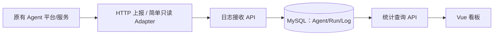

> **C04 方案 A 已确认（2026-10-11）**：Agent 详情「今日执行」复用 B01 **按 `started_at` 所属统计日计数真实唯一技术 Run** 的方向，并**限定当前 Agent**；同 Run HTTP 重传或状态变化不增加计数，不以 B06 活动消息数、业务 Task 或 UI-F0 静态数字替代。**统计时区/日界、RUNNING/SUCCEEDED/FAILED/CANCELLED 资格、唯一键及跨迁移冲突、迟到补报、环境权限、停用/归档 Agent、真实零/无数据、B01/C01/B10 对账、刷新与审计**均继续待议。不批准具体 SQL、API、协议、原型改动或上线。下一项 **C05 详情最近执行时间** 待确认。

> **C03 方案 A 已确认（2026-10-11）**：员工卡保留「估算节省工时（h）」，**仅当有经认可的人工基线、适用且可核实的业务工作量、需扣除的人工投入及可追溯的版本化估算规则**时展示 `ESTIMATED` 小时数；证据不足显示「不可估算」，不当作真实零、不使用 UI 静态值、Run 次数或 `duration_ms` 推算。与 B07 月度趋势及 B09 Top8 遵循可信依据原则，但**不自动批准 C07 或三者数值同口径**。**人工基线、业务工作量及去重、统计窗口、Run 状态、人工复核扣除、估算质量与覆盖率、负值、精度、环境权限、无数据、B07/B09/C07 对账及审计**全部待议。本次不批准新采集协议、SQL/API、原型改动或上线。下一项 **C04 详情今日执行** 待确认。

> **C02 方案 A 已确认（2026-10-11）**：员工卡与 Agent 详情统一显示**Agent 技术执行成功率**，采用 B02 同类的 `SUCCEEDED/(SUCCEEDED+FAILED)` 技术终态口径，**不再将该指标标为「一次通过率」**；技术成功不等于业务完成或首次尝试成功。**统计时间窗及 `finished_at` 日界、SUCCEEDED/FAILED/RUNNING/CANCELLED 资格细则、Run 唯一性、首次尝试与跨 Run 重试关联、零分母、Agent 状态、环境权限、缺失/数据质量、精度、B02 聚合一致性和审计继续待确认**。本决定不批准 attempt/correlation 新字段、业务完成率、API/SQL 或修改原型/严格 v1/v1.1。下一项 **C03 员工卡估算节省工时** 待议。

> **C01 方案 A 已确认（2026-10-11）**：员工卡「累计执行」以**该 Agent 实际采集并持久化的历史唯一技术 Run** 计数，与 B11 同源，但不默认跨状态/环境/时间/权限完全同口径。不得用 UI-F0 原型静态次数、HTTP 重传或业务 Task 数替代，不补造接入前历史。**时间范围、唯一键及迁移、RUNNING/FAILED/CANCELLED、停用归档、环境权限、迟到补报、真实零/未接入、展示精度、B11/E01 对账及审计仍待确认**。仅确认方向，不批准新 API/SQL/协议/原型改动或上线。下一项 **C02 技术成功率与「一次通过率」** 待议。

**B11 方案 A 已确认（2026-10-11）**：集团累计运行量以**授权范围内实际已采集、已持久化的历史唯一 Agent 技术 Run** 为依据；不得使用演示数字、HTTP 上报次数、业务任务数，或补造接入前未采集的历史运行。当前 Agent 启用/停用状态不自动抹除历史，但停用/归档历史的可见权限仍待确认。**历史起算时间、Run 唯一性跨迁移处理、RUNNING/FAILED/CANCELLED 纳入、迁移与完整性、迟到补报、环境与权限、归档 Agent、无数据、展示位置、审计及 C01/E01 是否复用均未批准**。仅确认方向，不批准 API、SQL、协议或上线。下一项 **C01 员工卡累计执行** 待确认。

**B11 方案 A 已确认（2026-10-11）**：集团累计运行量采用授权范围内**实际已采集并持久化的历史唯一 Agent 技术 Run**，不以当前 A02「在用」标记自动剔除历史，不虚构日志接入前的运行次数，也不将技术 Run 解释为业务任务完成。**历史起算时间、唯一键与跨源迁移冲突、RUNNING/FAILED/CANCELLED 纳入、迁移及数据完整性、迟到补报、环境与权限、停用/归档 Agent 历史可见性、无数据/真实零、展示位置、审计以及 C01/E01 关联均待确认**。本次只批准统计方向，不批准具体 SQL、接口、历史回填或上线；原型和 v1/v1.1 协议不变。**下一项 C01 员工卡累计执行待确认**。

> **更新裁决 A10（2026-10-10）**：用户明确要求「不要场景演示，去掉」。原始 HTML 不得编辑，但新 Vue UI-F0 与 UI-F1 **均不再做五场景 `p7` 页面、场景演示跳转或 Agent—场景关联**；UI-F0 的原型忠实复刻对此有明确例外。只做总览/员工详情/监控三页。A07 的业务来源说明及常规 Agent Run 监控保留。下文历史提及五场景复刻的段落以本裁决为准。

> **B06 补充确认（2026-10-11）**：正式集团首页「实时执行动态」采用**真实 Run 技术信息 + 可选调用方可信脱敏活动摘要**（方案 A）；摘要未报/不可信则回退为中性技术描述，不将技术成功推断为业务成功，不恢复五场景演示。排序、N、RUNNING 更新、重复事件、刷新/延迟、摘要新字段/脱敏、缺失、权限审计仍待审批；严格 v1、v1.1 草案和原型 HTML 不变。见 [21 逐项确认台账](21-metrics-field-confirmation-register.md)。**B07 节省工时月趋势已由用户选方案 A（2026-10-11）**：集团图表保留有可信来源才可计算的「月度估算节省工时」方向，这**替代**下文旧表格「把该图换成 Agent 执行量趋势」的工程建议；但**当前未批准人工基线系统/业务任务回执的建设**。没有经确认的人工基线及计算规则时显示「暂无可靠估算」，不能显示静态小时或从技术 Run 时长推导；详细实现边界/口径和 C03/C07/B09 仍待确认。

> **B08 后续专项决议（2026-10-11）**：已选方案 A，集团首页「月度模型估算费用趋势」按**授权环境 + Run `started_at` 启动月份 + 原始计价币种**分别汇总/展示已存 ESTIMATED 模型费用，不自动换汇/混币，不按单均 × Run 次数造数。这**覆盖下文把成本图换成 Run 耗时/失败率趋势的旧工程建议**，但费用质量 KPI 准入、RUNNING/FAILED/CANCELLED 状态、币种精度与未知、月界/时区、上报覆盖、迟到历史冻结、环境权限/审计、图形及 C08 仍待批准。既有 v1/v1.1 OpenAPI 与原始 HTML 不变。见 [21 台账](21-metrics-field-confirmation-register.md)。

> **B09 方案 A 已确认（2026-10-11）**：总览原「场景效能 Top 8」改为按**已登记 Agent** 的可信「**估算节省工时（h）**」排行，不按场景，不使用技术 Run 次数或耗时替代。只有具备真实人工处理基线、适用业务工作量及版本化估算规则的 Agent 才可形成估算值；缺基线是**不可估算、不是 0 或末位**，完全没有可信可比样本应显示「暂无可靠排行」，禁止用原型静态榜单。A10 已取消的五场景页/Agent—场景绑定仍不恢复。**Agent 唯一性、统计窗口与时区、状态/业务工作量去重、Top N/并列、不足 8/无样本、Agent 管理状态与归档、环境及权限、估算覆盖率/基线质量、负值/精度与审计均待确认**。C03/C07 不随之自动批准；不因本决定批准人工基线系统、业务 Task 对账或 v1/v1.1 协议修改。下一项 B10 实时累计计数/刷新待选。

> **B10 已确认方案 A（2026-10-11）**：集团今日 Agent 技术 Run 次数以服务端复用 B01 `(agent_id, source_run_id)` 唯一 Run、按 `started_at` 启动日得到的真实聚合统计为权威；正式前端**自动刷新读取服务端新快照**，不得按 B06 动态条数、RUNNING→终态、重传/乱序事件或 DemoTicker/本地定时器直接 `+1`。这**不批准**刷新机制选轮询/SSE/WebSocket 哪种，也不决定周期/实时延迟、水位/快照版本、RUNNING 等状态、迟到补报、统计日界/时区、环境权限、无数据/网络错误、页面重挂载/重复订阅、审计和 B06 联动细节；不自动创建 API 协议或修改原始 HTML/严格 v1/v1.1。下一项 B11 集团历史累计运行量待确认。

> **B11 全集团累计运行量方案 A 已确认（2026-10-11）**：集团指标仅表示**授权范围内系统真实已采集/保存的历史唯一 Agent 技术 Run 累计数**，以 `(agent_id, source_run_id)` 识别唯一执行，HTTP 重传/状态更新不得多计。**不能声称 Agent 自创建以来全部执行，也不能用原型员工卡静态值、请求次数或业务任务数补造**；当前 A02 在用标记变更不会自动抹除已记录事实，但已停用/归档 Agent 的历史访问与统计纳入资格仍须确认。**历史起算时间、跨环境 Run 身份、RUNNING/FAILED/CANCELLED、可信历史迁移与缺口/重复、迟到补报、时区/日界、环境权限/归档、无数据/真零、展示位置/精度、审计及 C01 员工卡/E01 监控的对账关系未获批准**。本决定只确认核心历史累计方向，不批准新首页卡布局、新 Schema/新 API 形状、回填虚假历史或直接上线。**下一项 C01 员工卡累计执行待独立选择**。

# 17｜MVP 范围冻结：Agent 登记、执行日志采集、看板展示

> **已确认的产品范围（2026-10-10，项目发起人在会话中明确收缩）**：**不做复杂数字员工管理和业务结果对账；只做 Agent 登记 → 采集 Agent 日志 → 展示看板**。
>
> **此前仍然有效的已确认决定**：集团管理层优先；原始 [HTML](../prototype/index.html) 保持不变并作为 UI-F0 的布局基准；正式前端使用 **Vue 3 + TypeScript + Vite**。
>
> **本文件是 MVP 最高优先级的范围说明**。此前 [02](02-product-prd.md)、[03](03-architecture.md)、[04](04-metrics-and-contracts.md)、[05](05-roadmap-and-decisions.md)、[06](06-management-dashboard.md)、[07](07-executive-data-architecture.md)、[09](09-frontend-data-implementation.md)、[11](11-frontend-backlog.md)、[14](14-employee-management.md)、[15](15-data-integration.md)、[16](16-source-inventory.md) 中涉及“业务 Task/Outcome、双 Owner 审批、复杂 Connector、工时基线、财务对账”等要求已**退出本期 MVP**；仅作远期设计参考，不能作为首期开发/验收条件。
>
> 本文件中的具体日志字段、API 命名、数据库表和技术实现属于**建议落地细节**，不是用户逐项签署的技术决策；真正的源 Agent 平台接口可用性仍需接入前验证。

## 0. 日志采集方式已确认（2026-10-10）

> **指标字段确认流程补充**：2026-10-10 用户已要求所有原型指标及采集字段的展示、计算、来源、标准**逐项讨论批准**；候选清单见 [21](21-metrics-field-confirmation-register.md)，不要将此文中的技术 KPI 示例视作已定指标。

项目发起人已确认：**在 Agent 调用处增加一个简单的统一上报接口**，不以 Agent 平台只读拉取作为首期默认方案。

**v1 契约**：`POST /api/v1/ingest/agent-runs`，服务端 Bearer 验证，入参包括 `schema_version/agent_code/run_id/status/started_at`，终态强制 `finished_at`，耗时/Token/错误/trace 可选；同一 Run 允许开始/终态更新但不得重复计数。完整协议与调用例子见 [18](18-agent-run-reporting-standard.md)，机器可读规范见 [OpenAPI](../openapi/agent-run-reporting-v1.json)。

**调用策略**：仅终态一次上报即可；可选前置 RUNNING；上报失败有界重试、不得导致原 Agent 业务失败。上报的是**Run 技术日志**，非业务系统最终结果。

**本轮指标与非功能深化（待方案评审）**：原型全指标审计 [19](19-prototype-metrics-coverage-audit.md)、性能扩展迁移 [20](20-performance-extensibility-portability.md)、[v1.1 可选字段 OpenAPI 草案](../openapi/agent-run-reporting-v1.1-draft.json)。**v1.0 必填和含义保持不变，新增内容未视为已批准/已部署**；仍然仅做登记、上报和看板。

## 1. 只做三件事

| 功能 | 用户操作 | 首期最小能力 |
| --- | --- | --- |
| **Agent 登记** | 新增、编辑、停用、查看 Agent | 名称、平台、原平台 Agent ID、所属部门、负责人、说明、启用状态 |
| **Agent 日志采集** | 给已登记 Agent 配置日志上报或适配 | 每次 Run 的开始/结束/状态/耗时；可选分级日志、Token、错误信息；幂等、脱敏、最近采集时间 |
| **运营看板** | 查看集团整体、按部门分组、进入单 Agent 详情/监控 | Agent 数、执行次数、执行成功率、平均耗时、趋势、最近执行、失败记录；来源/时间/数据缺失提示 |

**首期没有**：能力/多资源绑定体系、审批上线流程、Agent 编排、工作流编辑、源业务回执联通、Task/Run/Step 复杂业务账本、业务成功/财务价值核验、工时节省/ROI、对账平台、复杂 Connector 向导、自动发现、告警工单操作、成本分摊。保留日志只读查看；原型的“告警处理/忽略”在 UI-F0 仍是演示交互，UI-F1 **不接任何真实写操作**。

**简单定义**：**一条登记记录对应一个外部 Agent 实例**（例如一个百炼 Agent ID），并在本平台显示为一名数字员工。不同环境（测试/生产）用不同登记项或明确标识。一个 Agent 可以有多次 Run。此为按本轮用户范围作出的最简实施解释；将来若需要一个数字员工整合多个 Agent，再单独讨论。

## 2. UI 设计：原型 1:1 外观，正式数据口径简化

### UI-F0：不改原型的布局和演示效果

- [原始 HTML](../prototype/index.html) 原样保留；Vue 仅做**三页**（总览、员工详情、监控），原型其余布局和样式对照复刻；**不做五场景静态展示页**。
- Demo Provider 的示例员工卡、必要图表与模拟动态仅出现在**明确标注 DEMO** 的独立演示环境；不再有五场景静态演示页。
- **场景演示整体移除**：不实现独立场景页、五场景导航、场景演示按钮、Agent—场景映射或演示计量；不把原型“真实在用”当生产状态。

### UI-F1：替换真实 Agent 数据，但保持同一个页面结构

| 原型显示 | MVP 正式页面如何表达（建议） |
| --- | --- |
| 数字员工总数 | **登记 Agent 数** |
| 今日执行任务 | **今日 Agent Run 数**（不是业务任务数） |
| 当日成本 | **平均执行耗时**或今日失败 Run 数；成本无真实计费数据时不显示假值 |
| 自动化成功率 | **Agent Run 成功率**；只代表技术执行状态 |
| 员工卡（真实在用/运行中） | 名称/部门/负责人/平台；登记启用状态 + 最近日志时间分开显示 |
| 节省工时趋势（**B07 2026-10-11 后续决议覆盖旧工程建议**） | **保留「月度估算节省工时（h）」方向，只有在另经确认的人工基线/适用规则及可信数据到位时才绘制；否则「暂无可靠估算」**。不直接替换为 Run 次数，更不能用运行耗时/演示数据造节省工时；工时基线/任务数据接入与公式尚未获批 |
| 成本趋势（**B08 2026-10-11 决议覆盖旧工程建议**） | **保留「月度模型估算费用」趋势，按照授权环境、Run `started_at` 月份和原始币种独立汇总已存 ESTIMATED 费用**；不换汇/跨币种加总、不按平均费用补值；**月界/状态/质量准入/币种与金额精度/覆盖率/迟到冻结/权限及 C08 待审批**，不得显示原型静态数或冒称 BILLED |
| 效能 Top 8 排行（**B09 后续决议覆盖旧执行量排行建议**） | **Agent 可信「估算节省工时（h）」排行**：不按场景；仅具备批准的人工基线/工作量/估算规则且数据可比时输出值，无依据显示「暂无可靠排行」、未覆盖 Agent 不作为 0 参与排名。**当前不授权建设基线/回执系统，也不认为当前 Run v1 具备估算来源。** 排名/时间/状态/环境权限/覆盖审计待选 |
| 员工详情 | Agent 基本资料、执行数/成功率/平均耗时/最后活跃、执行历史及错误 |
| 监控中心 | 最近 Run、失败日志、接入延迟；原型告警处理仍仅 Demo，不做生产处置 |

原型**布局、卡片数量、图表位置、色彩不变**，但正式模式的**文案/数据与图表含义必须反映真实日志能力**。这是“保持原型视觉，不沿用虚假业务效能指标”。

**无数据**：未接入日志的 Agent 显示“无日志/未接入”；已接入但近期无新记录显示“最近活跃时间/数据可能延迟”；真实 Run 数确为 0 显示 0。登记启用状态 ≠ 运行在线，不能通过无日志直接宣称离线。

## 3. Agent 登记字段（推荐最小字段）

| 字段 | 示例/约束 | 说明 |
| --- | --- | --- |
| `id` | 系统生成 UUID/雪花 ID | 本平台内部主键 |
| `name` | 菜品调整助手 | 显示名称，不用作唯一键 |
| `platform` | BAILIAN / CUSTOM / OTHER | 所属 Agent 运行平台 |
| `external_agent_id` | 源系统稳定标识 | 与平台、环境组成唯一性约束 |
| `environment` | PROD / TEST | 禁止测试日志混入生产报表 |
| `department_id` | 可读部门编码 | 首期可先从企业组织列表选择，尚无 IAM 时使用登记字段 |
| `owner` | 责任岗位或人员引用 | 方便发生错误时找到人 |
| `description` | 用途简介（可选） | 供管理层阅读 |
| `enabled` | true / false | 登记表内是否启用接入，不直接停止远端 Agent |
| `created_at/updated_at` | 服务端时间 | 基本维护审计 |

**首期仍不自动批准建设**独立的 Capability、资源多对多 Binding、人工上线审批准入、成本与工时基线、自动资产发现。**B07 仅已确认有可信依据时保留估算工时趋势的展示方向**；如果未来需要工时基线采集/维护/审批、任务粒度关联、扣减、历史更正，须另行确认范围与开发验收，不因本次选 A 即纳入已实施功能。首期“停用”只影响采集和展示状态，不调用外部 Agent 平台停机。

## 4. 日志采集：只需一条简单链路



**已确认方式**：由 Agent 调用方/统一 Gateway 包装层在运行结束时通过 **标准 HTTP POST** 上报 Run 摘要；可选先上报 RUNNING。严格使用 [18 上报标准](18-agent-run-reporting-standard.md)。阶段内不开发自动拉取适配器或通用 Connector 管理框架；若个别调用端确实无法加埋点，再另行评估例外。

### 最小 Run 记录示例（虚构的 DEMO 数据）

```json
{
  "schema_version": "1.0",
  "agent_code": "agent-demo-001",
  "run_id": "run-demo-1001",
  "status": "SUCCEEDED",
  "started_at": "2026-10-10T08:10:00+08:00",
  "finished_at": "2026-10-10T08:10:05+08:00",
  "duration_ms": 5000,
  "input_tokens": 680,
  "output_tokens": 180,
  "error_code": null,
  "error_message": null
}
```

其中 `input_tokens/output_tokens`、`duration_ms`、`error_code` 可以由实际平台能力决定是否可选。若源平台只给 Run 终态/耗时而不提供逐条日志，首页仍可统计执行情况；详情页只展示实际有的字段，不虚构 Step。

**推荐状态**：`RUNNING, SUCCEEDED, FAILED, CANCELLED, UNKNOWN`。成功率的分母仅包含观察窗内 **SUCCEEDED + FAILED** 的终态 Run；取消/运行中单独统计（是否把取消计入分母可在后续细化）。平均耗时只统计有真实 duration 的已结束 Run；空集合返回 `null`，不返回伪造 0。

**推荐时间口径**：
- 今日执行量 = 统计时区内 `started_at` 落在今日的唯一 Run 数，标题写清“启动次数”；若平台仅提供结束记录，则须决定统一以 `finished_at` 统计，不得混口径。
- 成功率 = `SUCCEEDED / (SUCCEEDED + FAILED)`，依据 `finished_at` 时间窗统计；重试会形成多个不同的 Run，**就是多次 Agent 执行**，不属于业务任务去重。
- 最近活跃 = 最大有效 `finished_at/started_at`，只代表**最后可观测活动**。
- 延迟 = 服务接收时间 `received_at` 与源发生时间之差；需要防止极端时间偏移影响排序。

**当前上报契约**必须包含 `schema_version/agent_code/run_id/status/started_at`，终态再包含 `finished_at`；`received_at` 在服务器生成。具体校验见 [18](18-agent-run-reporting-standard.md)。同一 Agent + 源 Run ID 的多次上报只存一个运行记录，必要时允许合法状态更新；不同 Agent 的 Run ID 即使相同也不合并。

### 数据安全与稳定性（避免过度工程化）

- 接收 API 必须认证发送方，并校验发送方可上报哪个 Agent；密钥放服务端 Secret/配置，不能写仓库/前端包。
- **默认不采集用户原文 Prompt、模型原始回复、上传文件、账单、手机号、员工敏感信息和完整工具请求/响应**。仅收必要摘要、脱敏错误和可选 usage；禁止将 PII 原文写入公共日志。
- 接口参数大小限制、分页、基础速率限制及幂等键必需；连接失败可稍后补发，不能阻断 Agent 原本工作。
- **复杂 Kafka/Flink、CDC、全公司 Connector 管理系统、全量 Trace 搜索**均不在 MVP 范围。

## 5. 最小持久化表（建议三张）

| 表 | 字段概要 | 重要约束 |
| --- | --- | --- |
| `dw_agent` | ID、平台、外部 Agent ID、环境、名称、部门、负责人、描述、enabled、维护时间 | `(platform, environment, external_agent_id)` 唯一（需将源命名空间纳入防碰撞） |
| `dw_agent_run` | ID、Agent ID、source_run_id、状态、开始/结束/接收时间、耗时、usage、错误码/摘要 | `(agent_id, source_run_id)` 唯一；状态变更幂等且不可倒退 |
| `dw_agent_log` | Agent ID、Run ID、级别、时间、脱敏消息/错误、源日志 ID（若有） | 按 Agent/Run/时间分页；有源 log ID 则幂等去重 |

如源平台只能提供 Run 摘要且没有安全的明细日志接口，**首期两张表足够**，第三张 `dw_agent_log` 按实际需求再上。尽量通过 SQL `GROUP BY` 与索引完成初期看板查询；数据量变大后再引入按日聚合表。

## 6. 最小 API（建议）

```http
GET    /api/v1/agents                      # 列表、部门/名称/平台/状态筛选
POST   /api/v1/agents                      # 登记 Agent
PATCH  /api/v1/agents/{id}                 # 编辑/启停
GET    /api/v1/agents/{id}                 # 基础资料 + 最近采集状态

POST   /api/v1/ingest/agent-runs           # 服务间认证，上报单条或小批次 Run
POST   /api/v1/ingest/agent-logs           # 可选，短日志/错误明细
GET    /api/v1/agents/{id}/runs            # 分页查看执行记录
GET    /api/v1/agents/{id}/logs            # 可选，分页查看脱敏日志

GET    /api/v1/dashboard/overview          # 注册数/Run 次数/技术成功率/平均耗时
GET    /api/v1/dashboard/trends            # 每日 Run 次数、耗时、失败数
GET    /api/v1/dashboard/rankings          # 按 Agent 执行量/失败率（注明分母）
```

正式环境的**查询授权**仍需满足集团权限规范；首期可使用现成 IAM/统一登录，而不是造完整新的用户/角色管理系统。

## 7. 极简开发里程碑（建议）

| 迭代 | 交付物 | 可客观验收的条件 |
| --- | --- | --- |
| A 原型 UI-F0 | Vue 原型复刻 + Demo Provider | 除 A10 场景演示以外保留原型布局；三页交互、示例卡、图表和移动适配 |
| B Agent 登记 | 简单管理列表/表单 + CRUD API + MySQL | 新增、编辑、停用一个 Agent，并在正式看板显示 |
| C Agent 日志 | 上报 Run API（+ 可选分级错误日志）、分页查询 | 提交成功/失败 Run、重试同一源 Run ID 不重复计算 |
| D 实际看板 | API Provider + 技术执行 KPI、趋势、排行、详情 | 总览与单 Agent 日志数能对齐；断流显示最后采集时间，不显示原型数字 |

**不需要前置完成菜品、报销等业务源系统回执整合**。可先接一套有真实 Run ID、状态和时间戳的 Agent 日志链路，验证全部页面的核心闭环。

## 8. 仍需要接入时确认的细节（不阻塞本次范围明确）

1. 第一批 Agent 在哪个平台运行：百炼、Dify、自研 Agent 服务或其他？是否支持 webhook/日志 API？
2. 实际日志是只有 Run 结果，还是有可安全采集的分级错误日志和 Token 使用数据？
3. 各平台的 Run 唯一 ID、时间戳、状态字段如何定义？能否补发/分页读取？

这些是**对接调查问题**，不是重新讨论已经确定的三项功能。默认从 HTTP 运行摘要上报切入，其他集成能力按源平台条件裁剪。

## 9. 对既有研发任务的影响

- **FE-00～FE-08** 仍用于原型 Vue UI-F0 复刻，验收原型视觉与交互（Demo）。
- **FE-09 / Issue #11** 收缩为**正式 Agent 目录/Run 查询 Provider**，只提供 Agent 日志与技术指标，不接业务回执、工时基线或生产告警操作。
- 额外只需要最小 **Agent 登记 API + Run 接入 API + Dashboard 查询 API**，可放在同一个后端服务中。无需创建多套业务子系统。
- [14](14-employee-management.md)、[15](15-data-integration.md)、[16](16-source-inventory.md) 是此前较复杂方案的保留存档，**不是本期必做**。本文件的范围裁决优先于那些旧文档。


### C05 MVP 采集与边界（方案 A 已确认，2026-10-11）

**C05 方案 A 已确认（2026-10-11）**：Agent 详情「最近执行时间」应来源于**该 Agent 真实已采集、可信的技术 Run 事件时间**，而非服务端最近收到上报的时间、浏览器当前时钟或模拟数据；`started_at` 可作为「最近启动执行」的候选，**`started_at` 与 `finished_at` 最终选择、优先级与指标准确命名尚未确认**。最近执行时间不等于在线、健康或当前 RUNNING 状态；平台接收时间仅可作为独立「最近收到上报」语义。**迟到补报、乱序、调用侧时钟偏差与异常时间校验、无数据与真实无运行、环境权限、停用/归档 Agent、时区格式、刷新/缓存、B06/B10/E01 一致性与审计均继续待议**。不修改原型 HTML、严格 v1/v1.1 协议，不批准新 API/SQL 或上线。下一项 **C06 详情月度执行趋势** 待选。

**待单独确认**：`started_at`/`finished_at` 字段及事件优先级、迟到补报与乱序、调用侧时钟偏差/时间质量校验、无数据、环境权限、停用/归档 Agent 历史、时区/格式、刷新与缓存、B06/B10/E01 一致性、审计。
