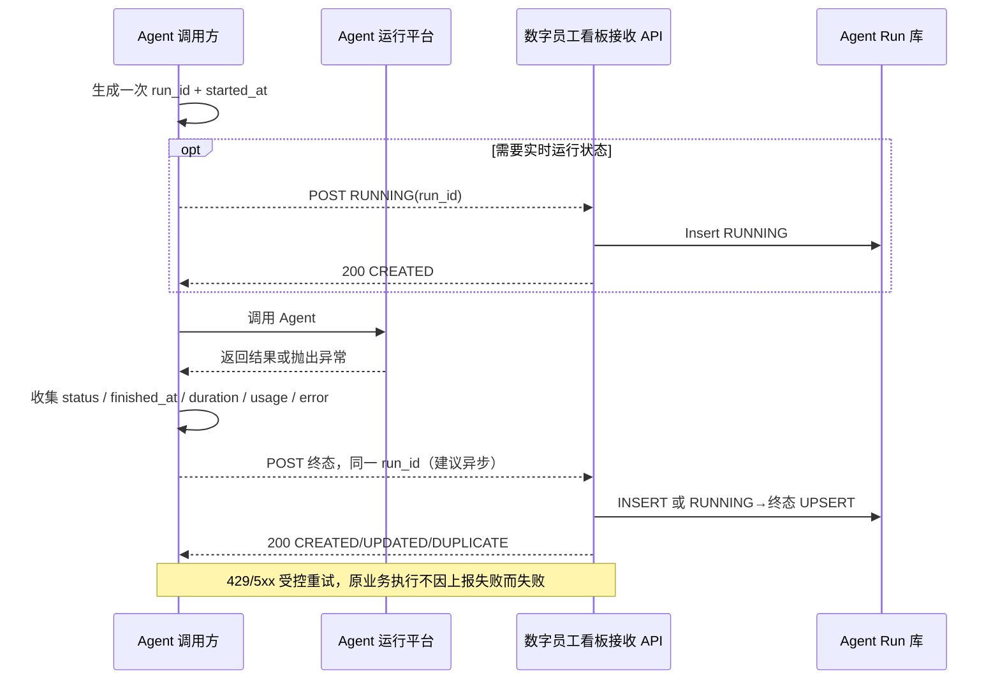

# 18｜Agent Run 上报标准 v1.0（调用侧接入契约）

> **覆盖范围提醒（2026-10-10）**：v1 定义的是**Agent Run 基础执行状态上报**，并**不能完整支撑原型中的成本、工时节省、人工介入、异常恢复与五场景专项指标**。逐页源码核对见 [19 原型全量指标审计](19-prototype-metrics-coverage-audit.md)。**已新增 [v1.1 扩展 OpenAPI 草案](../openapi/agent-run-reporting-v1.1-draft.json) 和 [20 性能扩展迁移方案](20-performance-extensibility-portability.md)**；均为待评审设计，**本文件与 v1.0 OpenAPI 本身不改变**。

> **D13 已确认（2026-10-10）**：在 Agent 调用处增加**简单的标准上报接口**，统一采集执行日志。**本文件提出具体的 v1.0 契约实施标准**，用于开发；具体字段和错误码可在首个真实 Agent 接入时按版本化流程调整。
>
> **机器可读规范**：[OpenAPI 3.1 JSON](../openapi/agent-run-reporting-v1.json)；整体产品范围以 [17 极简 MVP](17-agent-log-dashboard-mvp.md) 为准。
>
> **B03 P0 新增记录要求（2026-10-10，待版本化落地）**：首期一次 Agent Run 需支持保存输入 Token、输出 Token、实际计费模型标识、该次 Token×模型有效单价得到的 ESTIMATED 成本（价格依据可追溯）。**现有 v1.0 只有可选的两类 Token 字段，严格校验不接受新增 `model_id`/`estimated_cost_amount`；本文件所述 v1.0 契约没有因此变更**。必须后续确认向后兼容的新协议/独立模型标识来源、字段必填/空值/币种等，不能要求老 v1 客户端立刻上报新字段。P0 不强制完整多模型调用 Trace 或供应商账单。[详细草案](22-token-pricing-cost-design.md)。
>
> **B03-P0-02 最新确认（2026-10-10，方案 A）**：已有的 `input_tokens/output_tokens` 继续为**可选非负整数**，只能从真实模型 SDK/API Usage 取得；不能因上报缺失而补 0、用字符数估算或拒收合法 Run。真实报告 0 与未报告严格区分；缺少计价所需 Usage 时**费用不可计算**，不得默认 0。供应商字段映射、流式中断/失败取消、迟到更新和质量细节仍未确认，v1 OpenAPI 保持原样。[B03-P0-03 单次成本计算责任方](22-token-pricing-cost-design.md#当前待选b03-p0-03-单次成本计算责任方尚未确认) 原已待选；现在 B03-P0-03 已确认调用方自行计算并上报 ESTIMATED 费用（方案 B），详见最新设计。
>
> 本接口上报**Agent 一次技术执行 Run 的摘要**，不是原文 Prompt/模型响应/所有工具步骤日志，也不是菜品、财务等业务系统的最终回执。

> **B03-P0-03（方案 B）与 B03-P0-04（方案 A）确认，2026-10-10**：调用方负责按模型真实 Usage × **自身维护的有来源、版本化模型单价快照**计算本次模型 ESTIMATED 金额并随 Run 上报；看板端接收/校验/存储，不担任权威重新定价者，不把估算视为已结算账单。价格配置具体字段、维护审批、版本生效时点、币种/精度、缓存/阶梯、缺价/历史更正和单价展示仍待确认。**B03-P0-05 已选方案 B：另立独立版本的简化 Run 上报结构，采用扁平费用金额及价格依据字段，不默认使用 v1.1 草案嵌套 `cost`**；但**实际金额字段/必填/小数位/币种/质量标签、版本编号、严格 v1 兼容分发及重报冲突细则仍未批准**。**B03-P0-06 已选方案 C：费用只做基本字段格式校验，不核验调用方模型费率真实性、Token 覆盖或计价金额偏差，也不能据此认定账单已核验；格式失败后的 ACK/是否影响 Run 尚未批准。** **B03-P0-07 方案 B 已确认：一次 Run 初始缺费可后来补入首笔 ESTIMATED 金额，首次保存后在普通 Run 报文中锁定；重复原金额幂等，不同金额只按冲突处理，绝不能自动覆盖/累加**。补报时限、并发首次写入、乱序、冲突 ACK/错误码、异常修复授权/审计和历史重算尚未确认。**B03-P0-08 已选方案 A：单次 Run 的 ESTIMATED 模型费用按其 `started_at` 所在统计日归属**，跨日执行、迟到首次补入仍属于原启动日；不意味着已经确定历史报表何时刷新/冻结，或状态/环境/币种/质量准入范围。**B03-P0-09 已选 A：集团首页 B03 主卡方向为「今日模型估算费用」，原则聚合有权统计的真实技术 Run ESTIMATED 金额**，不按 Agent 当前 A02 在用标记或暂停/停用自动抹掉历史费用；但 RUNNING/FAILED/CANCELLED、TEST/PROD、归档历史、币种/精度、成本质量准入、缺失/覆盖率等仍待确认。**B03-P0-10 已确认方案 C**：RUNNING/SUCCEEDED/FAILED/CANCELLED 四类技术状态中已成功保存一次 ESTIMATED 费用的 Run 可作为**所属环境**成本统计候选；各环境独立统计、不混成一个缺少环境标签的集团总额。RUNNING 首次计价时点未定；登记资产与服务授权决定环境归属，不能直接信任客户端自报。**B03-P0-11 已选方案 A：调用方保留原始计价币种并上报；各环境按 Run `started_at` 统计日和币种分别汇总/展示 ESTIMATED 费用，不自动汇率换算或跨币种相加**。**当前讨论 B03-P0-12：费用缺失、真实零与上报覆盖率**；环境默认/灰度、质量、币种/精度、时区/日界/历史补数和新增 Schema 仍待批准。严格 v1 OpenAPI 和未批准 v1.1 草案保持原状。[22 计价讨论](22-token-pricing-cost-design.md)。
>
## 1. 一句话接入方式

在 Agent 的**统一调用包装层**生成一个 `run_id`，执行完成时 `POST /api/v1/ingest/agent-runs` 上报一条终态数据。需要“正在执行”时可提前用**同一个 `run_id`**上报 `RUNNING`。默认只在结束时上报一次即可。



**重要**：一个 `run_id` 表示**一次实际 Agent 调用尝试**。重复发送同一次上报必须重用 ID；如果业务主动再次调用 Agent（重试执行），应生成**新的** `run_id`，技术执行次数就增加 1。平台已有稳定 ID 时直接映射；没有则在调用前生成 UUID，终态/补发沿用同一个。

## 2. URL 与基础规则

| 项 | 标准 |
| --- | --- |
| 方法 | `POST` |
| 路径 | `/api/v1/ingest/agent-runs` |
| Content-Type | `application/json; charset=utf-8` |
| Authorization | `Bearer <INGEST_TOKEN>`，**服务端到服务端**的上报凭证 |
| HTTPS | 正式环境必须使用 TLS |
| 请求体大小 | 推荐服务端最大 **16 KiB**，超限 `413` |
| 版本 | `schema_version: "1.0"`（且路由 `/api/v1`） |
| 速率保护 | 服务端按调用方限流，客户端对 `429` 按 `Retry-After`/退避重试 |
| 服务确认 | 仅**持久化已提交成功**后返回 `200`，不把“收到但尚未写入”当成功 |
| 兼容策略 | v1 不变更必填字段语义；破坏性修改用 `/api/v2` / `schema_version: "2.0"` |

`agent_code` 是看板上登记的**固定识别编码**，而不是可随意填写的中文昵称。登记时保存 `platform/environment/external_agent_id` 等资产资料，并把 `agent_code` 作为调用方上报映射键；**平台及环境由后台配置/授权身份确定，客户端不重复传入**。服务端必须校验 Token 有权向对应 Agent 及环境上报，防止自报其他员工。禁用 Agent 采集后拒绝新的入站记录，不会停止源 Agent 自己的业务执行。

## 3. 请求字段

| JSON 字段 | 类型 | 是否必填 | 说明 / 校验 |
| --- | --- | --- | --- |
| `schema_version` | string | **必填** | 固定 `"1.0"` |
| `agent_code` | string | **必填** | 已登记固定编码；长度 1–64，ASCII 字母数字开头，其余可使用 `._:-` |
| `run_id` | string | **必填** | 同 Agent 下唯一；1–128 字符、同上字符规则；重试保持相同 |
| `status` | enum | **必填** | `RUNNING / SUCCEEDED / FAILED / CANCELLED` |
| `started_at` | RFC3339 | **必填** | 本次执行实际开始时刻，带 `Z` 或 `+08:00` 等时区 |
| `finished_at` | RFC3339 | **终态必填** | 结束时刻，带时区，且不早于 `started_at` |
| `duration_ms` | int >=0 | 可选 | 实际执行耗时；缺失时服务端用起止时间计算，不可得则 null |
| `input_tokens` | int >=0 | 可选 | **实际计量**的输入 Token；不可得则不发送 |
| `output_tokens` | int >=0 | 可选 | 实际计量的输出 Token；不可得则不发送 |
| `error_code` | string | 可选 | 短错误代码 ≤100 字符；失败时建议填 |
| `error_message` | string | 可选 | 已脱敏诊断摘要 ≤500 字符，禁止原文 Prompt/回复/用户信息 |
| `trace_id` | string | 可选 | 已有日志系统的无敏感链路索引，非必需 |

首期请求默认**不提供**任意 `metadata`、`prompt`、`response`、`steps` 和大段日志数组，避免接入越来越复杂或引入敏感信息。后续若要完整调用轨迹，可**另行新增 Trace/Log 查询能力**，与此 Run 级统计接口解耦。

## 4. 请求示例：最小终态 / 含可选字段 / 失败

### 最小终态（一次上报即可）

```bash
curl --fail-with-body -X POST "${DASHBOARD_API_BASE}/api/v1/ingest/agent-runs" \
  -H "Authorization: Bearer ${AGENT_INGEST_TOKEN}" \
  -H "Content-Type: application/json" \
  -d '{
    "schema_version": "1.0",
    "agent_code": "dish-adjuster-demo",
    "run_id": "run-20261010-0001",
    "status": "SUCCEEDED",
    "started_at": "2026-10-10T08:10:00+08:00",
    "finished_at": "2026-10-10T08:10:04+08:00"
  }'
```

文中均为**虚构演示编码和时间**，不可将示例当生产数据。Shell 变量 `DASHBOARD_API_BASE` 和 `AGENT_INGEST_TOKEN` 由调用系统的机密配置提供，不能在 GitHub 或浏览器前端提交真实值。

### 包含 Token 与耗时的成功

```json
{
  "schema_version": "1.0",
  "agent_code": "dish-adjuster-demo",
  "run_id": "run-20261010-0001",
  "status": "SUCCEEDED",
  "started_at": "2026-10-10T08:10:00+08:00",
  "finished_at": "2026-10-10T08:10:04+08:00",
  "duration_ms": 4000,
  "input_tokens": 680,
  "output_tokens": 180,
  "trace_id": "trace-demo-0001"
}
```

### 失败记录

```json
{
  "schema_version": "1.0",
  "agent_code": "dish-adjuster-demo",
  "run_id": "run-20261010-0002",
  "status": "FAILED",
  "started_at": "2026-10-10T08:20:00+08:00",
  "finished_at": "2026-10-10T08:20:02+08:00",
  "duration_ms": 2000,
  "error_code": "AGENT_TIMEOUT",
  "error_message": "Agent execution timed out",
  "trace_id": "trace-demo-0002"
}
```

### 可选开始记录

```json
{
  "schema_version": "1.0",
  "agent_code": "dish-adjuster-demo",
  "run_id": "run-20261010-0001",
  "status": "RUNNING",
  "started_at": "2026-10-10T08:10:00+08:00"
}
```

上报 RUNNING 不需也不应传 `finished_at`；终态再次发送时 `run_id` 与 `started_at` 保持一致。

## 5. 服务端响应

无论新插入、合法状态更新还是完全重复/晚到旧状态，**在合法且可持久化处理完成后统一 HTTP `200`**，响应：

```json
{
  "agent_code": "dish-adjuster-demo",
  "run_id": "run-20261010-0001",
  "result": "CREATED",
  "received_at": "2026-10-10T08:10:04+08:00"
}
```

`result` 值：

| result | 解释 | 统计次数 |
| --- | --- | --- |
| `CREATED` | 首次建立 Run | +1（按 Run 启动时间口径） |
| `UPDATED` | `RUNNING` 合法更新为终态 | 不再新增 Run；按终态调整成功/失败等统计 |
| `DUPLICATE` | 同状态、同不可变事实的重复上报 | 不增加 |
| `IGNORED_STALE` | 终态已存在，收到晚到的旧 RUNNING | 不增加 |

**状态不可倒退**：

```text
（未存在） → RUNNING → SUCCEEDED / FAILED / CANCELLED
（未存在） ─────────→ SUCCEEDED / FAILED / CANCELLED   （仅结束上报）
```

- `SUCCEEDED/FAILED/CANCELLED` 是终态，不接受改为另一个终态；同一 Run 上报冲突的终态返回 `409`，需人工排查源日志问题。
- 同一 Run 的 `started_at`、Agent 身份不可变化；不同值上报视为冲突 `409`。合法的 RUNNING → 终态可以新增 `finished_at`、耗时、Token 和错误。
- 终态在无开始记录时直接创建，随后迟到的 RUNNING 不能覆盖终态。
- 源平台无法给出最终状态、进程异常退出导致终态丢失时，应在看板标记**长时间无更新 / 状态待确认**，不能擅自记为 FAILED。
- 同一次 HTTP 上报超时，即使服务端可能已经提交，调用方仍可使用**原 `run_id`**安全重试；避免为了重试新造 Run ID。

### HTTP 错误与重试

| HTTP | 示例原因 | 客户端动作 |
| --- | --- | --- |
| `400/422` | JSON/字段/时间格式不合法 | 修复输入，不盲目重试 |
| `401/403` | Token 无效或 Agent 无授权 | 检查密钥/绑定；不循环重试 |
| `404` | Agent 尚未登记 | 先登记；避免自动造资产 |
| `409` | 同一 Run 不兼容的终态或元数据冲突 | 记录冲突并排查，不自动改写 Run |
| `413` | 请求超 16 KiB | 精简字段，不能上报完整 Prompt |
| `429` | 限流 | 根据 `Retry-After` 和指数退避重试 |
| `500/503`、网络超时 | 服务异常/未知提交结果 | **使用相同 Agent + run_id** 有界重试 |

**推荐调用端行为**：业务线程完成后将**脱敏的 Run 摘要交给有界异步队列**，发送超时与次数受控（例如初次 + 最多 3 次重试，指数退避加抖动），达到上限仅记录脱敏上报失败警告；**不要重新执行 Agent，也不要让看板上报失败导致原业务返回失败**。需要更高可靠性时再增加持久化待发送队列/Outbox，MVP 不强制。

## 6. 采集器接入点：推荐包在调用方，而不是修改 Agent 本体

- **Java/Spring 应用**：调用 Agent API 的 Service/Gateway 层统一生成 Run ID、采集时间、捕获正常/异常、执行后异步上报。建议抽象 `AgentRunReporter`，由所有调用点复用，不在每个 Controller 手写采集代码。
- **Python/Node**：同理用 wrapper/decorator/middleware 负责 Run 的生命周期和上报。
- **流式/异步 Agent**：必须在流式响应**真正完成**或出错时上报终态，不能在 HTTP 初次返回 stream/任务已受理时直接报成功。
- **Agent 自身内部重试**：若平台只给最终结果，报告一条 Run 即可，说明其粒度是“一次外层 Agent 调用”；不要猜测未暴露的内部调用次数。
- **同一个业务请求再次调用 Agent**：若调用方确实发起第二次独立 Agent 运行，产生新的 Run ID。未来需要关联一组尝试时再加 `correlation_id`，首期不用。
- **同步响应时延**：统计真正的 Agent 调用开始到完成，不把异步日志上报网络耗时算进 `duration_ms`。

伪代码仅示意调用边界，不是仓库里已经可运行的 SDK：

```text
runId = sourceRunIdOrNewUuid()     // 每次真正执行一次；HTTP 上报重试不重新生成
start = clock.now()
try:
    result = invokeAgent(...)
    finish = clock.now()
    reporter.reportAsync(agentCode, runId, SUCCEEDED, start, finish, result.usage?)
    return result
catch (cancelled):
    finish = clock.now()
    reporter.reportAsync(agentCode, runId, CANCELLED, start, finish)
    rethrow
catch (exception):
    finish = clock.now()
    reporter.reportAsync(agentCode, runId, FAILED, start, finish, sanitize(exception))
    rethrow
```

实际情况需保证报告入队本身的异常也**不会改变原业务结果**；finally 清理资源/长连接取消逻辑仍由原应用负责。

## 7. 看板聚合：严格用 Agent Run 而非业务任务

- **登记 Agent 数**：当前被授权可见的 Agent 记录，注册态与最近活跃分开。
- **Run 执行数**：同 Agent 下唯一 `run_id`，在时间窗按 `started_at` 统计。只在终态上报的客户端，长耗时 Run 需等终态入库后才出现在回溯的开始时间段。
- **技术成功率**：按 `finished_at` 查询窗口中 `SUCCEEDED / (SUCCEEDED + FAILED)`，运行中/取消不在分母；分母为 0 返回 null。
- **平均耗时**：已结束且有有效时长的 Run 计算，缺失值不能当作 0。
- **数据新鲜度**：最近成功**接收**的 `received_at`，它不是远端 Agent 的健康心跳；长期无日志仅说明未观察到活动/采集未知。
- **Token**：仅来源有实际值时显示，不能按字符数估算为已核验 Token，更不能由此自动输出未证实财务成本。

## 8. 后端最小表与索引

```sql
-- 片段为字段级约束建议，不是完整迁移 DDL
-- dw_agent: id, agent_code, platform, environment, external_agent_id, enabled, ...
-- UNIQUE(agent_code) 或按明确隔离域 UNIQUE(tenant_id, environment, agent_code)

-- dw_agent_run: id, agent_id, source_run_id, status, started_at,
-- finished_at, duration_ms, input_tokens, output_tokens,
-- error_code, error_message, trace_id, received_at, updated_at
-- UNIQUE(agent_id, source_run_id)
-- INDEX(agent_id, started_at)
-- INDEX(agent_id, finished_at)
```

入站 upsert 必须**在数据库唯一约束和事务内原子化**，不能用“先 SELECT 后 INSERT”在并发下碰运气。Run 终态更新后影响成功率等统计，首期用 MySQL SQL 聚合即可。

## 9. 验收用例（BE-B / FE-09）

- [ ] **仅终态**：登记 Agent 后仅上报一条 SUCCEEDED，执行数+1，成功终态+1。
- [ ] **开始+终态**：RUNNING → FAILED，Run 仍然 1 条，正确记录时长和脱敏错误。
- [ ] **重复发送**：同一终态重试 10 次，只有一条 Run，响应为 DUPLICATE。
- [ ] **乱序**：先收到 SUCCEEDED 再收到 RUNNING，保持 SUCCEEDED，响应 IGNORED_STALE。
- [ ] **终态冲突**：同一 Run 已 FAILED，再上报 SUCCEEDED，返回 409，不更新旧值。
- [ ] **归属验证**：Token A 不能向 Agent B、其他环境上报，返回 403。
- [ ] **未知 Agent**：返回 404，不自动插入假员工。
- [ ] **时区**：等价 `Z` / `+08:00` 时间戳标准化，跨日统计正确。
- [ ] **异常字段**：没有 Token/duration 时空值可保存，不能转为 0；失败消息敏感信息被拒绝或有效脱敏。
- [ ] **字段边界**：运行中报告不带完成时间，终态必须带完成时间；`finished_at < started_at`、负时长、非法状态、请求超 16 KiB 被拒绝。
- [ ] **网络失败**：超时/限流有界重试，原业务结果不受上报失败影响。
- [ ] **生产统计**：Run 技术成功率与明细一致，无真实日志时不采用原型演示数据。

## 10. 版本演进约定

v1 以固定字段和单一 Run 摘要覆盖管理层 MVP。将来确需原文日志、步骤明细、模型计费精度、批量 ingest 或业务 Task 关联时，**先另提需求/升级协议**，不能为了预留扩展在本次 v1 偷建一套通用 Agent 编排与监控系统。

### F11 数据时间与质量字段 · 方案 B（2026-10-11）

**F11 数据时间与质量字段方案 B 已确认（2026-10-11）**：E09 正式采集新鲜度**先只用真实且可核验的服务端最近成功接收时间**作为候选权威证据（`received_at` 的字段身份/落地实现待另议），展示文案必须说明「最近接收／最近成功接收」，**不能从此宣称聚合统计已更新、数据覆盖完整、系统/采集服务健康或 Agent 在线**。何谓成功接收、服务端时间生成点以及 HTTP ACK 与持久化的关系**尚未确认**，不能把原始请求/重传、Run `started_at`、浏览器时间或页面刷新时间当作接收事实。无真实接收证据显示「未知／未接入／暂无可靠新鲜度数据」，不把低频/停用 Agent 久未上报等同离线或数据零。**`as_of` 作为统计水位、`data_quality` 作为质量/覆盖元信息全部留待独立讨论；二者未获批准，也不能与接收时间混称。A11 方案 A、E04 方案 B、E05/E06/E07/E08/E09 方案 A 均保持不变**。

**F11 未决细节**：`received_at` 是否为现有持久化内部字段或 API 响应字段、接收 ACK/持久化一致性、时间精度/时区和可信性、同一 Run 状态更新及重试重复接收的处理、异常/断链/拒绝/补报、最近成功接收范围、查询缓存与水位（`as_of`）、质量/缺失/覆盖率（`data_quality`）、权限/环境/部门/停用归档 Agent、迟到重算/历史冻结、无数据与真实零、字段归属及未来协议版本、A11/E09/B06/B10/E01/E08/S03/S05/S06/S10 一致性与审计。**仅确认初期新鲜度证据方向**，不批准任何新增 SQL/API/Schema、严格 v1/v1.1 上报协议变更、健康/Agent 在线判断、原型 HTML 修改或上线。**下一项 S01 跨页面同名指标口径与复用标准待选**。

**严格协议不变**：F11 的 `received_at` 为服务端接收事实候选，不是要求 Agent Reporter 在 v1 请求中新报时间；本轮不向标准 v1/v1.1 增加 `as_of` 或 `data_quality`，更未确认 API 返回字段。

### S01 跨页面相同指标口径与查询复用 · 方案 A（2026-10-11）

**S01 跨页面相同指标的计算口径与查询复用方案 A 已确认（2026-10-11）**：同一已批准的**指标 ID、技术/业务语义、计算公式和版本化口径**，在集团首页、员工卡/详情、监控中心应有一份统一的权威定义，并依集团/部门/Agent、环境、时间窗口、权限范围等**显式参数化的查询维度**进行过滤与聚合。**只有同指标且统计时间窗/时区、过滤条件、状态资格、权限范围及可信数据水位/数据质量等确实一致时**才要求跨页面可对账，条件不同不得假设数据相等或以不同维度导致的差额冒充故障。B01/C04/E01 技术 Run 启动日计数与 B02/C02/E01 技术终态结束日成功率的时间和分母差别必须保留；B05/E03 的已知人工介入 Run 比率不能与 E02 的人工介入事件次数混淆，B06/C10/E08 技术执行流水不等于业务 Task；E04–E06 真实独立异常/告警事件不从 FAILED Run 或流水推导。**A11 方案 A、E04 方案 B、E05/E06/E07/E08/E09 方案 A、F11 方案 B 与其他此前已确认决议全部不变**。

**S01 尚未确认**：指标 ID/命名/单位/精度、公式定义和口径版本维护主体、集团/部门/Agent/环境/归档维度与权限过滤、事件时间/时区/统计日界、Run 身份唯一性/迁移/重复、各指标状态资格、零分母/无数据/真实零、迟到补报/历史重算、数据质量与覆盖、统计查询水位与 F11 最近成功接收的区别、实时刷新/缓存/分页、聚合与详情对账、共用后端代码/SQL/API/指标注册表的实际实现选择、性能及审计。**仅批准统一权威语义、参数化维度和可比条件下对账的方向**；不因此批准新指标平台或统一 SQL/API/Schema、修改严格 Run v1/v1.1、原始 HTML 或上线。**下一项 S02「计数粒度」共用标准待选**。

**严格协议不变**：统一展示指标口径不是要求调用方在 Run v1/v1.1 中上报统一 KPI 结果、统计查询维度或注册表版本；既有上报事实与查询统计定义必须分层，跨平台身份和重试规则仍单独审议。

### S04 状态口径共用标准 · 方案 A（2026-10-11）

- [x] **S04 状态口径共用标准方案 A 已确认（2026-10-11）**：真实技术 Run 状态在集团首页、Agent 卡片/详情及监控中心使用**同一技术状态语义**，但**每个已确认指标依各自已批准的状态资格、样本、事件时间、分子分母与过滤条件计量**；不得强行将成功率状态过滤套用于所有 Run 计数、费用、介入和事件指标。同一真实唯一 Run 状态更新/重复上报不计为新执行；`SUCCEEDED` 仅表示技术成功，不表明业务交付、无人工介入或一次通过；未知/缺失状态不得自动映射成功、失败或 0。B02/C02/E01 仍只以 `finished_at` 范围的 SUCCEEDED/FAILED 计算技术成功率，RUNNING/CANCELLED 不在该分母；B03-P0-10 仍允许四类状态中具备首次保存估算金额的 Run 成为费用候选（费用质量与 KPI 准入待议）；B01、B05/E03、E02 不自动沿用成功率过滤。E04–E06 独立可信异常/告警事件及工单生命周期**不得**从 FAILED 技术 Run 或技术状态推导。**S01/S02/S03 方案 A、F11 方案 B、A11 方案 A、E04 方案 B、E05–E09 方案 A、B05 方案 B 及其他此前全部已确认决议保持不变**。
- [ ] **仍待议**：技术状态全集、UNKNOWN/无效/自定义状态、RUNNING→终态与乱序/重试/终态冲突、状态权威来源及一致性、逐指标 RUNNING/FAILED/CANCELLED 资格、不同样本的分子分母及零分母、费用质量、事件和工单自身状态、环境/部门/Agent 权限与停用归档、统计时区/窗口、迟到补报/历史重算、缺失与真实零、数据水位/覆盖、展示颜色/精度/文案、跨页面对账和审计。**[x] 仅代表产品方向获批，不代表研发实现完成**；不批准 Run v1/v1.1 协议、SQL/API/Schema、独立事件或任务系统、原型 HTML、上线。**下一项 S05 数据可信度与质量等级共用标准待选**。

**协议边界说明**：本条是指标展示与计算共用原则记录，并不修改现行严格 v1 的四种已定义技术状态与验收条款，也不批准 UNKNOWN 枚举、强制 RUNNING、额外字段或未来版本；任何上报协议改变须另行审议。

### S05 数据可信度与质量等级 · 精简版方案 D（2026-10-12）

- [x] **S05 数据可信度与质量等级共用标准 · 精简版方案 D 已确认（2026-10-12）**：不引入统一可信度评级、数据质量打分、单独质量管理页面或强制通用质量枚举/字段；继续执行每个指标已批准的**真实来源、已有口径、缺失与真零区别、展示证据门槛**。Agent 登记信息直接注明为登记来源；技术 Run 使用真实采集且可信的技术事实；B03/B08/C08 等模型费用必须明确写「ESTIMATED／模型估算费用」，不得当作真实已出账、价格正确或核验完成；B07/B09/C03/C07 等工时必须有已认可的人工基线及版本化规则才能标注「估算」，无依据为不可估算；**B03-P0-12 原费用已报/未报 Run 数及上报覆盖率方向保留，明确报 0 与未报严格区分**。E04–E06 告警/异常必须有独立可信来源，无数据则不可统计；F11 真实最近成功接收时间继续与未获批的 as_of/数据质量字段区分；生产环境不得引用静态演示或随机数字填充真实 KPI。不可可靠计算时用该指标恰当的「暂无数据／不可计算／未接入」等空态，而非自动补 0；具体文字/触发条件另议。**S01/S02/S03/S04 方案 A、F11 方案 B、B03-P0-06 方案 C（后台仅基础格式校验）、B03-P0-12 方案 A 及全部此前已确认决定不变**。
- [ ] **S05 尚未批准细节**：空态具体文字与出现条件、标签位置、数值精度、B03-P0-12 费用覆盖率分母/零分母/旧协议 Run、迟到补报与历史重算、费用上报基本格式有效和 KPI 准入、真实零证明、价格/Token 正确性、工时基线批准证据、E04–E06 告警来源、F11 received_at/as_of/data_quality 字段归属、水位、时区、环境部门权限/归档/脱敏及审计。未来若个别指标确需质量字段，必须**重新逐项审批**，不得因 S05 自动批准统一 quality enum、评分引擎或页面。**[x] 只是产品原则已确认，非工程完成**，不批准 SQL/API/Schema、新协议、原型修改或上线。**下一项 S06 数值展示共用标准待选**。

**协议保护**：现行严格 v1 的字段和校验不因 S05 自动改变；尤其不强制 REPORT 质量编码或把 F11 候选 data_quality 定为字段。任何未来单项扩展仍走独立版本/协议审批。

### S06 数值展示共用标准 · 方案 A（2026-10-12）

- [x] **S06 数值展示共用标准方案 A 已确认（2026-10-12）**：集团首页、数字员工卡/详情及监控中心遵守**轻量统一的数值、单位与空值展示原则**，不修改每个指标已批准的公式、来源、事实粒度、状态资格或时间窗口。真实 Agent 数、唯一技术 Run 次数、独立介入/异常事件数、工单数等按自身计数单位使用**整数及明确的「名/次/条」等单位**，不得混用 Run、事件和业务 Task；成功率/介入率/费用覆盖率等比率使用**百分比**且保留已确认分子分母；有可信基线的节省工时注明**估算、小时 h**，耗时明确 ms/s 等有效单位；模型 ESTIMATED 费用必须按授权环境与**原始计价币种**分别展示、不跨币种无说明相加、不能冒充实际账单。严格区分可信真实 0、未上报、未接入、不可计算与分母为 0，缺数据不得自动填 0%/¥0/0h 或原型静态数。**S05 精简 D、S01/S02/S03/S04 A、F11 B、B03-P0-06 C、B03-P0-11/12 A、B04 B 以及其他已确认决议不变**。
- [ ] **待确认细节**：具体页面和字段的单位与文案、小数位/精度/进位舍入、千分位和万/K 缩写、h/min/ms/s 换算与显示阈值、百分比零分母及少量样本、真零/未知/未接入/不可算的占位样式、金额各币种精度和多币种排版、费用覆盖率分母/格式、数据时间/时区、权限/环境/归档、数据质量及估算标签的具体 UI、审计对账和验收。**仅方向决议通过，未批准新格式化系统、前端实际改版、Schema/SQL/API、严格 v1/v1.1 协议、原型 HTML 修改或上线**。**下一项 S07 成本口径共用标准待选**。

**上报契约边界**：S06 仅涉及看板展示，不修改源端 Run 事实字段、币种语义、状态、时间与校验；严格 v1 协议不变，未来费用扁平字段新版本的字段名/精度等也尚待专项审核。

### S07 成本口径共用标准 · 方案 A（2026-10-12）

- [x] **S07 成本口径共用标准 · 方案 A 已确认（2026-10-12）**：MVP 共享的成本概念只限于**真实唯一 Agent 技术 Run 由调用方上报、首次成功保存的 ESTIMATED「模型估算费用」**，绝不默认为集团全成本/真实已出账 BILLED、工具/API、基础设施或人工复核成本。B03 集团今日、B08 集团月度、C08 Agent 月度以及关联成本指标依据各自已批准的授权范围，按 Run `started_at` 归属启动日/月、**授权环境和原始计价币种分组**，不同币种不直接相加且不自动汇率转换。调用方根据真实 SDK Usage 和有来源/版本化的本地模型单价自行估算上报；后端 P0-06 C 仅基础格式校验、**不权威重算或验证真实性**。同一 Run 费用首次保存后普通重报锁定，重复金额不得重复汇总，可允许先前未报费用的迟到第一次补入；不同金额重报冲突不能覆盖。所有技术状态（RUNNING/SUCCEEDED/FAILED/CANCELLED）的已存费用 Run 仅是候选，质量准入及权限仍待议；费用未报不是实际 0；B03-P0-12 费用已报/未报 Run 数及覆盖率继续保留。**B04 方案 B 不变**：同环境及启动日已报 ESTIMATED 金额按原币种分别求和，除以**同范围全部唯一技术 Run 数**（包括费用未报者），但不把缺失单笔费用填零，覆盖率需提示欠报风险；多币种分母对应显示方式仍待审。B03-P0-05 独立协议版本扁平费用字段方向不变，具体字段及协议未批。**S01–S04/S06 方案 A、S05 精简 D、F11 B、B03-P0-06 C 与全部此前确认决议保持不变**。
- [ ] **S07 实施细节仍待议**：B03-P0-06 基础格式通过后的正式费用 KPI 准入、单价和 Usage 真实性/版本依据及同 Run 多模型问题、币种 ISO/存储及展示精度、未知币种/多币种显示、B04 每币种分子与全 Run 分母的解释、费用上报覆盖率的精确分母与真实零证据、RUNNING 等状态资格、环境/部门/Agent/停用归档历史权限、默认时区与日月界、晚到首次费用补报和历史冻结/重算、金额冲突受控处理、数据水位、对账/审计/性能及未来是否扩其他成本。**[x] 仅产品共用口径方向通过，非研发实现完成**；不批准工具/API/基础设施/人力、BILLED 账单、自动汇率、费用平台、SQL/API/Schema、严格 Run v1/v1.1 协议、原型或上线。**下一项 S08 人工介入与工时共用标准待选**。

**严格协议约束**：本决议不修改现行 v1 上报定义、不推出 v1.1 草案或扁平费用字段新协议；来源/首次存额/币种表达仅作为已确认未来模型估算范围，具体协议版本与字段仍需独立批准。

### S08 人工介入与工时共用标准 · 方案 A（2026-10-12）

- [x] **S08 人工介入与工时共用标准 · 方案 A 已确认（2026-10-12）**：真实人工介入**事件次数（E02 A）**、**明确有介入的唯一 Agent 技术 Run 占全部唯一 Run 的比例（B05 B／E03 A）**、**有可信业务证据的 ESTIMATED 节省工时（B07/B09/C03/C07 A）**是三类独立事实，不得互相替代或推算。E02 可对同 Run 明确真实上报的多次介入累计事件次数；B05/E03 分子对同 Run 最多计一次、分母保持同范围**全部唯一技术 Run（包括介入字段未报者）**，字段未报即未知非 0，并提示覆盖率不足导致比例偏低的风险。工时仅在经认可的**人工基线、可信适用业务工作量、需扣除的实际人工投入、可追溯版本化估算规则**均具备时显示「估算节省工时」，否则「不可估算」；不得从 Run 数、运行耗时、介入次数、Demo 或未经批准的业务 Task 数伪造工时。强制人审/异常接管/人工协助是否划分类别、介入来源/字段、独立事件去重与状态、业务工作量唯一性、实际人工耗时扣除及负节省均待专门确认；不建立新的介入事件平台或人工工时系统。**S07 A、S06 A、S05 精简 D、S01–S04 A、B05 B、E02/E03 A 及此前所有已确认决议保持不变**。
- [ ] **仍待议**：人工介入事件类型与多次计数/去重、源端真实观测及协议字段、真实零与缺报/覆盖率、B05/E03 的 Run 身份/状态/时间窗/时区、人工基线来源与审批、适用业务工作量关联与去重、人工复核投入扣减、负节省展示和精度、B07/B09/C03/C07 指标间对账、环境部门 Agent/归档权限、迟到补报与历史重算冻结、脱敏与审计。**[x] 只代表产品共用原则批准，不表示开发实现完成**；不批准 SQL/API/Schema、严格 Run v1/v1.1 修改、独立事件/Task/人工工时平台、原型 HTML 修改或上线。**下一项 S09 扩展指标共用标准待选**。

**上报协议保护**：现行严格 v1 没有自动获得新介入次数、人工基线、估算工时字段；未来某个字段确需接入必须单独完成来源、幂等与版本批准，不能因 S08 直接调整严格 v1/v1.1。

### S10 质量与审计共用标准 · 方案 A 决议提示（2026-10-12，协议未变）

- [x] **S10 质量与审计共用标准 · 方案 A 已确认（2026-10-12）**：MVP 采用**最小必要事实来源证据、可追溯核查与关键回归验收**原则。既有 Agent 登记/真实唯一 Run/获批费用与人工介入等各自已确认的来源/唯一性/指标公式不变；按必要性核查来源、事件时间和接收依据、唯一身份、规则/价格/人工基线版本、状态或费用冲突记录。对账仅在同指标/定义版本/权限及环境/时间窗口/时区/过滤和可比水位与覆盖条件下成立；缺报不当真零，估算不冒充财务账单或已审计。回归验收原则关注重复上报、状态变化、缺失/真零、费用首次保存锁定/冲突、跨页面可比对账、权限脱敏与 Demo 隔离。**S09/S08/S07/S06 A、S05 精简 D、S01–S04 A、F11 B 及全部此前已批准决议不变**。
- [ ] **细节继续待议**：质量/来源证据字段及可信责任、覆盖率精确分母/质量 KPI 准入、`received_at` 的成功接收/ACK/持久化关系、候选 `as_of` 查询水位及 `data_quality` 的归属与必要性、唯一键/身份迁移、计价/人工基线版本、迟到补报与历史冻结/重算、审计对象/操作/日志期限、部门/环境/Agent/归档权限与脱敏、验收样本/性能等。本轮**不批准**全局质量等级/评分/质量管理页、独立审计平台、强制新字段或额外采集、自动重算系统、SQL/API/Schema、严格 Run v1/v1.1 变更、原型 HTML 修改或上线。[x] 指产品原则已确认，不是研发完成；**下一项 S11 安全与权限共用标准待选**。

**v1 严格协议保护**：S10 只确认最小证据/冲突核查/回归验收的产品方向；不改变 v1 规定的字段、类型、校验、ACK、终态转换或错误码，不批准将 `received_at`/`as_of`/`data_quality` 加入上报或查询 Schema。有关持久化时点、异常审计与可追溯记录的实现另行审批。

### S11 安全与权限共用标准 · 方案 B（2026-10-12，严格 v1 协议未变）

- [x] **S11 安全与权限共用标准 · 方案 B 已确认（2026-10-12）**：MVP **先按操作功能作简化权限角色分层**，区分 Agent 登记维护、看板查看、调用侧 Agent Run 上报三种功能权限方向；登记维护/查看/上报者不因属于同一系统就自动互获权限。**不据此批准任何具体角色矩阵或人群映射**，集团/部门/单 Agent、不同环境、归档/停用的行级过滤与数据可见范围及更细权限**另行评审**；拥有看板功能权限或登录成功**绝不等于默认开放全集团数据**，未有可信授权的数据不得被展示。维持已确认的**敏感原始 Prompt、密钥、客户私密内容不可直接进入可见日志、真实文本/摘要/错误的必要脱敏与 Demo/生产隔离**，E07 监控正式只读，C09 附件真实授权另议。**S10/S09/S08/S07/S06 A、S05 精简 D、S01–S04 A、F11 B 及此前全部决议不变**。
- [ ] **S11 未决细节保留**：集团/部门/Agent 用户角色及权限矩阵、身份/SSO/组织归属和变更、Agent 登记 CRUD/维护权、查看范围和跨环境过滤、Run 上报身份/凭证绑定、历史停用/归档 Agent 可见性、原始 Prompt/密钥/个人信息和日志/错误/摘要脱敏、工作流/附件鉴权存储、审计日志范围及留存、Demo/正式环境、回归用例/性能和 Run v1/v1.1 协议兼容。**[x] 表示产品共用原则确认，不表示工程完成**；不自动批准细粒度数据过滤策略、集团默认全可见、字段级安全 schema、RBAC/ABAC/IAM 平台、API/SQL/Schema、严格 Run v1/v1.1 修改、原型 HTML 改动或上线。**下一项 S12 性能与迁移共用标准待议**。

**上报身份**：调用侧「上报」仅是独立功能权限方向，采集身份、Agent 映射、环境绑定、密钥轮换、ACK、审计记录及具体请求授权/错误码规则均须另行审批，**不因本轮修改任何严格 v1/v1.1 的字段、鉴权协议或 Schema**。

### S12 性能与迁移共用标准 · 方案 B（2026-10-12，严格 v1 未变）

- [x] **S12 性能与迁移共用标准 · 方案 B 已确认（2026-10-12）**：MVP **仅在架构设计中预留后续增长的轻量扩展点**，记录索引/分页及查询优化、缓存/预聚合、异步处理/MQ、数据库迁移/兼容的候选接入位置与需有真实规模或性能证据才重新评审的触发条件；**不因本轮选择就实施**新缓存、MQ、预聚合、复杂分区/分片、多存储/仓库、迁移工具或通用指标平台。首期仍是已批准的 Agent 登记→真实 Run 上报→看板；所有优化/迁移须保护唯一 Run、状态时间窗、首次模型 ESTIMATED 金额及原币种、缺失/真实零、权限过滤和审计/可比对账，不得改变既有 KPI 口径。**S11 B、S10/S09/S08/S07/S06 A、S05 精简版 D、S01–S04 A、F11 B 及全部此前决议不变**。
- [ ] **继续待议**：Run 每日/峰值规模、吞吐量/并发/延迟与 P95/P99、数据保留、可靠接收 ACK/事务持久化、唯一身份/幂等及迁移、索引分页、缓存/预聚合/MQ 触发条件和查询水位、迟到补报/冻结与历史重算、成本质量、环境/部门/Agent/归档权限和 Demo 隔离、压测样本/验收与故障恢复。**仅产品方向已确认，非开发完成/性能达标**；不批准 SLA 数字、任何具体 SQL/API/Schema、Run v1/v1.1、更换数据库或部署上线。下一项 **I01 技术 Run 唯一身份与幂等判定（实施细则）待选**。

**上报协议保护**：异步/队列、批量/压缩、ACK/持久化、唯一 Run 键与重传、不同存储的数据迁移等技术方向均属于待评审细则；不因为 S12 批准设计扩展点就修改现行严格 v1 OpenAPI 的字段、鉴权、状态或错误码。

### I01 技术 Run 唯一身份与幂等判定 · 方案 A（2026-10-12，严格 v1 未修改）

- [x] **I01 技术 Run 唯一身份与幂等判定 · 方案 A 已确认（2026-10-12）**：真实独立 Agent 技术执行使用调用方生成/复用的**稳定 `run_id`**；同次执行 HTTP 失败重发、重复消息及 RUNNING→终态上报复用同一 `run_id`，服务端依据**可信上报身份+已登记 Agent 映射**识别实际 Agent 后对同一真实 Run 做幂等更新，不因状态变动/重复 HTTP 增加执行数。真实重新执行/跨 Run 重试须使用新的 `run_id`，**同一个 `correlation_id` 不自动合并技术 Run 或生成业务 Task**。与现行严格 v1 的 `agent_code`/`run_id` 和候选内部 `source_run_id` 映射方向兼容；不新增第二套必填 Run 身份或业务关联平台。B03-P0-07 B 的首次迟到模型估算费用允许补入、首次成功保存后普通重报锁定、金额冲突不覆盖，以及 S12/S11 B、S10/S09/S08/S07/S06 A、S05 精简版 D 和此前全部决议不变。
- [ ] **I01 仍待议**：`run_id` 的既有 v1 格式对未来版本/历史兼容的规则、Agent/平台/租户/环境可信映射、唯一作用域及物理复合键/索引、并发重传/乱序状态/终态冲突、Run 执行与跨 Run 重试的边界及冲突、费用首次存额原子性、ACK/事务持久化与 `received_at`、无 ID 历史 Run 迁移、归档权限/脱敏、核查测试和性能。**仅产品身份路线已确认，不批准任何具体 SQL/API/Schema、严格 v1/v1.1 修改、自动历史合并、额外权限或上线；[x] 不是研发完成**。下一项 **I02 Agent/环境身份映射与 Run 唯一作用域待选**。

**协议核对**：严格 v1 已有请求 `agent_code`、`run_id`；现行 Run 上报文档已有同次重试复用 `run_id`、平台重新执行生成新 `run_id` 的说明。本次确认该身份路径，不扩写 OpenAPI、不推定新的多租户命名空间；`run_id` 输入与内部 `source_run_id` 映射方向并不意味着物理唯一键或新字段已批准。下一轮 I02 再确定授权环境和 Agent 的逻辑作用域。

### I02 Agent/环境身份映射与 Run 唯一作用域 · 方案 A（2026-10-12，严格 v1 未修改）

- [x] **I02 Agent/环境身份映射与 Run 唯一作用域 · 方案 A 已确认（2026-10-12）**：逻辑上以服务端**经可信上报身份、已登记 `agent_code` 和实际授权的环境/资产关联确定的稳定 Agent 身份**，结合调用方同次执行稳定 `run_id`，来认定唯一技术 Run；相同可信 Agent + Run ID 的重复请求/状态更新属于同一技术 Run，不同真实 Agent 即使复用相同字符串 `run_id` 也不得错误合并。环境、租户、平台身份依据可信的授权与 Agent 资产映射解释，不信任客户端自行自报越权 Agent/环境，也**不自动让同名 Agent 在跨环境/平台时共享内部 `agent_id`**。严格 v1 请求 `agent_code` + `run_id` 与设计中的 `source_run_id` 映射方向保留；不要求新增全局 Run ID、双层强制 ID 或业务 Task 关联。**I01 A、S12/S11 B、S10/S09/S08/S07/S06 A、S05 精简 D、S01–S04 A、F11 B、B03-P0-07 B 及此前全部决议不变**。
- [ ] **I02 未决**：`agent_code`/Token/平台注册与环境授权映射、Agent 资产跨环境/租户/平台的逻辑连续性和更名/停用归档、Run ID 已有 v1 约束及新版本兼容、实际复合唯一键/索引是否含环境或租户、同 ID 并发重复及乱序/终态冲突、费用首次保存原子性、ACK/事务持久化、旧数据迁移/修正、权限脱敏/审计、性能与回归验收。**[x] 仅确认产品逻辑身份方向，不表示研发完成；不批准 SQL/API/Schema、严格 Run v1/v1.1 修改、历史自动合并或生产部署**。下一项 **I03 同 Run 并发重传与状态冲突裁决待选**。

**契约边界**：v1 的 `agent_code` + `run_id` 及调用侧同 Run 重发原则原封不动；服务端需按已批准的可信授权/登记 Agent 逻辑映射后区分其他 Agent 的同名字串 Run。历史文档示例 `UNIQUE(agent_id, source_run_id)` **不是本轮已批准的物理表结构/索引**，是否需要把环境/租户列入仍由后续决定。后续 I03 才审议乱序/冲突的原则。

### I03 同 Run 并发重传与状态冲突裁决 · 方案 A（2026-10-12，严格 v1 协议不变）

- [x] **I03 同 Run 并发重传与状态冲突裁决 · 方案 A 已确认（2026-10-12）**：依 I01 A 的调用方稳定 `run_id` 与 I02 A 的可信登记 Agent+Run ID 逻辑身份，同 Run 的**一致重发、HTTP 重试/重复消息不增加真实技术 Run、重复费用或计次**；允许沿用现有严格 Run v1 合法 `RUNNING`→可信终态方向更新**同一 Run**，已形成可信终态不因迟到的 `RUNNING` 或“最后到达就覆盖”而倒退。不同终态或 `started_at`/`finished_at` 等矛盾事实**不得静默覆盖已可信记录**，需要保留必要可核查的冲突证据并待专项裁决；并发重传应保证不双计和可核查一致性，**不因此新增人工工单平台**。B03-P0-07 B 允许首次缺费后来补入、首次成功保存后普通重报锁定模型 ESTIMATED 金额及冲突不覆盖不变。**I02/I01 A、S12/S11 B、S10/S09/S08/S07/S06 A、S05 精简版 D、S01–S04 A、F11 B 和所有此前已批决议不变**。
- [ ] **I03 未决实施细则**：一致重传如何判等、并发事务/锁与物理复合唯一键、RUNNING/终态状态转换及过时/冲突响应、终态间冲突优先级、`started_at`/`finished_at` 不一致、费用首次保存原子性与迟到补报、服务端 `received_at`、ACK/持久化/具体错误码和重试、审计证据/日志留存、Agent/环境/部门权限、历史纠错和回归压测。**[x] 只表示产品方向批准，不是研发/验收完成；本轮不批准 SQL/API/Schema、额外事件序列、严格 Run v1/v1.1 变更、冲突处理平台或上线**；下一项 **I04 Run 接收持久化与 ACK/重试语义**。

**与严格 v1 的关系**：保留已规定的稳定 `run_id`、允许有效 RUNNING→终态、终态不能倒退的协议方向和原有错误码/ACK 契约；不得将 I03 解释为新增序列、冲突表、悲观锁或修改 200/409/422 响应语义。下一轮 I04 将讨论持久化与 ACK/重试原则；具体响应与事务仍需审批。

### I04 Run 接收持久化与 ACK/重试语义 · 方案 B（2026-10-12；严格 v1 未修改）

- [x] **I04 Run 接收持久化与 ACK/重试语义 · 方案 B 已确认（2026-10-12）**：**只批准未来设计层区分两个不同接收确认语义**：`ACCEPTED`=已受理，不能推定真实 Run 已持久化；`PERSISTED`=达到后续需正式明确的可信持久化成功条件。**严格 Run v1 当前 HTTP `200` 仍代表既有持久化成功语义，不改成仅已受理，也不立刻新增双 ACK、202、查询/回调字段、状态机、队列或可靠暂存**。如未来采用异步/双阶段方案，须另行审批协议版本、可靠受理/落库证据、查询通知机制、调用方迁移与失败处理。保持 I01/I02 A 的可信 Agent + 稳定 `run_id` 同 Run 安全重传、I03 A 不增计/合法状态演进/冲突不静默覆盖和 B03-P0-07 B 首次费用迟到补报、首次成功保存锁定与冲突不覆盖。**`ACCEPTED` 不能冒充 E09/F11 最近成功接收或查询水位 `as_of`，`PERSISTED` 也不证明全部聚合已更新或 Agent 在线**。**I03/I02/I01 A、S12/S11 B、S10/S09/S08/S07/S06 A、S05 精简 D、S01–S04 A、F11 B 及此前所有已确认决议不变**。
- [ ] **I04 仍待议**：创建/幂等重报/合法状态更新及冲突的 ACK/具体 HTTP 码，两个阶段的实际实现与版本分发、受理与事务提交的精确关系和可恢复性、`received_at` 成功接收时间及 `as_of` 查询水位、5xx/429/网络超时与 `Retry-After` 有界退避、并发锁/唯一键、首笔模型费用原子性/冲突、持久化故障补偿、调用侧缓存/Outbox/MQ 是否必要、权限/环境隔离、审计范围和期限、协议兼容及回归压测。**[x] 仅批准产品设计方向，不表示已实现或通过测试**；不批准 SQL/API/Schema、新 ACK 字段、严格 v1/v1.1 修改、MQ/Outbox、恰好一次/零丢失/SLA 或上线。下一项 **I05 接收时间可信性与 `as_of` 统计水位边界待选**。

**特别说明**：现有 v1 文档规定成功创建/更新/幂等处理在持久化完成后使用 HTTP `200`，不可被本项方案 B 解释为单纯异步已受理。未来 `ACCEPTED`/`PERSISTED` 两阶段是**待独立版本审批的设计**，没有当前可调用的新返回码、回调/查询字段或持久化保证。原 v1 的重试表和请求/响应示例不因 I04 自动修改。

### I05 接收时间可信性与 as_of 统计水位边界 · 方案 A（2026-10-12；严格 v1 不变）

- [x] **I05 接收时间可信性与 `as_of` 统计水位边界 · 方案 A 已确认（2026-10-12）**：E09 A/F11 B 的**采集新鲜度**只能依靠服务端可信、可核查的**真实持久化成功接收或合法且成功持久化的状态/事实更新**的时间证据；仅有未来 I04 B 设计候选 `ACCEPTED` 已受理、拒绝/失败/未证实落库的请求、源端 Run `started_at`/`finished_at` 或浏览器/页面刷新时间均不能冒充成功接收。候选 `as_of` 的语义与接收时间**严格分离**：只有未来另批且可证明时才表示统计查询/快照**截至哪里**的水位，绝不自动等于 `received_at`，不得据此宣称聚合实时更新、数据完整/质量合格、系统健康或 Agent 在线。完全一致同 Run 重传是否刷新最近成功接收时间、首次落库/合法更新的服务端时点与字段归属仍**另议**，不得通过重试流量虚构活跃度。没有可靠来源时维持「未知／未接入／暂无可靠新鲜度数据」方向。现行严格 v1 HTTP `200` 持久化成功语义不变，I04 B `ACCEPTED`/`PERSISTED` 仅为未来双阶段设计方向；S03 事件时间窗口及 S01/S10 可比对账不变。**I04 B、I03/I02/I01 A、S12/S11 B、S10/S09/S08/S07/S06 A、S05 精简版 D、S01–S04 A、F11 B、E09 A 及全部此前已确认决议不变**。
- [ ] **I05 继续待议**：`received_at` 是否内部字段或查询响应字段及可信生成/持久化时点、首次持久化/合法状态更新/费用首次补入、同 Run 纯重复报文是否刷新新鲜度、`ACCEPTED`/`PERSISTED` 与事务 ACK 的可核验时间、候选 `as_of` 是否需要/如何反映统计查询、缓存/重算水位与覆盖、`data_quality` 字段、时区精度、迟到补报/历史冻结、权限环境和归档、低频 Agent、审计期限/脱敏、回归/性能验收。**[x] 仅批准证据语义，不代表实现/验收完成；不批准新 SQL/API/Schema、时间或质量字段、严格 Run v1/v1.1 更改、心跳/探活/健康页或上线**。下一项 **I06 同 Run 重传与合法更新的接收时间刷新规则待选**。

**严格 v1 保护**：既有服务端 `received_at` 历史描述不等于此轮已批独立 API 字段或精确生成点；v1 HTTP `200` 仍为持久化成功。未来可能设计的 `ACCEPTED` 不能作成功新鲜度证据；`as_of` 也不自动加入严格 v1/v1.1 的请求或响应。I06 再决定同 Run 纯重试和实际变更对新鲜度的影响。


### I06 同 Run 重传与合法更新的接收时间刷新规则 · 方案 A（2026-10-12）

- [x] **I06 方案 A 已确认（2026-10-12）**：E09/F11「最近成功接收／采集新鲜度」只可由可信 Agent+稳定 Run ID 的**真实首次成功持久化**，或此后同一 Run **实际保存了合法且可信的新状态/新事实**的服务端可核查时间事实推进。完全一致、无实际事实变化的幂等 HTTP 重传/并发重复/相同终态再报**不刷新**该新鲜度，即使严格 Run v1 对成功幂等处理仍依既有契约返回 HTTP `200`。合法 `RUNNING`→真实终态且持久化的更新可推进；拒绝、失败、终态/事实冲突、被阻止的倒退、仅未来设计层 `ACCEPTED` 未证实持久化等均不能推进；同 Run 重报不得新增技术 Run 数或重复累计模型费用。**迟到首次模型 ESTIMATED 费用补入是否构成推进新鲜度的有效事实变化仍待 I07 单独批准**。新鲜度不与源端 `started_at`/`finished_at`、页面/请求时间或查询 `as_of` 同义，不证明聚合已更新、数据完整、在线或健康；无可靠证据显示未知／未接入。现行严格 Run v1 HTTP `200` 持久化成功语义和 I04 B 仅设计层 `ACCEPTED`/`PERSISTED` 不变。
- [ ] **I06 未批准细节**：首次保存/后续状态与新事实的内容判等、合法状态转换和终态冲突裁决；迟到首次模型费用及其他字段变化的资格（I07）；`received_at` 属于内部存储/响应的确切角色、是否需要独立首次/最近有效变更时间、服务端时间生成与事务提交和持久化 ACK 的一致性；同 Run 并发/重试、真实零与缺报、时间精度/时区、`as_of` 查询水位/缓存/迟到重算、`data_quality` 是否需要、Agent/部门/环境/停用归档的授权过滤、审计留存、性能、回归/迁移及协议兼容。**[x] 仅表示用户确认指标原则，非研发、测试或上线完成**；不批准新增字段/API/SQL/Schema、严格 Run v1/v1.1 更改、MQ/Outbox、探活/心跳或健康页面。

**历史决议保护**：I05 A、I04 B、I03/I02/I01 A、S12/S11 B、S10/S09/S08/S07/S06 A、S05 精简版 D、S01–S04 A、F11 B、E09 A、B03-P0-07 B 及全部此前已确认决议保持不变。

**Run/ACK 边界**：调用方对同一真实 Run 的合法幂等请求，即使按当前严格 v1 获得持久化处理成功的 HTTP `200`，只要未实际持久化新事实，就不能刷新 E09/F11 的可信采集新鲜度。Run `started_at`/`finished_at` 仍为源端事实时间；现行响应示例 `received_at` 不自动等于已获批的「最后有效更新」存储字段，生成及展示映射另审。

**下一项**：I07 有效事实变更与迟到首次模型费用补入资格，尚未确认。


### I07 有效事实变更与迟到首次模型费用补入资格 · 方案 A（2026-10-12）

- [x] **I07 有效事实变更与迟到首次模型费用补入资格 · 方案 A 已确认（2026-10-12）**：在 I06 A 的可信 Agent + 同一稳定 Run ID 下，真实首次成功持久化以及之后**合法、实际成功持久化的新状态/新事实**才有资格推进 E09 A/F11 B「最近成功接收／采集新鲜度」候选事实时间。具体而言，**同 Run 此前从未保存模型估算费用，后续第一次成功保存满足既有基础格式校验要求的调用方原币种 `ESTIMATED` 费用**，允许作为有明确「模型估算费用首次补入」语义的有效事实更新候选；此举仅证明调用方估算值已被保存，**不代表价格/Usage 已核验、BILLED 已结算、发生新 Run、技术状态改变或统计聚合与 `as_of` 已刷新**。相同已保存费用再报、相同 Run 其他无变化的幂等重传不刷新且不重复计费；已锁定金额不同值的冲突不得普通覆写、更不能以冲突推进新鲜度；拒绝/失败/只有未持久化 `ACCEPTED` 亦不可刷新。B03-P0-07 B 保持首次未报可迟到补入、首次成功保存金额锁定、金额冲突不覆盖；B03-P0-06 C 仅做基础格式校验，不能把格式通过当真实性或 KPI 质量准入；S05 精简 D 的**明确报 0 与未报/NULL 必须区分**。具体有效事实列表与判等、锁与事务提交时间、金额和币种校验、质量准入及展示实现继续待议。
- [ ] **仍待专项确认**：能够推动新鲜度的具体 Run/模型费用事实字段白名单、真实差异判等与状态/事实矛盾、未报/NULL 和明确真零及格式异常的边界、首次补入金额与币种/价目版本的来源证据、金额锁定及并发补入/事务原子性、历史终态 Run 费用首次补报、时间字段归属与服务端生成/持久化 ACK、独立首次/最近有效时间的必要性、权限/环境/部门/停用归档、统计日期与时区精度、迟到补报/冻结与历史重算、缓存/`as_of` 水位、`data_quality`、审计/日志与脱敏、严格 v1/v1.1 兼容、性能及回归测试具体用例。**[x] 只是产品资格原则已批准，非代码、测试或上线完成**；不授权新字段/SQL/API/Schema、成本验证或质量评分引擎、消息队列、双 ACK、改原型或上线。下一项 I08 有效事实差异判等与字段范围待选。

**既有决议全部保留**：I06/I05 A、I04 B、I03/I02/I01 A、S12/S11 B、S10/S09/S08/S07/S06 A、S05 精简版 D、S01–S04 A、F11 B、E09 A、B03-P0-07 B、B03-P0-06 C、B03-P0-11 原币种分组 A、S07 A 及此前全部已确认决定不变。

**接收/协议边界**：严格 v1 `200` 持久化成功语义仍有效，幂等 200 不意味着事实有变化或应刷新新鲜度；首次迟到补入模型 ESTIMATED 费用的资格只是产品语义，当前 v1/v1.1 字段/ACK 与 server `received_at` 生成点不因 I07 获批发生变化。

**下一项**：I08 有效事实差异判等与字段范围，尚未确认。

### I08 有效事实差异判等与字段范围 · 方案 A（2026-10-12）

- [x] **I08 有效事实差异判等与字段范围 · 方案 A 已确认（2026-10-12）**：E09/F11「最近成功接收」候选证据的推进应在**可信登记 Agent + 稳定 Run ID** 范围内，依**已批准事实在合法、实际成功持久化前后的语义差异**判定，不以 HTTP 新请求、请求时间、JSON 字段顺序/序列化格式、追踪信息变化或调用方未经核验的 `changed` 声明代替实际新事实。沿用既批的真实首次 Run 持久化、合法且实际持久化的状态/新事实更新以及 I07 A **同 Run 原先未报费用→首次真正保存有效基本格式、原币种模型 ESTIMATED 费用**；后者只证明调用方金额已保存，不是价格/Token 的准确性核验。重复状态/相同费用及纯幂等重发不能刷新；终态矛盾或已锁金额冲突不覆盖也不刷新；未报/NULL 与上报真实 0 不等同。**不因此批准其他 Run 可选技术字段自动准入为新鲜度刷新事实**，字段白名单、合法差异/归一化与裁决仍待专项。严格 Run v1 的 HTTP `200` 持久化成功语义、I04 B 仅设计层 `ACCEPTED`/`PERSISTED` 不变，不推导统计 `as_of`、Agent 在线/健康、业务成功或聚合实时更新。
- [ ] **实施细节待议**：实际参与新鲜度判等的字段白名单/排除清单（下一项 I09），值的有效变化/格式归一化和时间/数字比较、合法状态转移与终态冲突、`started_at`/`finished_at`/时长/Token/错误字段准入、价格版本/币种与金额锁定/真实 0、服务端持久化前后事实快照/并发/事务/ACK、`received_at` 的归属/生成点/精度、`as_of`/`data_quality`、授权环境/部门/Agent/归档、迟到补报与历史重算/冻结、权限脱敏、审计证据/留存、严格 v1/v1.1 兼容以及性能和回归验收。**[x] 只表示产品原则批准，未开发、未测试、未上线；不批准具体新字段、API/SQL/Schema、通用 diff/事件版本系统、上报协议改动、消息队列或健康状态**。

**已确认决议保护**：I07/I06/I05 A、I04 B、I03/I02/I01 A、S12/S11 B、S10/S09/S08/S07/S06 A、S05 精简版 D、S01–S04 A、F11 B/E09 A、B03-P0-07 B、B03-P0-06 C、S09 A 及此前全部已确认决议保持不变。

**接收实现边界**：收到不同报文并不等于存入不同事实；同 Agent+Run 的新旧可信事实比较与持久化成功必须分开审计。严格 v1 幂等 200 不代表刷新可信接收时间；具体比较逻辑、原子事务与返回值均留待细则审批。

**下一项待确认**：I09 新鲜度有效事实字段准入白名单与排除边界。

### I09 新鲜度有效事实字段准入白名单与排除边界 · 方案 A（2026-10-12）

- [x] **I09 新鲜度有效事实字段准入白名单与排除边界 · 方案 A 已确认（2026-10-12）**：E09 A/F11 B 的「最近成功接收／采集新鲜度」首期只接受既批的**三类可信持久化事实变化方向**：①可信登记 Agent+稳定 Run ID 的**首次真实 Run 持久化**；②同 Run **合法技术状态演进且成功持久化**；③此前未保存模型费用时，**首次真正成功保存符合既有基本格式校验要求的调用方原币种模型 ESTIMATED 费用**（含先前未报→真实上报 0，NULL/缺报不等于零）。同 Run 相同报文、无实际变化的状态/费用重传、字段顺序、仅请求/trace 时间变化、调用侧未经核实的 changed 信号不准刷新；非法倒退、终态或已锁金额冲突不得以普通重报静默覆盖或推进新鲜度。**其他可选技术事实**如 `started_at`/`finished_at` 迟到更正、duration、Token、错误摘要、价目依据/版本变化等**不会仅因数值不同自动获得刷新资格**，须逐字段复核真实来源、合法性、质量与兼容性后另批。首期准入是产品事实**类别**，不是已批准具体字段/实现白名单、数据变更规则或指标扩展平台；不能把费用补入当新 Run、BILLED 或将服务器接收事实等同于统计 `as_of`、在线/健康。现行严格 v1 `200` 仍是持久化成功，I04 B ACCEPTED/PERSISTED 只是未来设计。
- [ ] **未决实施细节继续待议**：三类事实与精确字段/API/存储字段映射及版本、RUNNING 与各终态的合法状态迁移和冲突（I10）、状态/其他字段比对和归一化、Token/时长/错误字段后续准入、费用真实零/NULL/原币种/首次保存锁定与缺失质量、源端事件与服务端时间生成/`received_at`/ACK、事务并发/唯一性、权限/环境/部门/归档、时区精度、`as_of`/`data_quality`、缓存、迟到与历史重算/冻结、审计脱敏/期限、兼容 v1/v1.1、回归和性能验收。**[x] 仅产品原则批准，不代表已实现、已测试或可上线**；不新增字段、SQL/API/Schema、新消息/变更事件系统、配置规则引擎、任意 KPI、健康/在线推断，也不擅自改原型。

**所有既有决议不变**：I08/I07/I06/I05 A、I04 B、I03/I02/I01 A、S12/S11 B、S10/S09/S08/S07/S06 A、S05 精简版 D、S01–S04 A、S09 A、F11 B/E09 A、B03-P0-07 B、B03-P0-06 C、B03-P0-11 A 及此前全部已确认决议。

**上报标准边界**：RUNNING 依现有 v1 原则仍可选，严格 v1 允许直接终态上报；I09 不授权增加状态、模型费用必填、diff 字段或新 ACK。纯重传不推进接收新鲜度，状态合法性和终态冲突细则 I10 再议。

**下一项待确认**：I10 技术 Run 合法状态演进与终态冲突边界。
