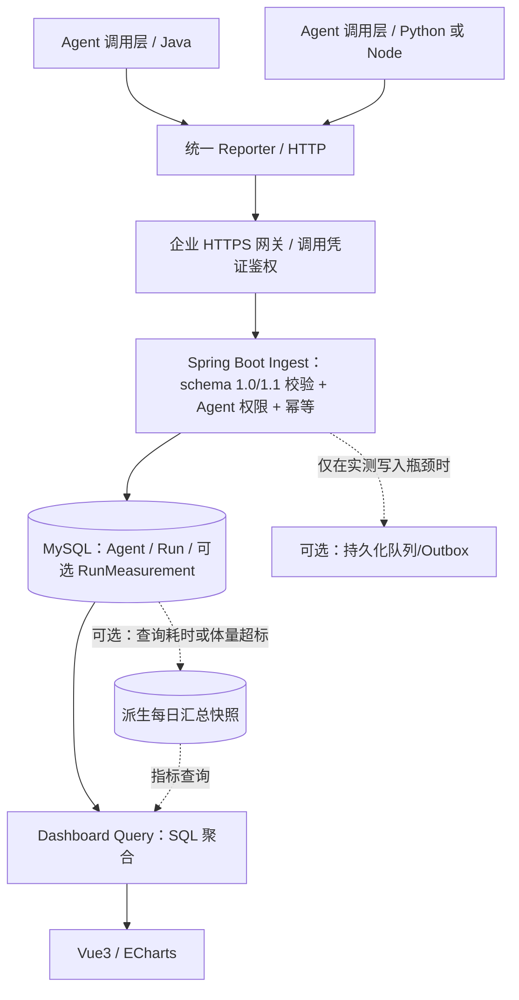

# 20｜MVP 方案深化：性能、可扩展性、可迁移性（设计建议）

> **2026-10-12 S12 方案 B 最新已确认（优先于下文所有历史性能建议）**：本期只允许**在设计中预留**未来索引/分页、缓存/预聚合、异步 MQ、数据库与模型提供商迁移的扩展点和待证实的触发条件；**不代表任何下述表结构、队列、预聚合表、索引、缓存、压测 SLA 或迁移步骤已获批准**。不得超出 Agent 登记→Run 上报→看板最小闭环、S09 A 不启用通用扩展指标、S11 B 功能权限分层且实际数据授权待议。触发需证明真实负载/瓶颈和一致性验收需求；具体工具/阈值/实现另议。


> **2026-10-12 S09 最新已确认决议（方案 A，优先于本文历史候选设计）**：当前 MVP **不启用动态 `measurements`、通用自定义 KPI 上报/展示/公式、场景绑定、指标注册中心或扩展数据管道**。本文有关场景自定义 measurements、10 项限制、422 返回码、`dw_run_measurement` 表、扩展字段及 UI/聚合的设计**均仅为历史未批准候选，不得实施或作为验收要求**；五场景页 D01–D11 已按 A10 取消。以后若有确切 Agent 业务指标须按指标单独确认业务事实粒度、来源、单位、公式与分子分母、去重、窗口、缺失、权限审计与开发范围，再另行审批协议与实现。**S08/S07/S06 A、S05 精简版 D 及此前全部决议不变**，S10 质量与审计标准待确认。

> **状态：2026-10-10 建议设计，不等于已经实测、实施或批准。** 产品范围依然只有 **Agent 登记 → Agent 调用处标准上报 → 看板展示**；首期不建设通用 Agent 编排/Connector 平台、业务结果对账、复杂工单或财务核算系统。
>
> 依据：[19 原型全指标审计](19-prototype-metrics-coverage-audit.md)；原始上报 v1.0 [18](18-agent-run-reporting-standard.md)；扩展协议 **[OpenAPI v1.1 草案](../openapi/agent-run-reporting-v1.1-draft.json)**；[17 当前 MVP](17-agent-log-dashboard-mvp.md)。v1.1 是**设计草案**，不能当已上线标准。

## 1. 架构决策：先最小化部署单元，再保持清晰边界



**推荐首期单体部署**：一个 Java/Spring Boot API + MySQL（以及已有企业网关/认证）；内部代码清楚分成四块：`agent-catalog`、`run-ingest`、`run-query`、`metric-policy`。不是四个微服务；这些只是包/模块责任。

### 分层协议

1. **Agent 登记层**：稳定 `agent_code`、平台、环境、版本、部门、Owner、场景等配置，只登记一次，不在每条 Run 重传。
2. **Run 上报层**：一次真实技术执行的事实快照。v1.0 包含身份、状态、耗时、Token；v1.1 草案**可选**操作类型/安全摘要、人工介入、费用与来源、扩展数值。
3. **统计/规则层**：真实 Run 聚合；以已登记的规则/基线做**明确标“估算”**的工时或费用分析。不可从 Run success 直接声称业务完成或实际释放人力。
4. **看板层**：保留原型布局；正式数据展示时间范围、数据截止时间、来源/核验等级。Demo 假数据与生产事实物理或逻辑隔离。

**不建议**：一个大号 JSON 日志里塞 Prompt、所有 tool call、业务单据、Agent 配置与 KPI；这既影响入站吞吐，也破坏脱敏和跨平台迁移。

## 2. 指标覆盖与数据责任：原型逐类落地

| 原型模块 | 核心数据来源 | v1.1 草案字段/规则 | 正式标签或约束 |
| --- | --- | --- | --- |
| 集团/部门已登记 Agent 数 | `dw_agent` | 业务元数据：platform / department / owner / environment / version / enabled | **登记数**不是在线 Agent 数 |
| 当日/累计执行、月度执行趋势、最近活跃 | `dw_agent_run` | `agent_code, run_id, status, started_at, finished_at` | **Agent Run 次数**，重试为新 Run |
| 自动化/执行成功率 | 终态 Run | `SUCCEEDED / (SUCCEEDED + FAILED)` | **技术成功率**；无分母返回 null |
| 最近执行动态、执行流水 | Run | **可选 `summary`、`operation_type`** + 时间/状态/耗时 | summary 必须是脱敏摘要，不是原始 Prompt |
| 人工介入次数/率 | Run | 可选 `manual_intervention_count`，缺失表示**未知** | 介入 Run 比率 = count(明确介入次数>0) / count(明确填报了介入字段且符合窗口条件的终态 Run)。另显示**上报覆盖率**，不能把未知当 0 |
| 单均成本、当日/每月成本 | 有据可查的费用来源 | 可选 `cost.amount/currency/quality/source/basis_id` | BILLED vs ESTIMATED **分列**；不跨币种混求和 |
| 累计/每月节省工时、场景效能排行 | **Agent 或操作类型的基线配置** + 人工实际参与时间（如有） | `operation_type` + `manual_handling_ms` + 人工基线配置版本 | **仅展示“估算工时”**；没有可用基线或必要数据时显示“不可计算”，不得假定 0 |
| 五场景今日执行与最近时间 | Agent↔场景/操作映射 | `operation_type` + Run | “今日巡检/报告数”等是否能以 Run 计必须先定粒度 |
| 五场景专项计量（报告数、巡检数、分子/分母） | 调用方若确实采到 | **可选 `measurements[]`**，必须预登记名称/单位/聚合策略 | 不自动将任务成功推导为业务回执或异常闭环 |
| 异常事件、重试/恢复 | FAILED Run + 可选 `correlation_id` | 失败次数可以直接算；相同 correlation_id 的重试仅能描述**技术重试** | 不把“先失败后成功”直接显示成**告警已处置/业务恢复** |
| 工作流文件、告警处理/忽略 | 非 Run 数据 | 原型 UI-F0 本地预览/演示操作 | 正式 MVP 不提供源业务工单与文件治理 |

### 工时估算必要前提

- `estimated_saved_minutes` **不由 Agent 随意自报为“已验证收益”**。首期如要保留，可在 Agent 配置（或操作类型）里维护 `baseline_minutes`（原人工处理时长）与 `basis_id/version`（依据/核验人），每次有效 Run 只给出估算。
- 推荐仅将**明确适用一次 Run 对应一次人工处理单位**、且完成终态符合规则的执行纳入；否则须先有 `measurements` 的产出数量和业务规则，不能把“巡检 12 项”当“一次巡检”估算。
- `baseline_minutes - observed_manual_handling_minutes` 只是**预估净节省**（人工作业口径），允许负数揭示负效能；若人工处理时长未知，不能静默按 0 算。另需认识技术 SUCCEEDED 不能独立证明最终业务成功，因此默认标签为“潜在/估算节省”，不是经过财务认可的真实收益。
- 标准化保存**规则版本、生效时间、适用操作、结果质量**，防止修改历史基线时让旧月份悄悄改变；首期可以简单一张 baseline 配置表，后续再扩展。

### 成本口径

- `cost.amount` 使用**十进制字符串**，服务端存 `DECIMAL(18,6)` 或与实际费用精度相适配类型；永远不使用二进制 float 计算人民币总额。
- `quality=BILLED` 必须有明确的供应商计费记录依据；未结算的 Token × 计价版本只能是 `ESTIMATED`，要带 `basis_id`；若缺失只显示“未上报成本”。
- 汇总时按照 `currency + quality` 分组；不把 CNY 与 USD 相加；不把“预计费用”和“已出账费用”直接合为“真实成本”。
- 同一次 Run 只统计一次费用；若以后账单回补/更正需要独立费用校正机制，不准悄悄覆盖已核对费用。首期不建财务对账。

### 历史未批准草案：场景自定义 `measurements`（S09 A 明确不纳入 MVP）

v1.1 草案允许最多 **10** 个 `{code, value, unit, quality, basis_id?}`，例如 `reports_generated=1 REPORT`、`stores_inspected=12 STORE`。这是**可选扩展位**而不是要求所有 Agent 填报。

- `code` 必须在该 Agent 或其操作类型的**受控指标字典中登记**，包括单位、计算模式（求和/次数/比值分子或分母）、是否允许负值、数据来源与敏感等级。
- 首期只需要**计数求和**；覆盖率/闭环率等比值必须有明确 numerator/denominator、同粒度和同时间窗的指标定义。**绝不对各 Run 百分比取简单平均**来计算总体覆盖率。
- 同一 Run 内重复 `code` 判为请求非法，不能重复记；未定义/冲突单位应拒绝该扩展或整单返回字段错误（需在后端契约测试中统一为 422）。
- `SOURCE_REPORTED` 只表示**调用方声明的值**，不是已经被原业务系统独立验证。

## 3. 性能：先用一个轻量写链路

### 3.1 写路径（P0 必要）

```text
POST JSON ≤16KiB
  → 鉴权 / Agent 授权与环境
  → schema_version 严格校验（v1.0/v1.1 分别校验）
  → 脱敏 / 字段长度/安全校验
  → 数据库唯一约束和事务性 INSERT 或有条件 UPDATE
  → commit
  → 200 + CREATED/UPDATED/DUPLICATE/IGNORED_STALE
```

- `UNIQUE(agent_id, source_run_id)` 是不可妥协的幂等基础。同一 Run 的重复 HTTP 投递和数据库并发入站只产生一条事实。
- **200 在提交之后返回**；不要“收到 HTTP 就 200，异步线程还没写入”导致静默丢数。
- `RUNNING → 终态` 可更新；终态同状态的**完全相同事实**返回 DUPLICATE；冲突终态/改变 `started_at` 返回 409。
- **v1.1 可选信息丰富化**：同一 Run 如果已有终态，允许仅对**原先为空的可选字段**做单调补充，返回 UPDATED；已存在字段值不允许静默覆盖，冲突返回 409。特别是已账单费用的更正应交由显式版本化机制，而不是普通重复 POST。上报方最好在首次终态就给齐已知字段，减少额外写入。
- API 不同步调用大模型、业务系统，不生成工时财务报表，不实时更新多张聚合表；入站目标只做有界验证和持久化。
- 大 JSON、原始上下文、图片/PDF、动态无限标签禁止进入采集协议。异常消息在调用侧和服务器双重脱敏。

### 3.2 读路径

| 指标/功能 | 首期实现 | 证明确有瓶颈后 |
| --- | --- | --- |
| Agent 详情最近 50 条 Run | `(agent_id, started_at DESC, id)` 索引 + 基于游标分页 | 冷热数据归档；需要全文搜索才评估检索系统 |
| 当日累计和成功率 | 单库条件聚合，按时间窗和部门授权过滤 | 按日/Agent 的派生聚合表，补偿重算 |
| 月度趋势及 Top 8 | SQL GROUP BY（使用业务时区边界换算后查询） | 预聚合明细，按日汇总至月 |
| 最近实时执行 Feed | 页面可见时 **15–30 秒**轮询，显示数据截至时间 | 确有需求再使用 SSE；不引入高频全量轮询 |
| 仪表盘切换筛选 | 异步取消旧请求、稳定查询参数、服务端分页 | 只缓存**同一授权范围**下的摘要，不缓存敏感明细到公共边缘 |
| 成本/工时聚合 | 能算则按质量与配置版本聚合 | 仅预聚合可重算的派生指标，规则变化可有版本回溯 |

**不建议起步就开启 MySQL 分区表**：MySQL 分区表的唯一索引与分区字段存在约束，可能破坏 `(agent_id, source_run_id)` 唯一性的简洁实现。先建合理索引和归档，之后按实测选择冷热分表/分库，且始终保持全局幂等键处理。

### 3.3 压测/容量设计（以下均为**建议测试档位，不是已测吞吐或 SLO**）

| 情境 | 试验设置 | 主要观察 |
| --- | --- | --- |
| 基础规模 | 10 req/s，混合新 Run/重复/终态更新 | 端到端延迟、DB 锁和写放大 |
| 增长规模 | 100 req/s，叠加一个管理层大屏的查询 | 写接口 P95/P99、慢 SQL、索引命中、DB CPU |
| 峰值/批量补报 | 500 req/s 短时，包含相同 Run 反复重试 | 限流保护、连接池、拒绝比例、队列/客户端重试健康 |
| 数据增长 | 100 万 Run 的**合成数据**（未实际创建） | 7/30/90 天检索、聚合、冷热策略与 DB 空间 |

**建议首期参考目标，须以压测后调整**：在经确认的正常峰值（例如实测可支持的 100 req/s 档）下，写接口 P95 目标 ≤200ms、看板预聚合查询 P95 ≤1s、前端轮询间隔 15–30s；它们**不是现成系统已达到的性能数据**。如果实际负载远小于此，不需要为这些阈值预装队列/OLAP。

### 3.4 数据量与保留

- 容量公式：`每日存储增长 ≈ 每日 Run 数 × (Run 平均字节数 + 索引/行开销) + 测量明细开销`。平均字节数应从真实（已脱敏）数据采样，不能把 1KB 当实测平均。
- 优先保留统计明细查询所需热数据；建议初步评估**90 天 Run 热明细、12 个月聚合**，最终周期由公司数据规范决定，不是已确认策略。
- 时间戳以 UTC 写入、查询时依 `Asia/Shanghai` 或明确筛选时区计算日边界，避免跨日 Run 分类错误。
- Run 过期归档前确认数据处理、历史聚合重算需求和合规删除策略；访问/上报凭证不进入任何数据导出。

## 4. 可扩展性：按瓶颈演进，而不是按技术热度扩容

### 4.1 写压力上升时

**阶段 0**：各 Agent 调用层独立有界异步上报；服务端同步鉴权/落 MySQL 后 200；MySQL 有事务与唯一索引。

**阶段 1**：当多实例/数据库写冲突上升，增加 Ingest 实例、连接池控制和每 Agent/调用方限流。**水平扩容不能依赖进程内的去重 Map**，数据库唯一约束必须仍然生效。

**阶段 2**：仅当上游突发量超出数据库承载或需要更强保留保证时，增加**持久化** Kafka/队列或 Outbox：收到数据先可靠入队后才 ACK（如协议改为 202 必须明确意味着已可靠入队而非已进 Run 表），消费者幂等投影；看板按水位展示延迟。引入此方案时需要重新审查 200/202 语义，不得默默改变现有上报 ACK 保证。

### 4.2 分析规模上升时

- 查询越来越慢：先加索引和**可重算的每日汇总表**，避免额外引擎。
- 员工/Run 数量巨大：先归档/冷热拆分，必要时将聚合复制到 Doris 等分析数据库；OLAP **只是派生查询副本**，源事实和幂等语义不随迁移丢失。
- **历史可扩展性候选，非当前需求**：未来若另行批准专项 KPI，再独立审批受控编码、单位、计算和新版本协议；S09 A 下不得把现有 `measurements[]` 草案自动用于生产。
- 需要更完整的 Trace：Run 只留 `trace_id` 与短错误摘要；通过既有追踪系统跳转，不复制每一步的 Prompt/工具负载。
- 成本补账与真实节省工时验证属于**新需求范围**，不作为 KPI 自定义扩展的隐藏实现任务。

### 4.3 数据一致性原则

- **原始 Run 是事实源，日汇总是派生物**；重复/迟到/状态更新可以触发指定日期/Agent 粒度重新汇总，不能无限次简单 `counter++`。
- 单个 Run 如果先报 RUNNING、后报 SUCCEEDED，启动次数仍 1；终态成功数从 0→1；跨日运行分别按 `started_at` 和 `finished_at` 统计，避免负差。
- 告警不能直接等于 FAILED Run 的数量；自动恢复/待处理需要可核对的独立状态，不然正式版只显示“失败运行”。
- 接入完整性缺口是系统自己的监控重点：`ingest_accepted`、`ingest_rejected`、`ingest_duplicate`、`ingest_p95_latency`、每 Agent 最后事件水位、调用方上报队列丢弃/失败次数。看板**无新日志不代表 Agent 离线**。

## 5. 可迁移性：同时考虑 Agent 平台、语言、数据库和环境

| 迁移对象 | 核心做法 | 避免的耦合 |
| --- | --- | --- |
| 百炼 → 自研 / Dify / 其他平台 | Reporter 只依赖标准 HTTP + JSON + agent_code/run_id；各平台在调用层完成 ID、状态、usage 映射 | 生产数据库字段绑死百炼特有枚举和 Prompt 结构 |
| Java → Python / Node / Rust | 用 OpenAPI JSON Schema 作为单一源，提供语言无关示例和合同测试 | 依赖 Spring 专用拦截器/Java 序列化类型作为跨语言协议 |
| MySQL → PostgreSQL | 使用应用层生成的稳定 ID、UTC 时间、DECIMAL、标准化表和受控索引；通过版本化迁移 SQL/Flyway 管理差异 | 把业务定义塞进某种数据库 JSON 方言、存储过程、分区规则 |
| 单机 → K8s 多副本 | Stateless API、凭证在 Secret、连接池限制、健康检查与必要的基础遥测 | 进程内唯一状态/本地文件/只存在 Pod 内存的业务明细 |
| 生产环境迁移 | 平台/环境命名空间和 Agent 编码分开，环境来源由鉴权映射；上报地址配置化，传输 TLS | 客户端写死生产 URL/Token 或把测试数据混生产 |
| OLTP → 分析副本 | Run/Measurement 真值可导出、按时间/Agent 重建聚合；快照有 source/version/watermark | 只保留 Redis 计数器、无可回放事实 |

### 最小可移植数据模型

```text
dw_agent                      -- Agent 登记元数据，新增 agent_code 唯一键
dw_agent_run                  -- Run 事实，一 Agent + source_run_id 唯一
dw_run_measurement (optional) -- v1.1 measurements 的受控指标明细
dw_metric_definition (optional) -- 允许的自定义计量 code/单位/聚合规则
dw_agent_baseline (optional)  -- 经认可的人工基线与版本（仅启用工时估算时）
dw_metric_daily (later)       -- 可重建聚合，不是事实源
```

注意：**首期最少两张表** `dw_agent` / `dw_agent_run` 即可完成 Run 指标。其他表按指标真正启用时增加，避免创建大量空表“为未来预留”。

不依赖数据库 JSON 字段即可实现核心 Run 统计。额外 `measurements[]` 如果要做 SQL 分组与比较，建议规范化存成 `dw_run_measurement`，不要永久只塞 MySQL JSON 并在前端遍历算汇总。

### 契约兼容与版本规则

- **v1.0 原封不动**，原 [OpenAPI v1](../openapi/agent-run-reporting-v1.json) 继续有效。
- **v1.1 仅为草案**，复用同一 `POST /api/v1/ingest/agent-runs` URL，以 `schema_version` 区分 v1.0 或 v1.1 的**严格 JSON Schema**；v1.0 `additionalProperties:false`，直接塞新字段到 v1.0 会收到 422。
- v1.1 **不增加 v1 原有字段的必填要求**；只增加可选 `operation_type, summary, manual_intervention_count, manual_handling_ms, correlation_id, cost, measurements`。
- 服务端先部署可识别两版本的接入实现，完成旧样例回归后，新客户端才能发送 1.1；老客户端不用升级。
- 破坏性字段名或语义变更必须走 v2，不能在 v1.1 悄悄重定义 `run_id`、时间和成功率分母。
- 用**合同回归用例**验证老 v1、v1.1、状态机、幂等、签名/鉴权、币种/数据质量、场景计量、非法高基数字段和并发上报。
- 若跨语言生产者无法自动生成时间戳 RFC3339，必须在各客户端适配层规范化，不通过服务端猜测其时区。

## 6. 最小上线门槛（建议验收表）

| 类别 | 建议验收 | 影响 |
| --- | --- | --- |
| **功能覆盖** | Agent 基础信息、Run 总量/成功率/耗时/月趋势/最近摘要，覆盖真实 Agent 数据 | 与原型的大部分执行类 KPI 对齐 |
| **费用质量** | 成本来源、币种、quality 分组；未提供账单/定价基线时不显示确定金额 | 避免模拟 ¥308 成为经营事实 |
| **人力效能** | 仅在人工基线与参与时长有可信来源时显示估算工时；不准把模型耗时当人工节约 | 避免不可验证绩效 |
| **写入幂等** | 多线程重复同 Run，数据库只留 1 条；乱序/终态冲突不覆盖事实 | 可扩容 |
| **协议演进** | v1.0 客户端继续可投递；1.1 新字段有独立校验；新 Agent 平台可按协议适配 | 可迁移 |
| **请求性能** | 以实测峰值进行混合读写压测；不在无压测时宣称满足 P95 目标 | 可运营 |
| **故障策略** | 看板故障不阻断业务；客户端丢弃/失败计数可观察；如要求零丢失要明示增加持久化缓冲 | 数据可信 |
| **安全** | 凭证仅在服务端、Agent 权限范围校验、摘要脱敏、body 限流和大小约束 | 可安全接入 |
| **看板口径** | 不把失败=告警已处理、不把 Agent success=业务已完成、不把未知成本/人工介入当零 | 可信展示 |

## 7. 需要未来实测/业务确认的部分

1. 第一批 Agent 的**实际峰值 Run/s、日志大小、终态迟到率**和真实保留期限，以决定要不要异步队列、预聚合或归档。
2. 原型中的成本、人工介入与节省工时，分别由谁提供依据；没有基线时应保留原型位置并显示不可用/切换为可测技术指标。
3. 场景专项 `measurements` 的单位、口径与受控指标编码；例如“今日巡检”究竟表示 Run 次数、门店数还是指标条数。
4. 是否要求在技术上**不丢任何一条**上报：仅靠有界内存队列+有限重试不能做到零丢失；要加强就增加调用侧持久化暂存/可靠消息和服务端 durable ACK。

**推荐的建设顺序**：现有 **v1.0 稳定接收** → v1.1 安全摘要/操作类型/人工介入的可选字段 → 在来源具备时启用成本和受控专项指标 → 按实测瓶颈补日聚合/可靠缓冲。**不要一次把全部 P1 扩展做完才上线**。

## S10 质量与审计共用标准（2026-10-12 · 方案 A 已确认）

- [x] **S10 质量与审计共用标准 · 方案 A 已确认（2026-10-12）**：MVP 在此前每个指标已批准的真实来源、唯一性、统计语义与权限内，实行**最小必要来源/时间/口径版本证据、可追溯的必要变更/冲突核查与关键回归验收原则**；同指标仅在过滤、授权环境和部门/Agent、时间窗、指标版本及可比水位条件相同的情况下核对。验收方向覆盖 Run HTTP 重传与状态变化幂等、费用首次存储锁定/冲突、缺失/真零、估算来源、权限脱敏、Demo/正式隔离。**S09/S08/S07/S06 A、S05 精简 D、S01–S04 A、F11 B 及全部既定决议不变**。**未决**：证据字段/来源责任、覆盖率和分母、`received_at`/`as_of`/`data_quality`、接收 ACK/持久化、审计主体/操作/留存、唯一键/迁移、迟到补报与历史重算/冻结、权限/脱敏、具体验收及性能。不建全局评分或质量/审计管理平台，不因此增加上报字段、SQL/API/Schema、严格 v1/v1.1、原型改动或上线；**下一项 S11 安全与权限共用标准**。
- [ ] 后续逐项批准审计持久化位置/保留期、幂等索引和唯一键、晚到补报历史冻结/重算、性能与查询水位、正式验收的测试规模。不得把本文历史候选审计表、可选 `measurements` 或扩展字段改写为必建范围。

## S11 安全与权限共用标准（2026-10-12 · 方案 B 已确认）

- [x] **S11 安全与权限共用标准 · 方案 B 已确认（2026-10-12）**：首期优先从**登记维护、看板查看、调用侧 Run 上报**三类功能权限区别角色及操作，读/写/报送不自动互通；**这不是具体人员/角色授权表**。Agent/部门/集团、生产/测试环境和停用/归档历史的数据过滤、字段级脱敏及权限继承均要再议；不能把登录成功或拥有查看页面权限误认为集团全量数据可见。沿用禁止原始 Prompt、密钥和客户隐私进入可见日志、真实摘要及错误内容安全脱敏、Demo/正式隔离和 E07 正式只读等既定原则。**S10/S09/S08/S07/S06 A、S05 精简 D 及全部此前决议不变**。
- [ ] **继续待议**：具体角色/身份源/组织同步、登记 CRUD、上报凭证和 Agent 身份绑定、部门/Agent/环境授权数据范围、停用归档历史可见性、敏感字段与附件鉴权、审计日志范围与留存、回归验收、兼容性及性能。**仅确认产品功能分层方向，不批准集团默认全可见、复杂 IAM/RBAC/ABAC 平台、SQL/API/Schema、Run 严格 v1/v1.1 修改、原型或上线**；下一项 S12 性能与迁移共用标准。

**可扩展性边界**：未来性能/缓存/预聚合/迁移方案不能偷偷绕过授权数据范围或将旧权限复用到新环境；S11 尚未批准具体行级过滤和跨环境访问方式。S12 讨论性能迁移时仍不得降低安全边界。

## S12 性能与迁移共用标准 · 方案 B 已确认（2026-10-12）

- [x] **S12 性能与迁移共用标准 · 方案 B 已确认（2026-10-12）**：MVP **仅在架构设计中预留后续增长的轻量扩展点**，记录索引/分页及查询优化、缓存/预聚合、异步处理/MQ、数据库迁移/兼容的候选接入位置与需有真实规模或性能证据才重新评审的触发条件；**不因本轮选择就实施**新缓存、MQ、预聚合、复杂分区/分片、多存储/仓库、迁移工具或通用指标平台。首期仍是已批准的 Agent 登记→真实 Run 上报→看板；所有优化/迁移须保护唯一 Run、状态时间窗、首次模型 ESTIMATED 金额及原币种、缺失/真实零、权限过滤和审计/可比对账，不得改变既有 KPI 口径。**S11 B、S10/S09/S08/S07/S06 A、S05 精简版 D、S01–S04 A、F11 B 及全部此前决议不变**。
- [ ] **继续待议**：Run 每日/峰值规模、吞吐量/并发/延迟与 P95/P99、数据保留、可靠接收 ACK/事务持久化、唯一身份/幂等及迁移、索引分页、缓存/预聚合/MQ 触发条件和查询水位、迟到补报/冻结与历史重算、成本质量、环境/部门/Agent/归档权限和 Demo 隔离、压测样本/验收与故障恢复。**仅产品方向已确认，非开发完成/性能达标**；不批准 SLA 数字、任何具体 SQL/API/Schema、Run v1/v1.1、更换数据库或部署上线。下一项 **I01 技术 Run 唯一身份与幂等判定（实施细则）待选**。

**仅设计预留的候选清单（均非已批准建设项）**

| 候选方向 | 何时考虑复议 | 当前状态 |
| --- | --- | --- |
| 索引与分页 | 真实查询负载、数据量及慢查询证据明确时 | 预留，不批准具体索引/分页实现 |
| 缓存与预聚合 | 统计查询瓶颈经过实测、可以定义一致性/水位测试时 | 预留，不批准缓存或预聚合表 |
| MQ/异步缓冲 | 写入峰值/持久化与可靠性问题有证据及事务语义时 | 预留，不批准消息系统 |
| 数据库/部署迁移 | 业务或运维实际需要，兼容性/唯一性/权限与回滚方案已审时 | 预留，不批准迁移工具/实施 |

**后续决议顺序**：先议 I01 Run 唯一身份，再逐项确认数据规模、事务/ACK、查询及数据水位、归档/迁移等，未通过审批不自动进入开发 Issue。

## I01 技术 Run 唯一身份与幂等判定 · 方案 A（2026-10-12）

- [x] **I01 技术 Run 唯一身份与幂等判定 · 方案 A 已确认（2026-10-12）**：真实独立 Agent 技术执行使用调用方生成/复用的**稳定 `run_id`**；同次执行 HTTP 失败重发、重复消息及 RUNNING→终态上报复用同一 `run_id`，服务端依据**可信上报身份+已登记 Agent 映射**识别实际 Agent 后对同一真实 Run 做幂等更新，不因状态变动/重复 HTTP 增加执行数。真实重新执行/跨 Run 重试须使用新的 `run_id`，**同一个 `correlation_id` 不自动合并技术 Run 或生成业务 Task**。与现行严格 v1 的 `agent_code`/`run_id` 和候选内部 `source_run_id` 映射方向兼容；不新增第二套必填 Run 身份或业务关联平台。B03-P0-07 B 的首次迟到模型估算费用允许补入、首次成功保存后普通重报锁定、金额冲突不覆盖，以及 S12/S11 B、S10/S09/S08/S07/S06 A、S05 精简版 D 和此前全部决议不变。
- [ ] **I01 仍待议**：`run_id` 的既有 v1 格式对未来版本/历史兼容的规则、Agent/平台/租户/环境可信映射、唯一作用域及物理复合键/索引、并发重传/乱序状态/终态冲突、Run 执行与跨 Run 重试的边界及冲突、费用首次存额原子性、ACK/事务持久化与 `received_at`、无 ID 历史 Run 迁移、归档权限/脱敏、核查测试和性能。**仅产品身份路线已确认，不批准任何具体 SQL/API/Schema、严格 v1/v1.1 修改、自动历史合并、额外权限或上线；[x] 不是研发完成**。下一项 **I02 Agent/环境身份映射与 Run 唯一作用域待选**。

**性能和迁移边界**：未来索引/缓存/MQ/迁移扩展点须以可信 Agent 身份和稳定外部 `run_id` 保证同 Run 幂等；具体联合唯一索引和分区跨环境迁移规则须待 I02 以及性能细则确认。不得把本文件历史 `UNIQUE(agent_id, source_run_id)` 样例解释为本轮已批准物理 SQL。

## I02 Agent/环境身份映射与 Run 唯一作用域 · 方案 A（2026-10-12）

- [x] **I02 Agent/环境身份映射与 Run 唯一作用域 · 方案 A 已确认（2026-10-12）**：逻辑上以服务端**经可信上报身份、已登记 `agent_code` 和实际授权的环境/资产关联确定的稳定 Agent 身份**，结合调用方同次执行稳定 `run_id`，来认定唯一技术 Run；相同可信 Agent + Run ID 的重复请求/状态更新属于同一技术 Run，不同真实 Agent 即使复用相同字符串 `run_id` 也不得错误合并。环境、租户、平台身份依据可信的授权与 Agent 资产映射解释，不信任客户端自行自报越权 Agent/环境，也**不自动让同名 Agent 在跨环境/平台时共享内部 `agent_id`**。严格 v1 请求 `agent_code` + `run_id` 与设计中的 `source_run_id` 映射方向保留；不要求新增全局 Run ID、双层强制 ID 或业务 Task 关联。**I01 A、S12/S11 B、S10/S09/S08/S07/S06 A、S05 精简 D、S01–S04 A、F11 B、B03-P0-07 B 及此前全部决议不变**。
- [ ] **I02 未决**：`agent_code`/Token/平台注册与环境授权映射、Agent 资产跨环境/租户/平台的逻辑连续性和更名/停用归档、Run ID 已有 v1 约束及新版本兼容、实际复合唯一键/索引是否含环境或租户、同 ID 并发重复及乱序/终态冲突、费用首次保存原子性、ACK/事务持久化、旧数据迁移/修正、权限脱敏/审计、性能与回归验收。**[x] 仅确认产品逻辑身份方向，不表示研发完成；不批准 SQL/API/Schema、严格 Run v1/v1.1 修改、历史自动合并或生产部署**。下一项 **I03 同 Run 并发重传与状态冲突裁决待选**。

**迁移注意**：逻辑身份与物理 SQL/索引方案分开；不同真实 Agent 身份不能因 `run_id` 碰撞被合并，也不得迁移后默认让跨环境的同名资产成为同一 Agent。任何缓存、分区或历史迁移需要先批准身份映射与环境/租户范围及回归检查，S12 B 的性能扩展仅设计预留。

## I03 同 Run 并发重传与状态冲突裁决 · 方案 A（2026-10-12）

- [x] **I03 同 Run 并发重传与状态冲突裁决 · 方案 A 已确认（2026-10-12）**：依 I01 A 的调用方稳定 `run_id` 与 I02 A 的可信登记 Agent+Run ID 逻辑身份，同 Run 的**一致重发、HTTP 重试/重复消息不增加真实技术 Run、重复费用或计次**；允许沿用现有严格 Run v1 合法 `RUNNING`→可信终态方向更新**同一 Run**，已形成可信终态不因迟到的 `RUNNING` 或“最后到达就覆盖”而倒退。不同终态或 `started_at`/`finished_at` 等矛盾事实**不得静默覆盖已可信记录**，需要保留必要可核查的冲突证据并待专项裁决；并发重传应保证不双计和可核查一致性，**不因此新增人工工单平台**。B03-P0-07 B 允许首次缺费后来补入、首次成功保存后普通重报锁定模型 ESTIMATED 金额及冲突不覆盖不变。**I02/I01 A、S12/S11 B、S10/S09/S08/S07/S06 A、S05 精简版 D、S01–S04 A、F11 B 和所有此前已批决议不变**。
- [ ] **I03 未决实施细则**：一致重传如何判等、并发事务/锁与物理复合唯一键、RUNNING/终态状态转换及过时/冲突响应、终态间冲突优先级、`started_at`/`finished_at` 不一致、费用首次保存原子性与迟到补报、服务端 `received_at`、ACK/持久化/具体错误码和重试、审计证据/日志留存、Agent/环境/部门权限、历史纠错和回归压测。**[x] 只表示产品方向批准，不是研发/验收完成；本轮不批准 SQL/API/Schema、额外事件序列、严格 Run v1/v1.1 变更、冲突处理平台或上线**；下一项 **I04 Run 接收持久化与 ACK/重试语义**。

**实现与迁移边界**：历史 SQL UNIQUE/ON CONFLICT、事务隔离、乐观/悲观锁及 MQ 等均是历史设计候选；I03 只决定**重复不双计、状态不倒退、冲突不静默覆盖**的可核查原则。任何并发技术、跨库修复或预聚合更新策略仍待专项批准，S12 B 仅保留扩展点。

## I04 Run 接收持久化与 ACK/重试语义 · 方案 B（2026-10-12）

- [x] **I04 Run 接收持久化与 ACK/重试语义 · 方案 B 已确认（2026-10-12）**：**只批准未来设计层区分两个不同接收确认语义**：`ACCEPTED`=已受理，不能推定真实 Run 已持久化；`PERSISTED`=达到后续需正式明确的可信持久化成功条件。**严格 Run v1 当前 HTTP `200` 仍代表既有持久化成功语义，不改成仅已受理，也不立刻新增双 ACK、202、查询/回调字段、状态机、队列或可靠暂存**。如未来采用异步/双阶段方案，须另行审批协议版本、可靠受理/落库证据、查询通知机制、调用方迁移与失败处理。保持 I01/I02 A 的可信 Agent + 稳定 `run_id` 同 Run 安全重传、I03 A 不增计/合法状态演进/冲突不静默覆盖和 B03-P0-07 B 首次费用迟到补报、首次成功保存锁定与冲突不覆盖。**`ACCEPTED` 不能冒充 E09/F11 最近成功接收或查询水位 `as_of`，`PERSISTED` 也不证明全部聚合已更新或 Agent 在线**。**I03/I02/I01 A、S12/S11 B、S10/S09/S08/S07/S06 A、S05 精简 D、S01–S04 A、F11 B 及此前所有已确认决议不变**。
- [ ] **I04 仍待议**：创建/幂等重报/合法状态更新及冲突的 ACK/具体 HTTP 码，两个阶段的实际实现与版本分发、受理与事务提交的精确关系和可恢复性、`received_at` 成功接收时间及 `as_of` 查询水位、5xx/429/网络超时与 `Retry-After` 有界退避、并发锁/唯一键、首笔模型费用原子性/冲突、持久化故障补偿、调用侧缓存/Outbox/MQ 是否必要、权限/环境隔离、审计范围和期限、协议兼容及回归压测。**[x] 仅批准产品设计方向，不表示已实现或通过测试**；不批准 SQL/API/Schema、新 ACK 字段、严格 v1/v1.1 修改、MQ/Outbox、恰好一次/零丢失/SLA 或上线。下一项 **I05 接收时间可信性与 `as_of` 统计水位边界待选**。

**架构审议提示**：将未来 `ACCEPTED` 受理、`PERSISTED` 确认设计为可区分的逻辑阶段，**并不自动批准可靠队列、Outbox、异步持久化、多存储方案、具体 HTTP 状态/查询回调、吞吐承诺或切换流程**；S12 B 仍只预留扩展点。若实施需证明已受理未落库期间的可靠性、重放/去重和一致性，并另批版本及工程。

## I05 接收时间可信性与 as_of 统计水位边界 · 方案 A（2026-10-12）

- [x] **I05 接收时间可信性与 `as_of` 统计水位边界 · 方案 A 已确认（2026-10-12）**：E09 A/F11 B 的**采集新鲜度**只能依靠服务端可信、可核查的**真实持久化成功接收或合法且成功持久化的状态/事实更新**的时间证据；仅有未来 I04 B 设计候选 `ACCEPTED` 已受理、拒绝/失败/未证实落库的请求、源端 Run `started_at`/`finished_at` 或浏览器/页面刷新时间均不能冒充成功接收。候选 `as_of` 的语义与接收时间**严格分离**：只有未来另批且可证明时才表示统计查询/快照**截至哪里**的水位，绝不自动等于 `received_at`，不得据此宣称聚合实时更新、数据完整/质量合格、系统健康或 Agent 在线。完全一致同 Run 重传是否刷新最近成功接收时间、首次落库/合法更新的服务端时点与字段归属仍**另议**，不得通过重试流量虚构活跃度。没有可靠来源时维持「未知／未接入／暂无可靠新鲜度数据」方向。现行严格 v1 HTTP `200` 持久化成功语义不变，I04 B `ACCEPTED`/`PERSISTED` 仅为未来双阶段设计方向；S03 事件时间窗口及 S01/S10 可比对账不变。**I04 B、I03/I02/I01 A、S12/S11 B、S10/S09/S08/S07/S06 A、S05 精简版 D、S01–S04 A、F11 B、E09 A 及全部此前已确认决议不变**。
- [ ] **I05 继续待议**：`received_at` 是否内部字段或查询响应字段及可信生成/持久化时点、首次持久化/合法状态更新/费用首次补入、同 Run 纯重复报文是否刷新新鲜度、`ACCEPTED`/`PERSISTED` 与事务 ACK 的可核验时间、候选 `as_of` 是否需要/如何反映统计查询、缓存/重算水位与覆盖、`data_quality` 字段、时区精度、迟到补报/历史冻结、权限环境和归档、低频 Agent、审计期限/脱敏、回归/性能验收。**[x] 仅批准证据语义，不代表实现/验收完成；不批准新 SQL/API/Schema、时间或质量字段、严格 Run v1/v1.1 更改、心跳/探活/健康页或上线**。下一项 **I06 同 Run 重传与合法更新的接收时间刷新规则待选**。

**缓存/迁移边界**：S12 B 仅预留可扩展点。今后如果采用缓存、预聚合、MQ 或存储迁移，接收成功与聚合可见范围的时间证据必须分开设计；I05 不批准缓存刷新算法、查询水位字段、队列或数据重算机制。


### I06 同 Run 重传与合法更新的接收时间刷新规则 · 方案 A（2026-10-12）

- [x] **I06 方案 A 已确认（2026-10-12）**：E09/F11「最近成功接收／采集新鲜度」只可由可信 Agent+稳定 Run ID 的**真实首次成功持久化**，或此后同一 Run **实际保存了合法且可信的新状态/新事实**的服务端可核查时间事实推进。完全一致、无实际事实变化的幂等 HTTP 重传/并发重复/相同终态再报**不刷新**该新鲜度，即使严格 Run v1 对成功幂等处理仍依既有契约返回 HTTP `200`。合法 `RUNNING`→真实终态且持久化的更新可推进；拒绝、失败、终态/事实冲突、被阻止的倒退、仅未来设计层 `ACCEPTED` 未证实持久化等均不能推进；同 Run 重报不得新增技术 Run 数或重复累计模型费用。**迟到首次模型 ESTIMATED 费用补入是否构成推进新鲜度的有效事实变化仍待 I07 单独批准**。新鲜度不与源端 `started_at`/`finished_at`、页面/请求时间或查询 `as_of` 同义，不证明聚合已更新、数据完整、在线或健康；无可靠证据显示未知／未接入。现行严格 Run v1 HTTP `200` 持久化成功语义和 I04 B 仅设计层 `ACCEPTED`/`PERSISTED` 不变。
- [ ] **I06 未批准细节**：首次保存/后续状态与新事实的内容判等、合法状态转换和终态冲突裁决；迟到首次模型费用及其他字段变化的资格（I07）；`received_at` 属于内部存储/响应的确切角色、是否需要独立首次/最近有效变更时间、服务端时间生成与事务提交和持久化 ACK 的一致性；同 Run 并发/重试、真实零与缺报、时间精度/时区、`as_of` 查询水位/缓存/迟到重算、`data_quality` 是否需要、Agent/部门/环境/停用归档的授权过滤、审计留存、性能、回归/迁移及协议兼容。**[x] 仅表示用户确认指标原则，非研发、测试或上线完成**；不批准新增字段/API/SQL/Schema、严格 Run v1/v1.1 更改、MQ/Outbox、探活/心跳或健康页面。

**历史决议保护**：I05 A、I04 B、I03/I02/I01 A、S12/S11 B、S10/S09/S08/S07/S06 A、S05 精简版 D、S01–S04 A、F11 B、E09 A、B03-P0-07 B 及全部此前已确认决议保持不变。

**性能/迁移边界**：今后回归需区分首次持久化、合法终态更新、相同幂等重传、冲突/未持久化和首次迟到模型费用补入；只有前两类已审批推动新鲜度，最后一类交 I07。缓存重建、迁移和重复报文处理不得把请求时间或聚合刷新时间伪装成可信有效接收，NFR/迁移指标和实现方案另审。

**下一项**：I07 有效事实变更与迟到首次模型费用补入资格，尚未确认。


### I07 有效事实变更与迟到首次模型费用补入资格 · 方案 A（2026-10-12）

- [x] **I07 有效事实变更与迟到首次模型费用补入资格 · 方案 A 已确认（2026-10-12）**：在 I06 A 的可信 Agent + 同一稳定 Run ID 下，真实首次成功持久化以及之后**合法、实际成功持久化的新状态/新事实**才有资格推进 E09 A/F11 B「最近成功接收／采集新鲜度」候选事实时间。具体而言，**同 Run 此前从未保存模型估算费用，后续第一次成功保存满足既有基础格式校验要求的调用方原币种 `ESTIMATED` 费用**，允许作为有明确「模型估算费用首次补入」语义的有效事实更新候选；此举仅证明调用方估算值已被保存，**不代表价格/Usage 已核验、BILLED 已结算、发生新 Run、技术状态改变或统计聚合与 `as_of` 已刷新**。相同已保存费用再报、相同 Run 其他无变化的幂等重传不刷新且不重复计费；已锁定金额不同值的冲突不得普通覆写、更不能以冲突推进新鲜度；拒绝/失败/只有未持久化 `ACCEPTED` 亦不可刷新。B03-P0-07 B 保持首次未报可迟到补入、首次成功保存金额锁定、金额冲突不覆盖；B03-P0-06 C 仅做基础格式校验，不能把格式通过当真实性或 KPI 质量准入；S05 精简 D 的**明确报 0 与未报/NULL 必须区分**。具体有效事实列表与判等、锁与事务提交时间、金额和币种校验、质量准入及展示实现继续待议。
- [ ] **仍待专项确认**：能够推动新鲜度的具体 Run/模型费用事实字段白名单、真实差异判等与状态/事实矛盾、未报/NULL 和明确真零及格式异常的边界、首次补入金额与币种/价目版本的来源证据、金额锁定及并发补入/事务原子性、历史终态 Run 费用首次补报、时间字段归属与服务端生成/持久化 ACK、独立首次/最近有效时间的必要性、权限/环境/部门/停用归档、统计日期与时区精度、迟到补报/冻结与历史重算、缓存/`as_of` 水位、`data_quality`、审计/日志与脱敏、严格 v1/v1.1 兼容、性能及回归测试具体用例。**[x] 只是产品资格原则已批准，非代码、测试或上线完成**；不授权新字段/SQL/API/Schema、成本验证或质量评分引擎、消息队列、双 ACK、改原型或上线。下一项 I08 有效事实差异判等与字段范围待选。

**既有决议全部保留**：I06/I05 A、I04 B、I03/I02/I01 A、S12/S11 B、S10/S09/S08/S07/S06 A、S05 精简版 D、S01–S04 A、F11 B、E09 A、B03-P0-07 B、B03-P0-06 C、B03-P0-11 原币种分组 A、S07 A 及此前全部已确认决定不变。

**后续验收方向**：回归需覆盖终态 Run 首次迟到补费（含明确报 0）、无费用与已报 0 区分、相同费用重复不刷新、冲突覆盖禁止、并发首存及统计缓存滞后；这些是待细化验收方向，未批准具体测试数据/断言/压测门槛、存储 Schema、迁移算法。

**下一项**：I08 有效事实差异判等与字段范围，尚未确认。

### I08 有效事实差异判等与字段范围 · 方案 A（2026-10-12）

- [x] **I08 有效事实差异判等与字段范围 · 方案 A 已确认（2026-10-12）**：E09/F11「最近成功接收」候选证据的推进应在**可信登记 Agent + 稳定 Run ID** 范围内，依**已批准事实在合法、实际成功持久化前后的语义差异**判定，不以 HTTP 新请求、请求时间、JSON 字段顺序/序列化格式、追踪信息变化或调用方未经核验的 `changed` 声明代替实际新事实。沿用既批的真实首次 Run 持久化、合法且实际持久化的状态/新事实更新以及 I07 A **同 Run 原先未报费用→首次真正保存有效基本格式、原币种模型 ESTIMATED 费用**；后者只证明调用方金额已保存，不是价格/Token 的准确性核验。重复状态/相同费用及纯幂等重发不能刷新；终态矛盾或已锁金额冲突不覆盖也不刷新；未报/NULL 与上报真实 0 不等同。**不因此批准其他 Run 可选技术字段自动准入为新鲜度刷新事实**，字段白名单、合法差异/归一化与裁决仍待专项。严格 Run v1 的 HTTP `200` 持久化成功语义、I04 B 仅设计层 `ACCEPTED`/`PERSISTED` 不变，不推导统计 `as_of`、Agent 在线/健康、业务成功或聚合实时更新。
- [ ] **实施细节待议**：实际参与新鲜度判等的字段白名单/排除清单（下一项 I09），值的有效变化/格式归一化和时间/数字比较、合法状态转移与终态冲突、`started_at`/`finished_at`/时长/Token/错误字段准入、价格版本/币种与金额锁定/真实 0、服务端持久化前后事实快照/并发/事务/ACK、`received_at` 的归属/生成点/精度、`as_of`/`data_quality`、授权环境/部门/Agent/归档、迟到补报与历史重算/冻结、权限脱敏、审计证据/留存、严格 v1/v1.1 兼容以及性能和回归验收。**[x] 只表示产品原则批准，未开发、未测试、未上线；不批准具体新字段、API/SQL/Schema、通用 diff/事件版本系统、上报协议改动、消息队列或健康状态**。

**已确认决议保护**：I07/I06/I05 A、I04 B、I03/I02/I01 A、S12/S11 B、S10/S09/S08/S07/S06 A、S05 精简版 D、S01–S04 A、F11 B/E09 A、B03-P0-07 B、B03-P0-06 C、S09 A 及此前全部已确认决议保持不变。

**未来可验证方向**：回归应区分报文语法变化与状态/首次费用真变更、并发相同 Run 多报、NULL 对真实 0、已锁费用冲突以及缓存水位延迟；测试样本、并发算法、性能阈值/迁移实现、字段比较规则全待审批。

**下一项待确认**：I09 新鲜度有效事实字段准入白名单与排除边界。

### I09 新鲜度有效事实字段准入白名单与排除边界 · 方案 A（2026-10-12）

- [x] **I09 新鲜度有效事实字段准入白名单与排除边界 · 方案 A 已确认（2026-10-12）**：E09 A/F11 B 的「最近成功接收／采集新鲜度」首期只接受既批的**三类可信持久化事实变化方向**：①可信登记 Agent+稳定 Run ID 的**首次真实 Run 持久化**；②同 Run **合法技术状态演进且成功持久化**；③此前未保存模型费用时，**首次真正成功保存符合既有基本格式校验要求的调用方原币种模型 ESTIMATED 费用**（含先前未报→真实上报 0，NULL/缺报不等于零）。同 Run 相同报文、无实际变化的状态/费用重传、字段顺序、仅请求/trace 时间变化、调用侧未经核实的 changed 信号不准刷新；非法倒退、终态或已锁金额冲突不得以普通重报静默覆盖或推进新鲜度。**其他可选技术事实**如 `started_at`/`finished_at` 迟到更正、duration、Token、错误摘要、价目依据/版本变化等**不会仅因数值不同自动获得刷新资格**，须逐字段复核真实来源、合法性、质量与兼容性后另批。首期准入是产品事实**类别**，不是已批准具体字段/实现白名单、数据变更规则或指标扩展平台；不能把费用补入当新 Run、BILLED 或将服务器接收事实等同于统计 `as_of`、在线/健康。现行严格 v1 `200` 仍是持久化成功，I04 B ACCEPTED/PERSISTED 只是未来设计。
- [ ] **未决实施细节继续待议**：三类事实与精确字段/API/存储字段映射及版本、RUNNING 与各终态的合法状态迁移和冲突（I10）、状态/其他字段比对和归一化、Token/时长/错误字段后续准入、费用真实零/NULL/原币种/首次保存锁定与缺失质量、源端事件与服务端时间生成/`received_at`/ACK、事务并发/唯一性、权限/环境/部门/归档、时区精度、`as_of`/`data_quality`、缓存、迟到与历史重算/冻结、审计脱敏/期限、兼容 v1/v1.1、回归和性能验收。**[x] 仅产品原则批准，不代表已实现、已测试或可上线**；不新增字段、SQL/API/Schema、新消息/变更事件系统、配置规则引擎、任意 KPI、健康/在线推断，也不擅自改原型。

**所有既有决议不变**：I08/I07/I06/I05 A、I04 B、I03/I02/I01 A、S12/S11 B、S10/S09/S08/S07/S06 A、S05 精简版 D、S01–S04 A、S09 A、F11 B/E09 A、B03-P0-07 B、B03-P0-06 C、B03-P0-11 A 及此前全部已确认决议。

**性能与迁移边界**：后续验证三类首期有效事实、重复/冲突/不相关可选字段变动、弱网/并发/缓存/迁移后一致性；压力负载、数据量、字段白名单、原子性实现与通过阈值尚未批准。

**下一项待确认**：I10 技术 Run 合法状态演进与终态冲突边界。

### I10 技术 Run 合法状态演进与终态冲突边界 · 方案 C（2026-10-12）

- [x] **I10 技术 Run 合法状态演进与终态冲突边界 · 方案 C 已确认（2026-10-12）**：同一可信已登记 Agent + 稳定 Run ID 的合法技术执行状态演进保留**严格 Run v1 可直接终态上报、RUNNING 非必经**和真实 RUNNING→合法终态成功持久化的既有产品方向。**普通幂等重报不得更改已真实持久化的终态**；相同已保存终态不新增 Run、不刷新 E09/F11；不同终态或终态倒退不能被普通报文静默覆盖、不能以冲突制造成功接收新鲜度。**为真正错误的终态预留未来明确授权、审批和可追溯审计的受控纠错例外方向**；本项不批准纠错 API、审批流程、角色、存储事件/版本、历史重算或真正修改终态的工程动作。终态后同 Run **以前未报模型 ESTIMATED 费用首次合法持久化**仍按 I07 A 成为独立于技术状态的新事实候选，不增加 Run、也不改变终态；B03-P0-07 B 首次保存金额锁定、冲突不普通覆盖继续。E09/F11 只沿用 I09 A 三类已批事实准入，严格 v1 HTTP 200 持久化成功以及 I04 B 仅将来设计 ACCEPTED/PERSISTED 的语义不变；接收时间不自动成为查询 as_of/在线健康。
- [ ] **待议实施细节**：具体 RUNNING/SUCCEEDED/FAILED/CANCELLED 状态及合法迁移枚举、终态冲突与迟到直报裁决/ACK/错误码、未来纠错的触发条件、申请人/审核授权和职责隔离（I11）、如何保存或引用原始终态与执行时间证据、是否引入版本或附加事实、终态后首次费用/金额锁定例外、成功率和趋势历史重算与缓存、时间生成点/received_at/as_of/data_quality、环境/部门/Agent/归档权限、审计留存/脱敏、事务并发与唯一键、严格 v1/v1.1 兼容、测试/压测、上线。**[x] 仅产品方向确认，不代表研发测试完成**；不批准新字段/API/SQL/Schema、审批/纠错工作流、健康心跳、生产改写或上线。

**历史确认保护**：I09/I08/I07/I06/I05 A、I04 B、I03/I02/I01 A、S12/S11 B、S10/S09/S08/S07/S06 A、S05 精简版 D、S01–S04 A、S09 A、F11 B/E09 A、B03-P0-07 B、B03-P0-06 C、B03-P0-11 A 以及此前全部确认决议不变。

**非功能验收方向**：未来应覆盖相同/不同终态重复、终态→RUNNING 倒退、直接终态 v1 兼容、终态后首次有效费用补入、并发终态冲突与失败重试；若将来独立批准纠错，再讨论事务、版本迁移、回放、审计、回归和压测门槛。

**下一项待确认**：I11 终态受控纠错的授权与审批边界。

### I11 终态受控纠错的授权与审批边界 · 方案 B（2026-10-12）

- [x] **I11 终态受控纠错的授权与审批边界 · 方案 B 已确认（2026-10-12）**：I10 C 未来如另批启用真实终态纠错，由**少数经独立明确授权的指定管理／运营负责人集中受理并审批**，要求有申请事由、明确审批决定、执行证据及可追溯审计。普通技术 Run 上报调用方/稳定 Agent 身份、Agent 负责人自由文本或任何普通重试不能自动获得纠错审批或执行权；普通同 Run 上报仍**不得覆盖可信已持久化终态**。本次仅确认未来审批治理方向，**不默认授予管理员超越数据范围的权限**，更没有批准纠错界面、角色枚举、审批流程、API、数据库修改、运行中修正或历史统计重算。申请人可否兼任审批人、少数负责人的角色/人数、最小权限、环境/部门/停用归档范围、撤回/驳回/紧急处理均需另议。I07 A 的终态后**同 Run 首次合法成功保存 ESTIMATED 费用**仍独立有效，B03-P0-07 B 首次费用保存锁定不变；纠错申请/审批并不推动 E09/F11 新鲜度、B02/C02/E01 技术成功率或统计 as_of。现行严格 Run v1 HTTP 200 的持久化成功、可直接终态上报及 I04 B 仅设计层 ACCEPTED/PERSISTED 继续保持。
- [ ] **具体实施仍待议**：申请人能否兼任审批、指定管理人资格/人数/权限来源与最小权限、跨部门环境 Agent/停用归档授权、谁执行、紧急和撤回/拒绝、原始终态和纠错证据关联（I12）、审计脱敏/防篡改和留存期、纠错成功生效/版本及 ACK、历史成功率/成本/趋势重算与 as_of、新鲜度、首次模型费用与价格锁定、Run 状态冲突和判等、事务并发、时间精度/时区/数据质量、严格 v1/v1.1 兼容、压测/回归/验收/上线。**[x] 是产品授权治理方向已确认，非代码、权限配置、审批工作流或验收完成；不批准新增字段、SQL/API/Schema、管理员越权、纠错自动执行或上线**。

**历史批准保持**：I10 C、I09/I08/I07/I06/I05 A、I04 B、I03/I02/I01 A、S12/S11 B、S10/S09/S08/S07/S06 A、S05 精简版 D、S01–S04 A、S09 A、F11 B/E09 A、B03-P0-07 B、B03-P0-06 C、B03-P0-11 A 及其他全部此前决议均不变。

**未来回归方向**：验证无授权普通 Agent 上报无法改终态，未来实际受控纠错若另批须核查集中授权、审批证据、竞态与回滚、原始证据可追溯和跨环境隔离。并无压测/回归标准或实现获批。

**下一项待确认**：I12 终态纠错原始证据保留与更正事实追溯边界。

### I12 终态纠错原始证据保留与更正事实追溯边界 · 方案 A（2026-10-12）

- [x] **I12 终态纠错原始证据保留与更正事实追溯边界 · 方案 A 已确认（2026-10-12）**：I10 C 只预留未来经过授权审批审计的终态受控纠错产品方向、I11 B 选少数独立授权的指定管理/运营负责人集中审批。在未来纠错**经另行批准并真实合法成功执行**的情况下，原始已持久化的技术 Run 终态、原始事件时间以及必要证据必须**持续可核查、可追溯**，不能被更正操作无痕覆盖、篡改或遗失；实际生效的更正事实应可解释地**关联同一可信登记 Agent + 稳定 Run ID 的原始终态**，可在授权、脱敏范围内追溯原因、集中审批依据、执行身份/结果和真实生效时间。**申请提出、管理者批准、实际更正成功持久化**三阶段必须概念区分；前两者不得改原始终态、技术成功率、E09/F11 可信新鲜度、统计 as_of。更正**不新增独立技术 Run 或重复计次**。I12 A **不指定**数据库是追加事件/版本表、独立审计、快照、原位更新与外部证据，也**不自动确认**实际更正后的权威当前状态、历史指标重算/冻结、缓存刷新或采集新鲜度是否属于 I09 A 最小白名单。普通上报不得覆盖终态，严格 v1 可直接终态且 HTTP 200 持久化语义不变；I07 A 终态后首次合法 ESTIMATED 费用补入及 B03-P0-07 B 首次费用锁定独立保持。
- [ ] **仍待议**：原始技术状态/时间及证明内容的精确保存字段、证据形式/可信度、原状态与更正状态关联键/是否版本化、如何证明实际生效（下一项 I13）、原始与更正状态谁可查询、环境/部门/Agent/停用归档权限与期限/脱敏、防篡改/审计、是否允许原位更新与持久化事务/ACK、并发冲突/幂等、历史成功率/费用/趋势重算与冻结、E09/F11 新鲜度资格与 received_at、统计 as_of/缓存/data_quality、时区精度、首次 ESTIMATED 费用及金额锁定、严格 v1/v1.1 兼容、性能/回归/迁移/上线。**[x] 仅产品证据关联方向已批准，不代表技术实现、字段/Schema/SQL/API、审批/纠错流程或测试/验收已批准和完成**。

**既有决议保护**：I11 B、I10 C、I09/I08/I07/I06/I05 A、I04 B、I03/I02/I01 A、S12/S11 B、S10/S09/S08/S07/S06 A、S05 精简版 D、S01–S04 A、S09 A、F11 B/E09 A、B03-P0-07 B、B03-P0-06 C、B03-P0-11 A 及全部此前决议不变。

**未来回归与迁移方向**：后续须验证原始终态与源端时间证据不无痕丢失、更正对应同 Run、不重复计数、普通冲突上报无更正权限、审批未执行不可改历史；跨版本迁移/审计性能/并发验证细则均尚未批准。

**下一项待确认**：I13 终态受控纠错的实际生效与证据门槛。

### I13 终态受控纠错的实际生效与证据门槛 · 方案 A（2026-10-12）

- [x] **I13 终态受控纠错的实际生效与证据门槛 · 方案 A 已确认（2026-10-12）**：未来若另行批准并实际实现终态受控纠错，只有核查**独立有效授权且纠错依据已经指定管理/运营负责人批准、可信 Agent + 稳定 Run ID 的原始终态与更正目标事实有可追溯关联、实际更正结果已真实成功持久化的可信证据**，才能认定终态更正实际生效。**申请、已审批、排队、将来仅 ACCEPTED 或无持久化证据的 HTTP/页面回应、失败/回滚、未解决冲突不等于真正生效**；不凭其改变已保存终态、B02/C02/E01 成功率或 E09/F11 新鲜度。必须保留 I12 A 的原始状态和证据链，不能新增技术 Run 或双重计数；普通严格 v1 Run 报文无权绕过 I10 C 已锁终态与 I11 B 集中授权审批。真正生效后**历史指标是否重算、冻结区间、统计 as_of/缓存何时覆盖、E09/F11 是否纳入受控纠错事实**均留 I14 等专项确认，不得将“纠错成功持久化”自动当“统计已更新”。I07 A 已批准终态后此前未报模型 ESTIMATED 费用的首次合法补入仍是与终态纠错独立的事实，金额首存锁定/不普通覆盖和原币种/源事件时间归属不变。严格 v1 HTTP 200 为已有持久化成功，I04 B 的 ACCEPTED/PERSISTED 只是未来设计。
- [ ] **尚待专项确认**：审批和执行主体/实际授权路径、原始与更正事实关联字段、有效审批证据、终态更正允许范围、实际事务提交点和持久化 ACK、失败/回滚/重试与冲突、并发幂等、原始数据留存/防篡改/脱敏、权限/环境/部门/Agent/停用归档、时区精度/received_at、统计 as_of 与 data_quality、历史成功率/趋势/费用重算或冻结（I14）、E09/F11 新鲜度资格、费用首次 ESTIMATED 补入、严格 v1/v1.1 兼容、回归压测与验收。**[x] 仅产品生效证据门槛已确认，不表示纠错 API/审批流/数据库/审计服务已开发、测试通过或上线；不批准新 SQL/API/Schema、纠错操作或历史重算**。

**既有决议完整保留**：I12 A、I11 B、I10 C、I09/I08/I07/I06/I05 A、I04 B、I03/I02/I01 A、S12/S11 B、S10/S09/S08/S07/S06 A、S05 精简版 D、S01–S04 A、S09 A、F11 B/E09 A、B03-P0-07 B、B03-P0-06 C、B03-P0-11 A 以及此前全部已确认规则。

**未来回归方向**：应区分已审批未执行、只 ACCEPTED、事务持久化成功、提交失败/回滚和冲突；还须保持原始事实可追溯、同 Run 无重复计数及跨权限环境隔离。真实验收断言、性能门槛、存储与恢复策略均待后续批准。

**下一项待确认**：I14 终态纠错后的历史指标重算资格与统计水位边界。

### I14 终态纠错后的历史指标重算资格与统计水位边界 · 方案 A（2026-10-12）

- [x] **I14 终态纠错后的历史指标重算资格与统计水位边界 · 方案 A 已确认（2026-10-12）**：I13 A 未来真实受控终态纠错须具备有效授权及审批依据、同 Run 原始/更正事实追溯和**实际成功持久化**的证据方算纠错生效；**纠错生效不等于历史指标已同步**。未来该更正可以成为对受影响、在原事件时间窗口内的历史技术指标（如 B02/C02/E01 技术成功率）校正/重算的**事实候选**，但仅当相应**授权范围、环境/维度、统计窗口内对应查询或聚合确实完成更新，且有可靠可核查覆盖证据**时，方可宣称历史统计真正反映了更正事实。审批时间、更正保存时间、有效 Run 接收时间、前端查询时钟均**不能冒充统计 as_of 水位或已完成回算**；未更新、部分覆盖、无覆盖证明时需与完整同步明确区分，不把未知/无数据标成真实零。保留 I12 A 原始终态/统计证据的可追溯性，更正不新增技术 Run、不能更改事件时间的既批归属；I09 A 三类 E09/F11 新鲜度候选范围未扩大，**未来真实纠错本身是否刷新新鲜度仍待独立审批**。I07 A 终态后首次合法模型 ESTIMATED 费用补入、B03-P0-07 B 金额锁定、原币种/启动日汇总与原权限过滤全部保持。
- [ ] **未批准实施细节**：哪些指标受纠错影响及分子/分母、合法新旧终态与原事件时间窗口、历史重算是否实施及冻结范围、缓存/物化/查询真正完成的证据、as_of 具体字段/粒度/精度与覆盖范围（I15）、partial coverage/未知/真实零文案、E09/F11 是否独立准入真实纠错、received_at/data_quality、环境部门 Agent/停用归档权限、迟到回填/并发/重试和水位一致性、审计/脱敏/证据留存、时区、费用原币种/估算首存锁定、strict v1/v1.1 兼容及性能回归验收。**[x] 只说明产品统计同步证据门槛获批，不代表新字段/API/SQL/Schema、统计回算任务、缓存刷新、审批纠错流程、原型、测试或上线已批准和实施。**

**已确认历史决议不变**：I13/I12 A、I11 B、I10 C、I09/I08/I07/I06/I05 A、I04 B、I03/I02/I01 A、S12/S11 B、S10/S09/S08/S07/S06 A、S05 精简版 D、S01–S04 A、S09 A、F11 B/E09 A、B03-P0-07 B、B03-P0-06 C、B03-P0-11 A 及以前所有确认口径不变。

**未来验收方向**：回归区分纠错成功但历史统计尚未覆盖、部分统计维度已更新、旧窗口冻结、失败重试/迟到缓存及全量覆盖证据；一致性与查询延时、迁移/并发压测规模和通过标准均未批准。

**下一项待确认**：I15 统计 as_of 水位可信证据及覆盖范围。
